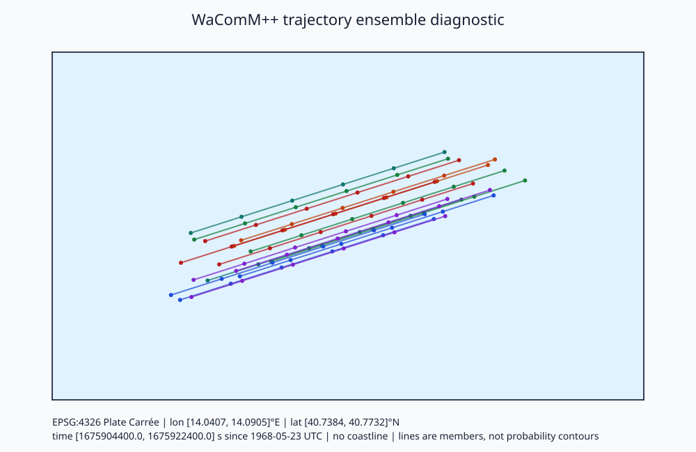

# WaComM++

WaComM++ (Water quality COMmunity Model in C++) is a C++17 Lagrangian transport and diffusion framework for marine pollutants and drifting surface objects. Gridded Eulerian ocean forcing drives compact, independently advected particles whose state includes position, emission time, age, health, a stable 64-bit identity, and restart-safe drift-object metadata.

The current release reads local or remote ROMS, NEMO, HYCOM, and native WACOMM products through direction-neutral adapters. HTTP, HTTPS, and DAP4 locations use the linked NetCDF transport. Forcing is opened lazily as a bounded current/adjacent pair, and the adjacent normalized window is reused on the next iteration. It supports deterministic forward and backward traversal, configurable stochastic forward diffusion, an explicitly labelled stochastic backward ensemble mode, restart input/output, OpenMP, MPI, FlexMPI/EMPI, OpenACC, and optional CUDA. Unsupported URI schemes, transport capabilities, and adapter layouts are rejected rather than silently interpreted as another source or grid.

Surface-object tracking augments the ambient current with an empirically parameterized leeway velocity resolved into downwind and crosswind components relative to 10 m wind, plus optional surface Stokes drift. Generic weather and wave interfaces keep transport physics independent of forcing products; the initial concrete adapters read WRF wind and WAVEWATCH III Stokes velocity. The restart-stable object catalog covers people in several immersion states, liferafts, person-powered and small craft, vessels, containers, debris, drums, mines, refugee rafts, and medical waste. Its left and right crosswind regressions remain distinct where the source data are asymmetric. A separate process catalog documents the configuration, units, stochastic character, and state requirements of the implemented current, leeway, Stokes, diffusion, settling/rise, decay, wind-error, and jibing operators. Opt-in ensembles remain reproducible and passive transport remains the default. Tracking direction remains solver policy; stochastic backward output is a candidate-origin ensemble rather than an exact inverse realization.

Environmental adapters validate declared velocity and coordinate units and normalize supported CF numeric time coordinates to the WaComM physical epoch. Ambiguous units, unsupported calendars, unequal grids, and inconsistent timestamps are rejected before particle integration. Dynamic WRF wind and WW3 Stokes components use the same normalized-grid space/time interpolation in CPU and CUDA particle execution.

Environmental grids remain exact-match by default. Explicit geographic options interpolate Earth-relative WRF or WW3 vectors from rectilinear or valid curvilinear grids without extrapolation, with deterministic indexed curvilinear lookup. Optional `USE_PROJ=ON` adds declared-CRS transformation for rectilinear or valid curvilinear projected grids with metric `x/y` coordinates. Separate first- and limited second-order conservative operators remap rectilinear or convex-curvilinear geographic cell averages, including explicit fractional active area; they are not selectable for point-valued wind or Stokes velocity. Coordinate transformation never substitutes for vector rotation.

Backward deterministic tracking reverses forcing traversal and resolved/terminal motion and suppresses normal forward sources. It can identify candidate prior locations under the supplied circulation and model assumptions; stochastic backward tracking is not a unique inverse trajectory.

A read-only [trajectory diagnostic workflow](docs/trajectory-diagnostics.md) joins stable particle identities across output snapshots, computes explicitly descriptive ensemble-spread statistics, and creates a self-documenting SVG map with projection, extent, time, provenance, and uncertainty semantics. It does not infer probability contours or modify solver physics.

## Quick start

Install CMake 3.20+, a C++17 compiler, and any requested backend. The default `WACOMM_BOOTSTRAP_DEPENDENCIES=AUTO` prefers installed application libraries and builds missing pinned dependencies privately below the build tree. Private Unix builds other than macOS include pinned OpenSSL 3.5.8 and require Perl and make; see the [serial build example](docs/build.md#serial-build-with-private-openssl). Then run:

```bash
cmake -S . -B build
cmake --build build
ctest --test-dir build --output-on-failure
./build/wacommplusplus examples/forward-roms/forward-roms.json   # after staging its forcing
```

The forcing for the example configurations is not bundled; each example guide lists what to stage. To check a fresh build offline, run the end-to-end regression. It drives the real executable forward and then backward on a generated analytic current and compares the result with the exact solution ([application verification](docs/application-verification.md)):

```bash
ctest --test-dir build -R '^application_end_to_end$' --output-on-failure
```



*Model result on synthetic analytic forcing (EPSG:4326 Plate Carrée, 14.04–14.09°E, 40.74–40.77°N, 01–06 UTC 2021-07-01). It is not an ocean forecast. See the [verification guide](docs/application-verification.md#documentation-case-and-diagnostic-figures) for the command that reproduces it.*

On macOS, see the [Homebrew build notes](docs/build.md#macos). They include selecting a Python interpreter that has the optional plotting stack.

For the dependency-free portable numerical tests:

```bash
cmake -S . -B build-core -DBUILD_APPLICATION=OFF
cmake --build build-core
ctest --test-dir build-core --output-on-failure
```

Options include `USE_OMP`, `USE_MPI`, `USE_EMPI`, `USE_OPENACC`, `USE_CUDA`, `USE_PROJ`, `DEBUG`, `BUILD_APPLICATION`, `BUILD_TESTING`, and `BUILD_REMOTE_INTEGRATION_TESTS`. `WACOMM_BOOTSTRAP_DEPENDENCIES` accepts `AUTO`, `ON` (force the complete private stack), or `OFF` (installed packages only). `WACOMM_BOOTSTRAP_PARALLEL_IO=ON` builds private MPI-enabled HDF5 and NetCDF-4 independently of `USE_MPI`; see the [build guide](docs/build.md). MPI and EMPI are mutually exclusive. CUDA is unavailable on modern macOS; PROJ is optional and required only for projected environmental grids. The network integration test is opt-in so the default suite remains deterministic offline.

## Reproducible operation

Set `physics.random_seed` explicitly. Wind forcing error can declare a PSD-validated east/north covariance and reproducible spatial and physical-time support scales; zero scales retain identity/substep white noise. Archive the complete configuration, Git revision, forcing and restart checksums, compiler/dependency versions, platform, parallel settings, tolerances, test output, and result checksums. Production random behavior does not use wall-clock time; random variates use the ordered counter-key scheme `ordered-splitmix64-v2` recorded in output and restart metadata, and seeded realizations from revisions that used the earlier symmetric key cannot be regenerated. Legacy `particlesPerHour` and `forcing_interval_batch` sources release at forcing records inside the closed `[start, end]` window, so `start` equal to `end` releases one batch. Calendar times are UTC `YYYYMMDDhh`, `YYYYMMDDZhh`, or `YYYYMMDDZhhmm`; minutes enter physical time (a release at `20210701Z1030` starts at 10:30), output cadence is anchored at the start of the hour containing `simulation.start`, and malformed values are rejected instead of being truncated silently. Examples, documentation, tests, source implementation, and physical definitions are versioned together.

Region-specific observational wind-error calibration is opt-in through non-overlapping EPSG:4326 bounds. Each entry must identify the matching object and forcing adapter plus estimator, sample size, observation period, dataset, SHA-256 checksum, and DOI. The same selector and stochastic equations run on CPU and CUDA; outside a declared region the global sensitivity parameters apply. Configuration validation checks consistency, not the scientific validity of supplied evidence.

## Documentation and examples

Start at the [documentation index](docs/README.md) for the [model](docs/model.md), [build guide](docs/build.md), [configuration](docs/configuration.md), [adapters](docs/adapters.md), [OpenDrift comparison and roadmap](docs/opendrift-comparison.md), [backtracking](docs/backtracking.md), [restart](docs/restart.md), [output publication and parallel file systems](docs/io.md), [testing](docs/testing.md), [application end-to-end verification](docs/application-verification.md), [parallelism](docs/parallelism.md), [supported platforms](docs/supported-platforms.md), [Raspberry Pi ARM64 validation](docs/raspberry-pi.md), [RISC-V 64 validation](docs/riscv64-linux.md), [reproducibility](docs/reproducibility.md), and [trajectory diagnostics](docs/trajectory-diagnostics.md). The [examples index](examples/README.md) covers every checked-in run configuration and source artifact, including forward/backward ROMS, NEMO, HYCOM, and native WACOMM workflows.

The [surface-drift guide](docs/sar-drift.md) defines the object-relative velocity model, coefficient provenance, units, ensemble assumptions, direction semantics, restart behavior, and supported object classes; the [catalog reference](docs/catalogs.md) lists every object and implemented process. Its paired catalog-mean [forward](examples/sar-person-forward/README.md) and [backward](examples/sar-person-backward/README.md) scenarios provide uniform-wind references, while the [kayak example](examples/sar-kayak-forward/README.md) exercises an asymmetric catalog entry. The ensemble and coupled-forcing examples are indexed in [examples](examples/README.md).

The [six-hour Sarno example](examples/wacomm-sarno-lite/docs/README.md) includes serial and two-process MPI Slurm workflows and an [MPI/OpenMP scaling sweep](examples/wacomm-sarno-lite/docs/README.md#mpiopenmp-strong-scaling) over 1–32 processes, saved native forcing, and publication maps/profiles generated by `examples/wacomm-sarno-lite/tools/publication_figures.py`. A one-process job regenerates `processed-6h/` before the scaling sweep; solver speedup and efficiency exclude forcing downloading, preparation, and loading. The sweep reuses native forcing directly; identical saved boundary records are reused and conflicting overlaps rejected. Its physical-time source rate remains continuous across the missing 12:00 forcing record; see the [diagnostic methods](docs/trajectory-diagnostics.md#publication-maps-and-profiles).

The [one-process OpenMP sweep](examples/wacomm-sarno-lite/docs/README.md#openmp-strong-scaling-and-mpi-comparison) compares 1–32 threads with the MPI experiment, using the same native forcing and executable. It reports solver and application timing separately, with efficiency/speedup figures and exact particle-state verification.

An [extended Sarno MPI sweep](examples/wacomm-sarno-lite/docs/README.md#extended-mpi-performance-test-164-processes) measures 1–64 ranks with one OpenMP thread each on `norm-wn`; the 64-rank case uses two nodes. Its separate plots and report retain timing, allocation, and exact particle-state evidence.

A [Sarno CUDA performance diagnostic](examples/wacomm-sarno-lite/docs/README.md#mpi-openmp-and-cuda-performance-diagnostic-on-low-gn) measures one, two, and four MPI ranks with one V100 GPU and one OpenMP thread per rank on `low-gn`. Those archived performance outputs predate the grid-metric and interpolation corrections. After synthetic parity passed in Slurm job 6358, a fresh six-hour Sarno CPU/CUDA comparison on `gn03` (jobs 6360 and 6361) passed declared numerical state tolerances and matched all gridded variables exactly; see the [consistency report](examples/wacomm-sarno-lite/docs/figures/gn03-cpu-gpu-consistency.json). The historical plots remain performance diagnostics from the earlier implementation.

The [shared performance-evaluation protocol](docs/performance-evaluation.md) applies to every runnable example and use case; it defines the CPU/GPU resource matrix, scientific equivalence gate, repeat measurements, charts, and per-test Codex review notes.

The [Sarno shared-protocol workflow](examples/wacomm-sarno-lite/docs/performance-evaluation.md) stages the complete MPI, OpenMP, and hybrid CPU matrix in rotated replicate blocks, selects the fastest measured CPU tuple, and gates the subsequent GPU sweep on numerical equivalence. It preserves a Codex review note for each valid performance configuration.


The webinar [explicit ROMS metadata repair](examples/webinar-roms-usecase-download/docs/rectilinear-angle-repair.md) validates the full
rectilinear C-grid before correcting angle in derived inputs under a declared
grid-axis interpretation. It preserves original forcing and does not alter
solver equations or certify upstream ocean-model accuracy.

## Recent changes

- MPI runs now give each rank particles of every emission age. Particle $q$ goes to rank $q \bmod P$, instead of rank 0 taking the first contiguous block plus the remainder. Particles are stored in emission order, so the old blocks gave the first ranks the particles that integrate the whole interval. Rank 0 restores the emission order after the gather, and results are bit-identical for every rank count: `mpi_decomposition_parity` now runs on 2, 3, and 4 ranks with alternating old and young particles. The `hhcpu` speedup has not yet been measured. See [parallel execution](docs/parallelism.md).
- Runs that exceed their resources now stop with a WaComM++ error instead of failing silently. A particle count above $2^{31}-1$ stops the solver interval; before, the `int` MPI counts truncated it. Before any forcing is read, the estimated per-node forcing memory (ranks per node × the resident normalized ocean window) is compared with the cgroup or `MemAvailable` limit. The run warns above 80% and stops above 100%, unless `simulation.memory_check` is `"warn"` or `"off"`. The 28-rank Sarno runs that the `hhcpu` out-of-memory handler killed with exit code 137 now stop with this message. Outputs are unchanged. See [resource limits](docs/parallelism.md#resource-limits).
- Particle histories, restarts, and gridded outputs can now be written asynchronously (`io.async=true`): rank 0 hands each file to a background writer thread and continues with the next forcing window, with at most `io.async_max_pending` writes outstanding. Every output is now written under a `.partial` name and renamed when complete, so a restart never reads a truncated file; a failed text write now stops the run instead of publishing a short file. For parallel file systems, `io.filesystem` (`posix`, `lustre`, `gpfs`) enables durable `fsync` publication by default, `io.staging_dir` writes through node-local storage, and `io.lustre_stripe_count`/`io.lustre_stripe_size` set the Lustre layout of the output directories. Outputs are identical to synchronous ones; `output_writer` and `application_end_to_end` check this forward and backward. MPI builds now initialize with `MPI_THREAD_FUNNELED`. See [output publication](docs/io.md) and the [example](examples/async-io-parallel-fs/async-io-parallel-fs.md).
- MPI builds with a parallel NetCDF-C, such as `WACOMM_BOOTSTRAP_PARALLEL_IO=ON`, can now write histories and gridded counts collectively from every rank (`io.parallel_write="collective"`): text histories with `MPI_File_write_at_all`, NetCDF histories and counts with parallel NetCDF-4 hyperslabs in collective mode, and `io.mpiio_hints` passed to MPI-IO. The values equal rank-0 output; `parallel_output_*_ranks` and `application_end_to_end` check this on 1–3 ranks, and CI now builds the parallel I/O stack on Ubuntu and macOS. Other builds reject the option instead of writing from rank 0. See [collective writes](docs/io.md#collective-writes) and the [example](examples/collective-io-mpi/collective-io-mpi.md).
- Source files now read the `depth` property, which is the name `saveAsJson` writes and the example catalogs use. `dep` remains as an alias, and a third `Point` coordinate is also accepted. If more than one is present they must agree. A feature with no position stops loading with an error naming it, as do a non-`Point` geometry such as a `Polygon`, a lone `j` or `i`, `k` without `j` and `i`, and explicit indices outside the domain. Before, such a source was added silently at the index $10^{37}$ and never entered the domain. The oil-spill polygon demos are therefore not source files; their guides now say that their preparation tool has not been verified. See [source position](docs/configuration.md#source-position).
- GeoJSON source positions are now converted to grid indices by exact inversion of the bilinear longitude/latitude map that the solver uses. The previous inverse was exact only on rectilinear grids: on a rotated test grid it misplaced sources by up to 1.12 cells. It also read past the arrays near the northern and eastern boundaries. Rectilinear grids give the same indices to rounding. A source outside the interpolation domain, or with non-finite coordinates, now stops loading with an error naming the source, instead of entering the run at an undefined index. See the [horizontal position mapping](docs/model.md#horizontal-position-mapping).
- Subsurface sources are now placed at the requested depth. Until now, the depth-to-level inverse `deplatlon2kji` stepped toward the wrong W level, and above the first sub-surface W level it read past the `s_w` array. Debug builds aborted there and Release builds used an undefined level. It is now the exact inverse of `kji2deplatlon` on the valid particle levels $[-N+2,0]$. Depths below the lowest valid level are clamped to it, and non-finite depths are rejected. Surface sources, which include every checked-in example, are unchanged. A new `vertical_coordinate_round_trip` test and a release-depth check in `application_end_to_end` cover the mapping. See the [vertical coordinate mapping](docs/model.md#vertical-coordinate-mapping).
- Polygon release areas, such as the [oil-spill demonstrations](examples/oilspill-demo-01/README.md), are now turned into a version 3 NetCDF restart by the C++ tool `createRestartFileFromJson`, built with the application. It samples uniformly per unit spherical area with `physics.random_seed`, keyed by particle identity. It places particles with the exact `deplatlon2kji` inverse used for Point sources, and fails on invalid geometry and on out-of-domain or land-cell samples. It then reads the restart back and requires an exact match. The earlier Python script stored nearest-node integer indices, float identities, and an unseeded, unversioned restart, and has been removed. `polygon_release` and `application_end_to_end` cover the new path, forward and backward. See [polygon releases](docs/model.md#polygon-releases).
- The OpenMP particle loop now uses dynamic scheduling, the CUDA path launches one stream per device outside the OpenMP region, and the land mask is written from a precomputed cell list. On one 12-core Ryzen 9 9900X node with an RTX 4080 SUPER, Sarno CPU efficiency on 12 physical cores rose from 75–76% to 90–93%, and GPU time no longer grows with the host thread count; one GPU is 2.8× (100,000 particles/hour) and 4.8× (1,000,000) faster than twelve cores, while twelve cores beat the GPU at 10,000. GPU equivalence now allows particle health to differ by at most 1e-15 (CUDA and glibc `exp` differ by one unit in the last place) while survival must match exactly. See the [physical-core CPU/GPU comparison](examples/wacomm-sarno-lite/docs/performance-evaluation.md#physical-core-cpugpu-comparison-on-one-workstation-class-node).
- Particle positions are now advanced with the explicit second-order midpoint method by default (`physics.integrator="midpoint"`). On a steady sheared current, halving the step reduces the error 3.9 times, against 2.0 times for the previous forward Euler step. That step remains available as `"integrator":"euler"` and reproduces earlier results bit for bit; configurations that omit the key change trajectories. CPU and CUDA share the scheme. See the [model description](docs/model.md#temporal-integration).

- An offline [end-to-end regression](docs/application-verification.md) now runs the complete executable, serially, with OpenMP, and on two MPI ranks. It found and fixed four defects. Hourly history and gridded outputs could be skipped silently because of modified-Julian round-off. Text restarts were written with six significant digits. Text restarts truncated 64-bit identities. A `.json` restart silently loaded zero particles. `restart.interval` and `io.timestep` must now be whole positive seconds.
- `USE_PROJ=ON` failed to configure on macOS and Linux because pkg-config had not been loaded in that scope. It now prefers PROJ's CMake package, and CI builds it on Ubuntu and macOS.
- ROMS input now rotates declared grid-relative U/V into east/north after the
  existing wet-face interpolation. Explicit eastward/northward standard names
  prevent double rotation. See the [metadata requirements and regression evidence](docs/adapters.md#roms-horizontal-vector-basis);
  missing or inconsistent basis metadata fails, and old unrotated native forcing
  must be regenerated. The webinar provider's angle/coordinate inconsistency is
  tracked separately from this implementation fix.
- The [native webinar protocol](examples/webinar-native-usecase/docs/performance-evaluation.md) uses 25 hourly forcing files from 2026-09-15 00:00 through 2026-09-16 00:00 UTC. Its paired ROMS conversion example prepares that same window; the native workflow applies the full CPU/hybrid and selected-CPU GPU matrix independently at each release rate.
- The [ROMS webinar download example](examples/webinar-roms-usecase-download/docs/webinar-roms-usecase-download.md) is a dry forcing-conversion workflow with isolated run archives and an application-wall-time benchmark. It does not execute the particle solver; historical endpoint availability and input metadata must be verified before use.

## References

Montella, R., et al. (2023), “A highly scalable high-performance Lagrangian transport and diffusion model for marine pollutants assessment,” *31st Euromicro International Conference on Parallel, Distributed and Network-Based Processing*, 17–26. Earlier WaComM publications and ocean-model references are listed in [references](docs/references.md).

Scientific use of surface-object drift should additionally cite the peer-reviewed leeway methodology and object-specific studies identified in [references](docs/references.md). Model output is conditional on forcing, parameterization, resolution, boundary treatment, and numerical configuration; it is not an observation or a unique reconstruction of an unobserved trajectory.

## License

WaComM++ is distributed under the terms in [LICENSE](LICENSE).
