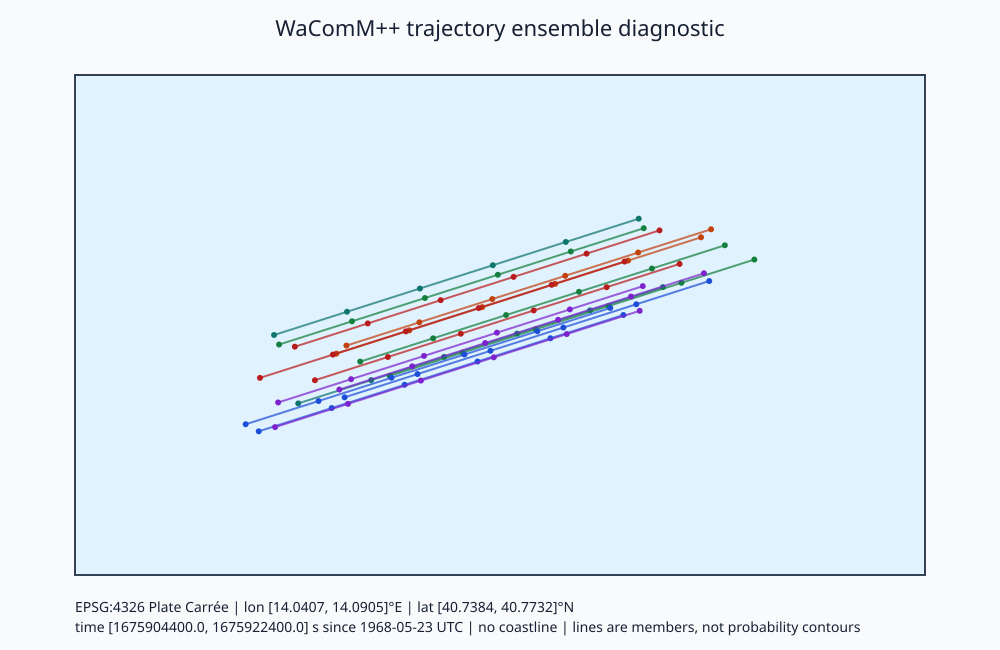

# Application end-to-end verification

The `application_end_to_end` CTest case runs the complete `wacommplusplus` executable on a generated analytic forcing case, without external data or network access. The component tests exercise adapters, particle motion, restart I/O, and configuration parsing separately. This test checks that the executable joins them correctly: JSON configuration, native WACOMM adapter, cross-file boundary assembly, GeoJSON source emission, forward integration, text restart output and input, backward integration, hourly particle histories, and hourly gridded-count output. Two further runs repeat the forward and backward cases with asynchronous output publication (`io.async=true`, `io.async_max_pending=1`, `io.filesystem="gpfs"` with its default `fsync`, and a staging directory), the backward run restarting from the asynchronously written forward history; their outputs must equal the synchronous ones exactly ([output publication](io.md)). In builds with MPI and parallel NetCDF, two more runs write every output collectively from both ranks (`io.parallel_write="collective"`) and must reproduce the rank-0 outputs in the same way ([collective writes](io.md#collective-writes)). A third run starts the simulation and a point release at `20210701Z0030` and checks the release time, particle age, analytic position, and that whole-hour outputs are still written.

It is numerical verification of the implemented equations on a synthetic case (Oberkampf and Trucano, 2002). It is not observational validation, and it says nothing about the accuracy of any ocean product.


*Figure 1. Conceptual schema of the regression workflow. This is not model output.*

## Analytic case

The fixture is a 21 × 21 rectilinear grid with node spacing $\Delta\lambda=\Delta\phi=0.01^\circ$, starting at $14.00^\circ$E and $40.70^\circ$N. It has depth $h=100$ m, two sigma levels, a wet mask everywhere, and zero free-surface elevation. Two forcing files cover $[00,01]$ and $[01,02]$ UTC on 2021-07-01, with records at their endpoints on the WaComM physical-time axis (seconds since 1968-05-23 00:00:00 UTC). The horizontal current is uniform and constant: $u=0.10$ m s⁻¹ eastward and $v=0.05$ m s⁻¹ northward. The vertical velocity and vertical diffusivity are zero. The configuration sets `physics.random=false`, `physics.random_sources=false`, and `tracking.backward_diffusion=none`. With these settings the solver integrates a deterministic ordinary differential equation and the result can be checked exactly.

A particle at latitude $\phi$ and longitude $\lambda$ (radians) on a sphere of radius $R=6\,371\,000$ m moves as

$$
\frac{d\phi}{dt}=\frac{v}{R},\qquad \frac{d\lambda}{dt}=\frac{u}{R\cos\phi},
$$

where $t$ is physical time in s. For constant $u$ and $v\neq0$, the exact solution after an interval $T$ is the rhumb line

$$
\phi(T)=\phi_0+\frac{vT}{R},\qquad
\lambda(T)=\lambda_0+\frac{u}{v}\left[\ln\tan\left(\frac{\pi}{4}+\frac{\phi}{2}\right)\right]_{\phi_0}^{\phi(T)} .
$$

The spatially uniform field is reproduced exactly by any consistent interpolation operator. Any remaining endpoint error therefore comes from the time integration, the single-precision storage of the forcing, and the discrete spherical grid metric, not from the choice of stencil. Four particles are released as a single pulse at $14.05^\circ$E, $40.75^\circ$N at 00 UTC and integrated for $T=7200$ s with `physics.dti=30` s. The great-circle path length is $\sqrt{u^2+v^2}\,T\approx805$ m.

Two further runs start from [polygon releases](model.md#polygon-releases). `createRestartFileFromJson` samples eight particles at 10 m depth inside a concave six-vertex polygon around the point source, with `physics.random_seed=5489`, and writes a version 3 NetCDF restart. One restart is released at 00 UTC and tracked forward to 02 UTC. The other is released at 02 UTC and tracked backward to 00 UTC, with $T=-7200$ s in the rhumb-line solution. Each particle's end position is compared with the analytic solution from its own sampled start, which the test reads from the restart. The release time and $k=-0.2$ must be preserved.

## Acceptance criteria

| Quantity | Criterion | Measured on macOS arm64, AppleClang 21 (2026-11-06) |
| --- | --- | --- |
| Forward endpoint vs. analytic solution | $< 10^{-3}$ of the path length (0.805 m) | 0.018 m |
| Forward then backward round trip at 00 UTC | $< 10^{-3}$ m | $1.0\times10^{-6}$ m |
| Forward vs. backward position at 01 UTC | $< 10^{-3}$ m | passes |
| Particle age at 01 and 02 UTC | $3600$ s and $7200$ s within $10^{-3}$ s | passes |
| Text histories | forward 01, 02 UTC; backward 01, 00 UTC | present |
| Gridded counts | forward Z00, Z01; backward Z02, Z01 | present |
| Collective MPI-IO and parallel NetCDF-4 output on two ranks (forward and backward; builds with parallel NetCDF) | text histories byte-identical and gridded `conc` exactly equal to the rank-0 runs | passes (2026-11-12, macOS arm64, OpenMPI 5.0.11, private HDF5 1.12.0 and NetCDF-C 4.8.1) |
| Asynchronous, staged, fsync publication (forward and backward) | text histories byte-identical and gridded `conc` exactly equal to the synchronous runs; no `.partial` file; empty staging directory | passes (2026-11-12) |
| Polygon release, forward and backward, each of 8 particles vs. analytic solution | $< 10^{-3}$ of the path length (0.805 m) | 0.078 m forward, 0.085 m backward (2026-11-08) |
| Polygon release time and level at both ends | $10^{-3}$ s and $10^{-12}$ in $k$ | passes |

Gridded files are stamped with the start of the last forcing interval of each window in the tracking direction; particle histories are stamped with the final physical time of the window. With `USE_MPI=ON` both executable invocations run under `mpiexec -n 2`. With `USE_OMP=ON` the test uses `OMP_NUM_THREADS=2`. With `USE_CUDA=ON` the test reports a CTest skip unless `nvidia-smi -L` lists a device. A compile-only CUDA container therefore does not claim device execution, while the self-hosted GPU workflow runs the full comparison. The same thresholds apply in every configuration, so the test also checks backend equivalence for this case. On this macOS host it passed in serial, OpenMP, MPI, MPI+OpenMP, and PROJ-enabled builds.

## Command

Configure any application build, then run:

```bash
ctest --test-dir build -R '^application_end_to_end$' --output-on-failure
```

The test writes into `build/application-end-to-end/`. Its log prints each particle's forward error and round-trip distance in metres. The helper can also be driven manually:

```bash
mkdir -p data/end-to-end && cd data/end-to-end
../../build/application_end_to_end_test generate .
../../build/wacommplusplus forward.json
../../build/wacommplusplus backward.json
../../build/wacommplusplus minutes.json
../../build/createRestartFileFromJson polygon-forward.json polygon.geojson 20210701Z0000
../../build/wacommplusplus polygon-forward.json
../../build/createRestartFileFromJson polygon-backward.json polygon.geojson 20210701Z0200
../../build/wacommplusplus polygon-backward.json
../../build/application_end_to_end_test verify .
```

## Documentation case and diagnostic figures

`application_end_to_end_test demo <directory>` writes a six-hour forward variant of the same fixture. It releases 16 particles with `physics.random_sources=true`, which applies seeded normal offsets of 0.25 grid-index units, and writes hourly NetCDF snapshots. The figures below were produced on 2026-11-06 with the Release serial build on macOS arm64:

```bash
mkdir -p data/end-to-end-demo && cd data/end-to-end-demo
../../build/application_end_to_end_test demo .
../../build/wacommplusplus demo.json
python3 ../../tools/trajectory_diagnostics.py demo-history-*.nc \
  --json trajectory-diagnostics.json \
  --svg ../../docs/figures/application-end-to-end-trajectories.svg \
  --html trajectory-interactive.html
```



*Figure 2. Model result on synthetic forcing, rendered by `tools/trajectory_diagnostics.py`. The projection is EPSG:4326 Plate Carrée, the extent is about 14.04–14.09°E by 40.74–40.77°N, and times run 01–06 UTC on 2021-07-01. The forcing is the analytic uniform current, not an ocean product, and no coastline is used. The paths are parallel because the current is uniform. The spread between members comes only from the seeded source-position offsets. It is not a probability, confidence region, or search area.*


*Figure 3. Screenshot of the HTML viewer produced from the same snapshots, captured with headless Google Chrome at 1280 × 1000 px. The viewer shows recorded snapshots only and does not interpolate between them.*

## Defects found by this test

On its first run, this test found four defects in the executable path that the component tests did not cover. All four are fixed in the same change:

1. History and gridded-output cadence used `int(finalOceanTime-startOceanTime) % interval`. Modified-Julian-day round-off makes the elapsed time slightly short of a whole hour (for example 3599.99999 s), so truncation skipped that snapshot or file without any error. Elapsed time is now rounded to the nearest second. `restart.interval` and `io.timestep` must now be whole numbers of seconds greater than zero, which also removes a possible modulo-by-zero.
2. Text histories were written with the default six significant digits. A physical time of 1675908000 s was stored as `1.67591e+09`, a 2000 s error (up to 5000 s in general), and grid indices lost precision. They are now written with `max_digits10`, so a text restart reproduces the in-memory state exactly.
3. The text restart loader parsed 64-bit particle identities with `atoi`, which truncates them. It now uses `std::stoull`.
4. `Particles::loadFromJson` was an empty function, so a `.json` restart silently started with zero particles. GeoJSON histories leave out inactive and out-of-domain particles and the restart metadata, so they cannot reproduce the continuous run. Loading one now fails with an explicit error.

## Limitations and interpretation

The test covers one grid, a uniform and constant current, the native WACOMM adapter, and passive drift with closures inactive. It does not test spatially varying interpolation, vertical motion, stochastic diffusion, leeway, ROMS/NEMO/HYCOM decoding, or CUDA. The only NetCDF restarts it loads are the generated polygon releases. The polygon endpoint errors are larger than the point-source error because the samples start away from the node rows. The solver evaluates the zonal cell width at the southern node row of each cell, which shortens the eastward displacement by about $\tan\phi\,\eta\,\Delta\phi$ relative, with $\eta$ the fractional position across the cell ([metric conversion](model.md#metric-conversion-and-position-update)). This was isolated by releasing Point sources at four positions whose starting $\eta$ ranges from 0 to 0.5. Their errors were 0.018, 0.031, 0.064, and 0.072 m, all eastward with less than 0.001 m northward, matching the estimate. The polygon errors fall in the same range and within the tolerance. Those are covered by the component tests listed in [testing](testing.md). Passing this test shows that the executable integrates this case correctly in the tested build. It does not show that a simulation driven by real forcing is physically accurate.

## Reproducibility metadata

Record the Git revision, the CMake options, the compiler, the NetCDF and log4cplus versions, the MPI launcher and rank count, `OMP_NUM_THREADS`, and the CTest log containing the printed errors. All inputs are generated deterministically from the constants in `tests/ApplicationEndToEndTest.cpp`, so no forcing checksum is needed beyond the source revision.

## References

- Montella, R., et al. (2023). A highly scalable high-performance Lagrangian transport and diffusion model for marine pollutants assessment. *Proceedings of PDP 2023*, 17–26. [doi:10.1109/PDP59025.2023.00012](https://doi.org/10.1109/PDP59025.2023.00012).
- Oberkampf, W. L., and Trucano, T. G. (2002). Verification and validation in computational fluid dynamics. *Progress in Aerospace Sciences*, 38, 209–272. [doi:10.1016/S0376-0421(02)00005-2](https://doi.org/10.1016/S0376-0421(02)00005-2).
- Thygesen, U. H. (2011). How to reverse time in stochastic particle tracking models. *Journal of Marine Systems*, 88, 159–168. [doi:10.1016/j.jmarsys.2011.03.009](https://doi.org/10.1016/j.jmarsys.2011.03.009).
