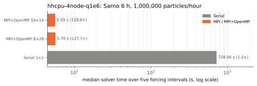
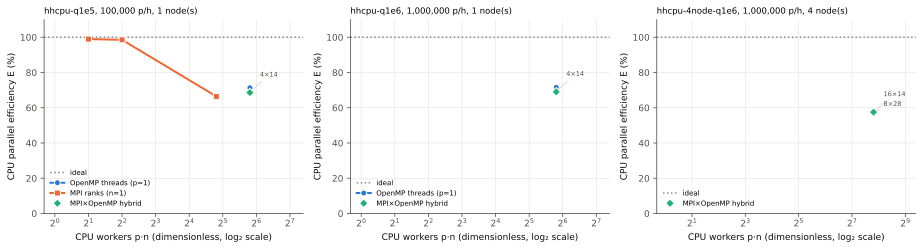
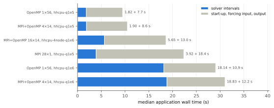
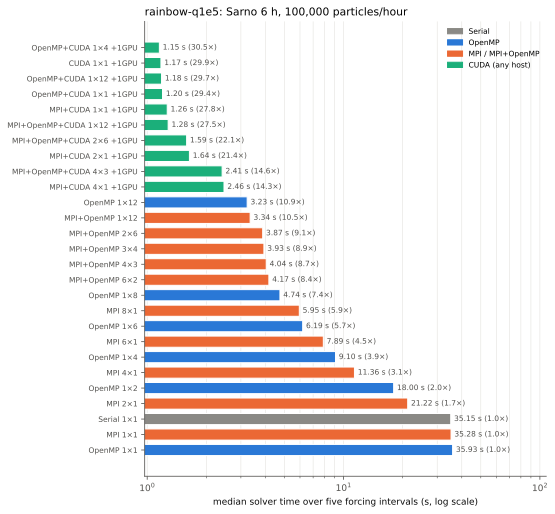
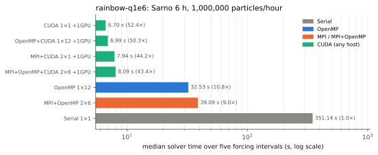
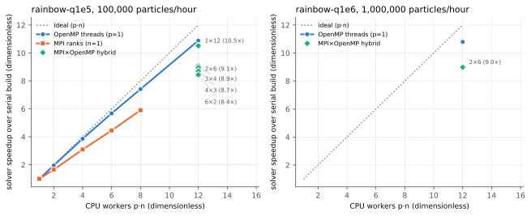
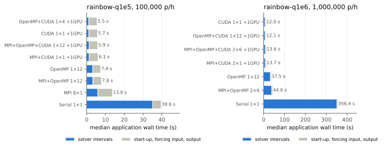

# Backend matrix evaluation and improvement plan (November 2026)

## Purpose and scope

This report records verification and performance passes over the execution backends of revision `ffa9c18` plus the dependency-cache change below (Mac and rainbow), and of revision `5a49653` plus the build and benchmark-tool fixes described in [Issues found on hhcpu](#issues-found-on-hhcpu-and-their-fixes). It answers two computational questions: do all backend combinations build and pass the offline suite, and which resource configuration runs the six-hour Sarno workload fastest on each machine. Timings characterize implementation and hardware. They are not observational validation, and no physical equation, parameter, or default changed.

## Test matrix

| Machine | Builds | Result |
| --- | --- | --- |
| Apple M4 Max (12 performance + 4 efficiency cores, 64 GiB), macOS 26.6.2, AppleClang 21, Open MPI 5.0.11, libomp 23.1.2 | Serial, OpenMP, MPI, MPI+OpenMP | 35, 35, 36, and 38 tests passed; no skips (Python 3.12 with `tools/requirements-figures.txt`) |
| `hhcpu` partition, E4 cluster (4 nodes, each 2 × Intel Xeon Gold 5520+, 56 cores, no SMT, 2 NUMA domains, 239 GiB), Rocky Linux 8.10 kernel, GCC 12.2.1, Open MPI 4.1.4, CMake 3.26.5, Slurm 23.11.3 | Serial, OpenMP, MPI, MPI+OpenMP | At `5a49653`: 37, 37, 38, and 40 tests passed (Slurm job 1077295). At `25b716d` with this change: 38, 38, 39, and 41 passed (job 1077326). At `94e9aa4` and `aa8378f`: 39, 39, 42, and 44 passed (jobs 1077482 and 1077961). No skips (Python 3.13.2 with `tools/requirements-figures.txt`) |
| rainbow (AMD Ryzen 9 9900X, 12 cores with SMT, one NVIDIA GeForce RTX 4080 SUPER, 60 GiB), Ubuntu 24.04, GCC 13.3, Open MPI 4.1.8, CUDA 12.8 (NVIDIA HPC SDK 25.3), CMake 3.31.6 | Serial, OpenMP, MPI, MPI+OpenMP, CUDA, OpenMP+CUDA, MPI+CUDA, MPI+OpenMP+CUDA | At `ffa9c18` with the dependency-cache change: 37, 37, 38, 40, 38, 38, 39, and 41 tests passed, no skips (Slurm job 1753, Python 3.11 with `tools/requirements-figures.txt`). `cuda_particle_parity` under `compute-sanitizer --tool memcheck` reported zero errors |

The first rainbow attempt (job 1747) failed in all eight configures on a transient HTTP 504 from GitHub while fetching nlohmann/json. This is an infrastructure fault, not a code defect, but it exposed that every build tree downloads every pinned archive again. The fix is the opt-in `WACOMM_DEPENDENCY_DOWNLOAD_DIR` cache described in the [build guide](build.md): archives are fetched once, their pinned SHA-256 is verified before every reuse, and a pre-seeded directory lets configures proceed during an outage. The four Mac builds were reconfigured with the option and passed again.

## Benchmark method

The workload is the Sarno-lite six-hour run (native WaComM forcing prepared from ROMS, five forcing intervals, stochastic forward tracking, seed 5489) at a uniform release of $q$ particles/hour, $q\in\{10^5,10^6\}$. [`sarno_backend_matrix.py`](../examples/wacomm-sarno-lite/tools/sarno_backend_matrix.py) runs every (build, $p$ MPI ranks, $n$ OpenMP threads, $g$ GPUs) tuple once as a warm-up and in three rotated replicate blocks. Every sample is compared with the serial-build warm-up: particle states exactly for CPU tuples, within the documented GPU health tolerance for CUDA tuples, and every gridded variable exactly. All 144 Mac samples passed. Solver time $T$ (s) is the sum of the five rank-0 solver intervals, timed between MPI barriers; it excludes forcing input and output. Application time is the launcher wall time. The estimator is the median of the three measured samples. Speedup is $S=T_{\mathrm{serial}}/T$ and CPU efficiency is $E=S/(pn)$, both dimensionless. On macOS ranks and threads are not pinned, and the efficiency cores are slower than performance cores, so efficiency above 12 workers is not a homogeneous-core measure.

## Results on the Apple M4 Max


All three figures are measured model-execution diagnostics of the real Sarno forcing; the companion tables are [`results-m4max-q100000.json`](figures/backend-matrix/results-m4max-q100000.json) and [`results-m4max-q1000000.json`](figures/backend-matrix/results-m4max-q1000000.json).

| $q$ (particles/hour) | Serial $T$ (s) | OpenMP 1×8 | OpenMP 1×12 | OpenMP 1×16 | MPI 8×1 | MPI+OpenMP 4×4 |
| ---: | ---: | ---: | ---: | ---: | ---: | ---: |
| $10^5$ | 24.49 | 3.15 s, $E$=97% | 2.31 s, 88% | 2.24 s, 68% | 3.96 s, 77% | 2.24 s, 68% |
| $10^6$ | 237.7 | – | 23.39 s, 85% | 22.35 s, 66% | 39.41 s, 75% | 22.83 s, 65% |

Findings:

1. OpenMP scales almost ideally on the performance cores (101% at 4 threads, 97% at 8). Adding the four efficiency cores gains only 3–5%.
2. MPI alone is 20–25 points less efficient than OpenMP at equal worker count (84% at 2 ranks, 77% at 8). Rank 0's own particle block took 0.37 s of a 0.53 s interval at 8 ranks; the remainder is scatter, gather, packing, and waiting for slower ranks under the static contiguous partition.
3. Every rank holds the full forcing: 4.2 GiB resident per rank at $10^5$ and 5.8–6.5 GiB at $10^6$. Eight ranks need about 35–50 GiB, which caps the usable rank count on 64 GiB machines, and the parallel forcing reads raise 8-rank application time to 9.1 s against 4.0 s of solver.

**Best Mac configurations.** At $10^5$ particles/hour, OpenMP 1×16 (2.24 s) and MPI+OpenMP 4×4 (2.24 s) tie within their sample ranges; OpenMP 1×16 has the shortest application time (4.2 s). At $10^6$ particles/hour, OpenMP 1×16 is fastest (22.3 s, 10.6×). For throughput per core, OpenMP 1×12 on the performance cores is the efficient choice. MPI is not needed on one Mac node.

The earlier rainbow physical-core sweep ([Sarno performance evaluation](../examples/wacomm-sarno-lite/docs/performance-evaluation.md)) measured 12-thread CPU efficiency of 90–93% and one GPU 2.8× faster than twelve cores at $10^5$ and 4.8× faster at $10^6$. The [rainbow results](#results-on-rainbow-cpu-and-cuda) below repeat those tuples and add the MPI, MPI+CUDA, and MPI+OpenMP+CUDA builds.

## Issues found on hhcpu and their fixes

The `hhcpu` pass exposed five defects or omissions. None changed an equation, parameter, default, or result; each was fixed and the affected step repeated.

1. **Private OpenSSL needs Perl core modules.** OpenSSL 3.5.8 `Configure` loads `IPC::Cmd`, which in turn loads `ExtUtils::MM::Utils` inside `can_run`. Rocky Linux ships both outside the `perl` package (`perl-core`), so the first build failed deep inside the OpenSSL sub-build. [`cmake/WacommDependencies.cmake`](../cmake/WacommDependencies.cmake) now checks the modules, including the `can_run` call, during configuration and names the missing ones. On `hhcpu` the signed Rocky packages were extracted with `rpm2cpio` and placed on `PERL5LIB`; the [build guide](build.md#serial-build-with-private-openssl) documents the procedure.
2. **MPI tests need Slurm task slots.** With `--ntasks=1 --cpus-per-task=56`, Open MPI saw one slot and the two-rank `application_end_to_end`, `mpi_decomposition_parity`, and `mpi_openmp_multi_worker_parity` cases failed. The job scripts request `--ntasks-per-node=56`.
3. **NetCDF utilities for workflow fixtures.** The private NetCDF builds no utilities, so `webinar_roms_workflow` skipped for lack of `ncgen`/`ncdump`. The test job loads the site NetCDF module for CTest only; it is not linked into the application.
4. **Benchmark binaries were relative paths.** [`sarno_backend_matrix.py`](../examples/wacomm-sarno-lite/tools/sarno_backend_matrix.py) launched each sample inside its own directory with the path given on the command line. It now resolves binaries to absolute paths and refuses non-executable ones before preparing a suite.
5. **Multi-node placement and the scheduler memory default.** Under Slurm, Open MPI 4.1.4 binds `--map-by slot:PE=n` against one CPU per remote daemon and refuses multi-node bound runs. The tool's new `--nodes N` option uses `--map-by ppr:(p/N):node:PE=n`, which places equal rank counts per node, and rejects uneven placements. The `hhcpu` partition also grants 1 GiB per allocated CPU (56 GiB per node) unless `--mem` is given. Every 28-rank-per-node sample was killed by the cgroup out-of-memory handler at that limit, although the node has 239 GiB. Both job scripts now request `--mem=0`, and only the killed samples were repeated (jobs 1077321–1077323).

The job scripts are [`hhcpu_backend_test_job.sh`](../examples/wacomm-sarno-lite/tools/hhcpu_backend_test_job.sh) and [`hhcpu_backend_matrix_job.sh`](../examples/wacomm-sarno-lite/tools/hhcpu_backend_matrix_job.sh).

## Results on hhcpu

Three suites use the Sarno benchmark method above with `--bind` (ranks on consecutive physical cores, `OMP_PLACES=cores`, `OMP_PROC_BIND=close`) on exclusive nodes. The forcing is read from the NFS-mounted `/home`. Suite `hhcpu-q1e5` (one node, 18 tuples, job 1077303) and `hhcpu-q1e6` (one node, 8 tuples, job 1077304) ran concurrently on separate nodes. Suite `hhcpu-4node-q1e6` (four nodes, 6 tuples, job 1077305) followed. After the memory-limit rerun, all 96 measured samples and 32 warm-ups passed the equivalence gate against the serial build: particle states exactly, every gridded variable exactly. Each suite runs its own serial reference: 73.10 s at $10^5$ particles/hour, 731.2 s and 730.4 s at $10^6$. Solver time is linear in the particle count to within 0.03%.


All eight figures are measured model-execution diagnostics of the real Sarno forcing, without confidence intervals. The first four and `application-breakdown` come from `sarno_backend_matrix.py collect`; `cpu-efficiency`, `memory-per-node`, and `application-split` come from [`backend_matrix_supplement.py`](../examples/wacomm-sarno-lite/tools/backend_matrix_supplement.py). The memory figure multiplies ranks per node by the median peak resident set of one rank. That product overestimates node demand, because shared library and page-cache pages are counted once per rank. Hybrid 14×4 tuples, with an estimated 64 GiB, completed inside the 56 GiB cgroup. The companion table is [`results-hhcpu.json`](figures/backend-matrix-hhcpu/results-hhcpu.json).

| $q$ (particles/hour) | Serial $T$ (s) | OpenMP 1×14 | OpenMP 1×28 | OpenMP 1×56 | MPI 28×1 | MPI+OpenMP 4×14 | 4 nodes, MPI+OpenMP 16×14 |
| ---: | ---: | ---: | ---: | ---: | ---: | ---: | ---: |
| $10^5$ | 73.10 | 5.44 s, $E$=96% | 3.59 s, 73% | **1.89 s**, 69% | 4.85 s, 54% | 2.35 s, 56% | – |
| $10^6$ | 731.2 | – | 35.89 s, 73% | **18.81 s**, 69% | 46.30 s, 56% | 23.28 s, 56% | **7.43 s**, 44% |

Findings:

1. **OpenMP is the efficient on-node decomposition.** It is ideal through 8 threads (99–100%) and keeps 96% at 14 threads. Efficiency drops to 73% at 28 threads (one full socket) and 69% at 56. The MPI rank-0 particle rate falls by a similar fraction at 28 ranks (17,600 against 25,300 particles/s serial), so the loss is a shared-resource effect of the full socket (memory bandwidth or all-core clock), not OpenMP overhead. Separating the two needs hardware counters, which this pass did not record.
2. **MPI loses 17 points at two ranks.** At two ranks, efficiency is already 83%. In the last interval, rank 0 processed its 264,358 particles at 23,458 particles/s, against the serial average of 25,309. The static contiguous partition gives rank 0 the oldest particles, which integrate the whole interval, while the newest particles, emitted part-way through, land on the last rank. The OpenMP loop avoids this imbalance with dynamic scheduling. Every hybrid placement on one node is 24–32% slower than OpenMP 1×56. The [load-balance model](#load-balance-model) attributes about 17 points of that to the partition; the rest was not separated.
3. **Forcing replication limits ranks and inflates input time.** Every rank holds the full forcing, 3.8–5.1 GiB. The time outside the solver grows from 8.1 s (OpenMP 1×56, $10^5$) to 19.7 s with 28 ranks reading the same NFS files, and to 23.5 s for 112 ranks on four nodes. At $10^5$ particles/hour, 81% of the fastest application run is outside the solver.
4. **Four nodes give 2.5× on the solver and 1.5× on the application.** The 16×14 placement is 2.53× faster than one-node OpenMP 1×56 on four times the cores, an inter-node relative efficiency of 63%. All four hybrid placements lie within 7.4–7.9 s. Application time falls only from 29.6 s to 19.9 s (8×28), because forcing input dominates.

### Load-balance model

The logged particle counts predict the efficiency that the contiguous partition allows. In interval $k$ of length $L_k$ (h), the $N^\mathrm{o}_k$ particles present at its start each integrate $L_k$. The $N^\mathrm{n}_k$ particles emitted during it are released uniformly at fractions $u\in[0,1)$ of the interval and integrate $L_k(1-u)$. The model takes work proportional to integrated time, so rank $r$ carries the summed time $W_{k,r}$ of its particles. The predicted efficiency is

$$
\eta=\frac{\sum_k \overline{W}_{k}}{\sum_k \max_r W_{k,r}},
$$

where $\overline{W}_k$ is the mean over the $p$ ranks, and $\eta$ is dimensionless. The intervals are 1, 1, 2, 1, and 1 h, because the 12:00 record is missing. The counts present at each interval's end are $10^5\times(1.00, 2.00, 3.95, 4.57, 5.29)$ at $10^5$ particles/hour, and ten times that at $10^6$. The model treats every counted particle as active for its whole integration time. With contiguous blocks and the remainder on rank 0, $\eta$ is 83.6% at $p=2$, 83.1% at 4, 82.7% at 16, and 82.5% at 28. Measured MPI 2×1 efficiency was 83.4%. With the interleaved partition of revision `32679ce` ([parallel execution](parallelism.md)), $\eta$ is 100% for every $p$. The model ignores communication, particle removal, per-particle cost differences such as coastal stranding, and memory contention. Multiplying the measured solver times by $\eta$ is an untested prediction for that revision: MPI+OpenMP 4×14 at $10^6$ particles/hour would fall from 23.28 s to about 19.3 s, within 3% of OpenMP 1×56, and four-node 16×14 from 7.43 s to about 6.1 s. Only a rerun at the new revision can check these predictions.

**Best hhcpu configurations.** On one node, use OpenMP 1×56 with `OMP_PLACES=cores OMP_PROC_BIND=close` at both rates: it is the fastest solver and the fastest application (9.9 s and 29.6 s). Pure MPI and on-node hybrid placements are slower and multiply memory. For independent ensemble members, four concurrent 14-thread runs per node have the best throughput per core ($E$=96%). For the shortest time to solution at $10^6$ particles/hour, use four nodes with MPI+OpenMP 16×14 (4 ranks/node, solver 7.43 s) or 8×28 (2 ranks/node, the fastest application at 19.9 s), always with `--mem=0`. Pure MPI with many ranks per node is never the best choice on this machine.

## Reruns after the first improvements

Two reruns repeat the `hhcpu` suites with the same method, tuples subset, Sarno forcing, and job scripts. Revision `94e9aa4` contains C5 (resource limits, `59f9b91`), C1 (interleaved decomposition, `32679ce`), and C2 step 1 (OpenMP packing and the `DISTRIBUTE`/`COLLECT` timers, `e2c9a21`). Revision `aa8378f` adds the fatal-error logging of `83e6337` and the atomic-free concentration counting of `aa8378f` ([parallel execution](parallelism.md)). The test jobs passed 39, 39, 42, and 44 tests in the Serial, OpenMP, MPI, and MPI+OpenMP builds at both revisions (jobs 1077482 and 1077961), with no skips. The matrix jobs are 1077483–1077485 and 1077962–1077964. Every measured sample and warm-up of both reruns passed the exact equivalence gate against its suite's serial build. Particle states and every gridded variable are therefore bit-identical across the decompositions and to the serial build.

Each suite runs its own serial reference. Between the two reruns the serial solver time changed by −0.4% (73.12 s to 72.83 s at $10^5$ particles/hour, 730.3 s to 727.6 s at $10^6$). The serial path is the same at both revisions, so differences of this size between revisions are job-to-job variation and are not attributed to the code. The concentration column is `EVALUATE sec:`, summed over the five intervals. It includes the land-mask pass. The distribution and collection columns are the rank-0 `DISTRIBUTE sec:` and `COLLECT sec:` sums. All values are medians of three samples, in seconds. The three samples of every tuple lie within 1% of the median, except MPI 4×1 at `94e9aa4` (3.2%).

| Suite | Tuple | Solver `5a49653` | Solver `94e9aa4` | Solver `aa8378f` | $E$ at `aa8378f` | Concentration `94e9aa4` → `aa8378f` | Distribution, collection at `aa8378f` | Non-solver at `aa8378f` |
| --- | --- | ---: | ---: | ---: | ---: | ---: | ---: | ---: |
| $10^5$, one node | OpenMP 1×56 | 1.89 | 1.90 | **1.82** | 71% | 0.089 → 0.016 | – | 7.68 |
| | MPI 2×1 | 43.84 | 36.80 | 36.80 | 99% | 0.099 → 0.100 | 0.071, 0.048 | 8.45 |
| | MPI 4×1 | – | 18.50 | 18.48 | 98% | 0.101 → 0.100 | 0.061, 0.053 | 8.67 |
| | MPI 28×1 | 4.85 | 3.91 | 3.92 | 66% | 0.143 → 0.141 | 0.101, 0.055 | 18.44 |
| | MPI+OpenMP 4×14 | 2.35 | 1.93 | 1.90 | 69% | 0.059 → 0.020 | 0.047, 0.022 | 8.59 |
| $10^6$, one node | OpenMP 1×56 | 18.81 | 18.88 | **18.14** | 72% | 0.793 → 0.070 | – | 10.92 |
| | MPI+OpenMP 4×14 | 23.28 | 19.16 | 18.83 | 69% | 0.479 → 0.086 | 0.420, 0.229 | 12.20 |
| $10^6$, four nodes | MPI+OpenMP 8×28 | – | 6.20 | 5.70 | 57% | 0.618 → 0.077 | 0.405, 0.199 | 12.45 |
| | MPI+OpenMP 16×14 | 7.43 | 6.01 | **5.65** | 58% | 0.478 → 0.086 | 0.369, 0.206 | 12.96 |

The `5a49653` column repeats the [first results](#results-on-hhcpu). The 8×28 tuple there was not measured with the `--nodes` placement. "–" marks tuples a suite did not run.







The three figures are measured model-execution diagnostics of the real Sarno forcing at revision `aa8378f`, without confidence intervals. They come from `sarno_backend_matrix.py collect` and `backend_matrix_supplement.py`, as in the first pass. The companion tables are [`results-94e9aa4.json`](figures/backend-matrix-hhcpu-rerun/results-94e9aa4.json) and [`results-aa8378f.json`](figures/backend-matrix-hhcpu-rerun/results-aa8378f.json).

Findings:

1. **The interleaved decomposition removed the MPI imbalance.** MPI 2×1 efficiency rose from 83.4% to 99.3%, and 4×1 reached 98.8%. The [load-balance model](#load-balance-model) predicted 100%. Its two time predictions also held: MPI+OpenMP 4×14 at $10^6$ particles/hour fell from 23.28 s to 19.16 s (predicted 19.3 s), and four-node 16×14 from 7.43 s to 6.01 s (predicted 6.1 s). On one node, 4×14 is now 1.5–4.4% slower than OpenMP 1×56, against 24% before. MPI 28×1 improved less (54% to 66%). Its efficiency is close to that of OpenMP 1×28 in the first pass (73%), so the full-socket loss described there remains.
2. **Atomic-free concentration removed most of the rank-0 counting time.** Sarno particles crowd into few cells (at 14:00 at $10^6$ particles/hour, 20 occupied cells hold 3.49 million particles, and 56.5% of them share one cell), so the atomic updates of all threads contended for one cache line. `EVALUATE sec:` fell from 0.793 s to 0.070 s for OpenMP 1×56 and from 0.478 s to 0.086 s for 16×14. Pure MPI rows count on one thread and are unchanged, as expected. The remaining time includes the land-mask pass, which was not timed separately. The solver gains match the concentration savings: 0.74 s against 0.72 s for 1×56, and 0.36 s against 0.39 s for 16×14.
3. **The C2 acceptance is met for efficiency, not for time.** The plan defines four-node relative efficiency as the one-node OpenMP 1×56 time divided by four times the 16×14 time. It rose from 63% at `5a49653` to 78.5% at `94e9aa4` and 80.3% at `aa8378f`. Over the three-sample ranges this spans 80.1–80.5%, above the 80% target by less than one point. The 16×14 solver time is 5.65 s, 0.15 s above the 5.5 s target.
4. **Distribution and collection are now the largest rank-0 terms.** At 16×14 they take 0.37 s and 0.21 s of the 5.65 s solver time. The Sarno run writes histories and gridded counts every hour, and each forcing window is one interval, so particle states must reach rank 0 every interval. Keeping particles resident (C2 step 2) could therefore save at most the scatter of the particles already present, a part of the 0.37 s. Outside the solver, 12–13 s of the 18–19 s application time on four nodes is start-up, forcing input, and output, which this pass did not separate.

**Best hhcpu configurations at `aa8378f`.** On one node, OpenMP 1×56 remains the fastest solver and application at both rates (1.82 s and 9.50 s at $10^5$ particles/hour, 18.14 s and 29.06 s at $10^6$). MPI+OpenMP 4×14 is now within 5% of it and is no longer a poor choice, but it multiplies forcing memory by four. On four nodes at $10^6$ particles/hour, 16×14 gives the fastest solver (5.65 s) and 8×28 the fastest application (18.15 s). Both need `--mem=0`.

## Results on rainbow (CPU and CUDA)

Two suites use the Sarno benchmark method above with `--bind` (ranks on consecutive physical cores, `OMP_PLACES=cores`, `OMP_PROC_BIND=close`) on the exclusive Slurm node, with the forcing on local disk. Suite `rainbow-q1e5` covers 27 tuples of all eight builds and suite `rainbow-q1e6` covers seven (job 1754). All 136 samples, warm-ups included, passed the equivalence gate against the serial build. CPU tuples matched the particle states exactly. CUDA tuples matched identities, counts, ages, and alive/dead states exactly, with living-particle health within $1.1\times10^{-16}$ and positions within 0.26 µm horizontally and 3.5 nm in depth, inside the declared $10^{-15}$, 1 µm, and 10 nm limits. Every gridded variable matched exactly. The serial references are 35.15 s at $10^5$ and 351.1 s at $10^6$ particles/hour.

This pass ran at revision `ffa9c18`, which predates the interleaved MPI decomposition (`32679ce`) and the atomic-free concentration counting (`aa8378f`). Its MPI rows therefore measure the contiguous partition, like the [first hhcpu pass](#results-on-hhcpu).









All four figures are measured model-execution diagnostics of the real Sarno forcing, without confidence intervals, produced by `sarno_backend_matrix.py collect`. The companion table is [`results-rainbow.json`](figures/backend-matrix-rainbow/results-rainbow.json).

| $q$ (particles/hour) | Serial $T$ (s) | OpenMP 1×12 | MPI 8×1 | MPI+OpenMP 2×6 | CUDA 1×1 | OpenMP+CUDA 1×12 | MPI+CUDA 2×1 | MPI+OpenMP+CUDA 2×6 |
| ---: | ---: | ---: | ---: | ---: | ---: | ---: | ---: | ---: |
| $10^5$ | 35.15 | 3.23 s, $E$=91% | 5.95 s, 74% | 3.87 s, 76% | **1.18 s**, 29.9× | 1.18 s, 29.7× | 1.64 s, 21.4× | 1.59 s, 22.1× |
| $10^6$ | 351.1 | 32.53 s, 90% | – | 39.09 s, 75% | **6.70 s**, 52.4× | 6.99 s, 50.3× | 7.94 s, 44.2× | 8.09 s, 43.4× |

GPU entries give the speedup $S$ over the serial build, because CPU efficiency is undefined for them. The rank-0 log separates two GPU-interval terms: `CUDA HOST2DEV sec:` (host clock around allocation and upload of the device forcing) and `GPU Processed in sec:` (CUDA events around the particle transfers and kernels on the stream). The table below gives the median, over three samples, of each term summed over the five intervals. With several ranks, the upload is the mean over ranks and the kernel term is rank 0's.

| $q$ | Tuple | Forcing upload per rank (s) | Particle transfers and kernels (s) | Solver $T$ (s) | Upload share |
| ---: | --- | ---: | ---: | ---: | ---: |
| $10^5$ | CUDA 1×1 | 0.49 | 0.54 | 1.18 | 41% |
| | MPI+CUDA 2×1 | 0.85 | 0.56 | 1.64 | 52% |
| | MPI+CUDA 4×1 | 1.66 | 0.58 | 2.46 | 68% |
| $10^6$ | CUDA 1×1 | 0.66 | 5.35 | 6.70 | 10% |
| | MPI+CUDA 2×1 | 0.94 | 5.56 | 7.94 | 12% |

Findings:

1. **One GPU is the fastest configuration at both rates.** CUDA 1×1 is 2.75× faster than OpenMP 1×12 on the solver at $10^5$ particles/hour and 4.86× faster at $10^6$, matching the 2.8× and 4.8× of the earlier sweep. On application time the gain is 1.29× and 3.11×, because 4.6–5.3 s of each GPU run lies outside the solver.
2. **Forcing upload dominates the GPU solver at small $q$.** Every interval allocates the device forcing, uploads all of it, and frees it again. That upload is 41% of the CUDA solver time at $10^5$ particles/hour and 10% at $10^6$, while the particle term scales with $q$ (0.54 s to 5.35 s).
3. **Several ranks on one GPU are slower, not faster.** Each rank uploads the full forcing over the same PCIe link. The per-rank upload grows from 0.47 s at one rank to 0.85 s at two and 1.66 s at four, while rank 0's particle term does not fall. MPI+CUDA 4×1 is therefore 2.1× slower than CUDA 1×1. MPI+CUDA is useful only with one rank per GPU, which this one-GPU node cannot test.
4. **Host threads barely affect CUDA builds.** OpenMP+CUDA 1×4 is 2% faster than CUDA 1×1 at $10^5$ particles/hour, with disjoint sample ranges, and 1×12 is 4% slower at $10^6$. These differences were not attributed to a phase.
5. **CPU scaling repeats the other machines.** OpenMP keeps 91% efficiency at 12 threads. Contiguous-partition MPI reaches 83% at two ranks, as the [load-balance model](#load-balance-model) predicts (83.6%), and 74% at eight. Each rank holds 3.8–4.0 GiB at $10^5$ and 4.4–5.0 GiB at $10^6$ particles/hour.

**Best rainbow configurations.** Use one process with the GPU: the CUDA build, or OpenMP+CUDA with a few host threads. At $10^5$ particles/hour, OpenMP+CUDA 1×4 has the shortest solver (1.15 s) and OpenMP+CUDA 1×12 the shortest application (5.53 s), both within 4% of CUDA 1×1. At $10^6$, CUDA 1×1 is fastest on both (6.70 s and 12.04 s). Never place more MPI ranks than GPUs. Without the GPU, use OpenMP 1×12 with `OMP_PLACES=cores OMP_PROC_BIND=close` (3.23 s and 32.53 s).

## Improvement plan

Status: computational items 5 (revision `59f9b91`) and 1 (`32679ce`), the OpenMP packing step of item 2 (`e2c9a21`), and atomic-free concentration counting (`aa8378f`) are implemented. They were measured on `hhcpu` at revisions `94e9aa4` and `aa8378f` ([reruns](#reruns-after-the-first-improvements)). Items 1 and 5 meet their targets: an oversubscribed 28-rank launch under the 56 GiB default grant now stops before reading forcing with a logged WaComM++ error (job 1078221). Item 2 meets its efficiency target but not its time target, and its resident-particle step is not implemented. Every other item is planned and not implemented. Items are ordered by measured or documented impact. Physical and numerical items change the governing configuration: each needs a mathematical description with units, peer-reviewed support, backend-equivalence, forward/backward, and restart evidence, and documentation and example updates. The [Claude Code improvement plan](improvement-plan.md) restates every item as an executable task with files, tests, and acceptance criteria.

### Computational

1. **Balanced MPI decomposition (done, `32679ce`).** `Wacomm.cpp` scattered the particle vector in contiguous blocks, with the remainder on rank 0. Particles are stored in emission order, so rank 0 received the oldest particles, which integrate the full interval. On `hhcpu`, rank 0 ran 7% below the serial particle rate at two ranks and MPI efficiency was 83%, against 100% for two OpenMP threads. Particles are now assigned cyclically ($i \bmod p$), and the original order is restored on gather. The result is invariant because each update depends only on its own state and identity-keyed random numbers. Target: MPI and hybrid efficiency within 5 points of OpenMP at equal workers. Result: MPI 2×1 reached 99.3%, and one-node MPI+OpenMP 4×14 is within 1.5–4.4% of OpenMP 1×56 ([reruns](#reruns-after-the-first-improvements)).
2. **Shrink the serial rank-0 section (partly done).** Every solver interval runs source emission, particle packing, `MPI_Scatterv`, `MPI_Gatherv`, unpacking, dead-particle removal, and concentration on rank 0, plus a full scatter/gather of the population. Packing and unpacking run as OpenMP loops since `e2c9a21`, which also logs rank-0 distribution and collection times (`DISTRIBUTE sec:`, `COLLECT sec:`). Concentration counting no longer uses atomic updates since `aa8378f`. Four-node relative efficiency rose from 63% to 80.3%, and 16×14 at $10^6$ particles/hour takes 5.65 s against a 5.5 s target. The remaining step keeps particles resident on their ranks: send only new emissions, and gather states only at output cadence. The Sarno run writes histories and gridded counts every hour, and each forcing window is one interval, so states reach rank 0 every interval in any case. That step can therefore save at most part of the 0.37 s distribution time at 16×14, and it is deferred.
3. **Shared forcing per node.** Each rank holds 3.8–5.1 GiB of forcing, and its non-solver time grew from 8.1 s (one process) to 19.7 s (28 ranks) and 23.5 s (112 ranks). Read each record once per node and expose it through an MPI-3 shared-memory window (`MPI_Win_allocate_shared`, Hoefler et al., 2013), or read on one rank and broadcast. Target: node memory independent of ranks per node, and non-solver time within 20% of one-process input.
4. **Overlap forcing input with solving.** At $10^5$ particles/hour, 81% of the fastest application run is outside the solver. These timings predate asynchronous output (`io.async`, revision `d960e54`), so first re-measure with it enabled to separate output from input. Then prefetch record $k+1$ on a dedicated thread while interval $k$ integrates, using double-buffered adapter arrays. Restart and backward ordering must not change.
5. **Fail fast on resource limits (done, `59f9b91` and `83e6337`).** Particle counts and displacements are `int` in the scatter/gather path, and `(int)` casts truncated silently above $2^{31}-1$ particles: 1,000,000 particles/hour for 90 days is $2.16\times10^9$. Such runs now stop with an explicit error. At start-up, the estimated per-node forcing memory is compared with the cgroup or `MemAvailable` limit. Before this change, runs were killed by the out-of-memory handler, as in jobs 1077303–1077305. Under the 56 GiB default grant, a 28-rank launch now stops after 1.1 s with a logged estimate (job 1078221).
6. **NUMA placement and the full-socket drop.** OpenMP efficiency falls from 96% at 14 threads to 73% at 28 on one socket. Forcing arrays are first-touched by one thread, so at 56 threads half the cores read remote memory. Measure memory bandwidth and clock with hardware counters, then test parallel first-touch initialization or `numactl --interleave=all` against the archived timings.
7. **Persistent CUDA device state.** Each interval currently allocates the device forcing, copies all time records, and frees them again inside the solver interval (`CUDA HOST2DEV`). On rainbow that upload is 41% of the CUDA solver time at $10^5$ particles/hour and 10% at $10^6$, and with several ranks on one GPU each rank repeats it over the shared PCIe link ([rainbow results](#results-on-rainbow-cpu-and-cuda)). Allocate once per run and upload only the new forcing record. Also log a warning when more ranks than visible devices share a GPU. Target: `CUDA HOST2DEV` time per interval falls by at least the share of unchanged records, with particle results identical to the current CUDA build.
8. **Heterogeneous-core awareness.** On hybrid-core CPUs, document a performance-cores-only default and report per-core-class efficiency.

### Numerical

1. **Position-dependent zonal metric.** Evaluate $D_x$ at the particle latitude rather than on the cell's southern node line, removing the documented $\tan\phi\,\eta\,\Delta\phi$ relative bias ([model](model.md#metric-conversion-and-position-update)).
2. **Horizontal Courant check.** Add a validated warning or limiter when $|\Delta x|/D_x$ exceeds a declared fraction of a cell, with a step-convergence test.
3. **Higher-order boundary fallback.** Replace the first-order Euler fallback of the midpoint step near coasts and open boundaries with a clipped-stage midpoint, and verify the order with the sheared-current test.
4. **Application step-convergence study.** Bilinear and trilinear sampling has discontinuous derivatives at cell faces, so the midpoint step's formal second order is not guaranteed on real forcing (Nordam and Duran, 2020). Run the deterministic Sarno case at `physics.dti` of 120, 60, 30, and 15 s, and report endpoint separation against the finest step per halving. The backend-matrix scripts already provide the validated execution path.

### Physical

1. **Standard random-displacement vertical diffusion.** Offer $\sqrt{2K_v\Delta t}\,Z$ with the drift correction $\partial K_v/\partial z\,\Delta t$ as an opt-in operator (Visser, 1997), keeping the legacy form for reproduction of archived runs.
2. **Horizontal diffusivity in physical units.** The horizontal increment $\sigma Z\sqrt{\Delta t/\Delta t_0}$ is a displacement scale in metres tied to `dti`. Offer an opt-in $\sqrt{2K_h\Delta t}\,Z$ with $K_h$ in m$^2$ s$^{-1}$, constant or scale-dependent following Okubo (1971), and document the conversion from archived `sigma`.
3. **Time-dependent vertical coordinate.** The depth mapping uses $z_w=h\,|\sigma_w|$ without free-surface elevation or ROMS stretching ([model](model.md#vertical-coordinate-mapping)). Offer the full ROMS transform of $(\sigma,\zeta,h)$ (Shchepetkin and McWilliams, 2005) as explicit configuration, with a fixture for each stretching type.
4. **Shoreline interaction.** Add an explicit, documented beaching/refloating parameterization as a separate opt-in boundary operator instead of relying on reflection or constraint.

## Reproducibility

Revision `ffa9c18` with the working-tree patch archived in each suite's `provenance/suite.json`; binary and CMake-cache SHA-256, forcing checksums, configuration, and source definition are archived under `data/matrix-mac/mac-q*/provenance`. Mac command:

```bash
python3 -I examples/wacomm-sarno-lite/tools/sarno_backend_matrix.py run --root data/matrix-mac/mac-q100000 --rate 100000 --blocks 3 --forcing data/wacomm-sarno-lite --prune-snapshots --build serial=BUILD/wacommplusplus --config omp:1:16:0
```

The `hhcpu` suites ran on revision `5a49653` with the working-tree patch of this change, which is archived in each suite's `provenance/suite.json` together with binary and CMake-cache SHA-256 values, `lscpu`, `mpirun --version`, forcing checksums, configuration, and source definition. The forcing passed `sha256sum -c prepared-forcing.sha256` on the cluster. From the repository root on the `hhcpu` login node:

```bash
sbatch examples/wacomm-sarno-lite/tools/hhcpu_backend_test_job.sh
```

```bash
sbatch examples/wacomm-sarno-lite/tools/hhcpu_backend_matrix_job.sh 100000 hh-q100000 serial:1:1:0 omp:1:56:0 mpi:28:1:0 mpi-omp:4:14:0
```

```bash
sbatch --nodes=4 examples/wacomm-sarno-lite/tools/hhcpu_backend_matrix_job.sh 1000000 hh4-q1000000 serial:1:1:0 mpi-omp:16:14:0
```

```bash
python3 -I examples/wacomm-sarno-lite/tools/sarno_backend_matrix.py collect --suite hhcpu-q1e5=data/matrix-hhcpu/hh-q100000 --suite hhcpu-q1e6=data/matrix-hhcpu/hh-q1000000 --suite hhcpu-4node-q1e6=data/matrix-hhcpu/hh4-q1000000 --output docs/figures/backend-matrix-hhcpu
```

```bash
python3 -I examples/wacomm-sarno-lite/tools/backend_matrix_supplement.py docs/figures/backend-matrix-hhcpu/results-hhcpu.json docs/figures/backend-matrix-hhcpu --node-memory-gib 239 --default-memory-gib 56
```

The reruns use the suite roots `hh-q100000-REV`, `hh-q1000000-REV`, and `hh4-q1000000-REV`, with `REV` the short revision, and the tuples listed in [the reruns](#reruns-after-the-first-improvements). For revision `aa8378f`:

```bash
sbatch examples/wacomm-sarno-lite/tools/hhcpu_backend_matrix_job.sh 100000 hh-q100000-aa8378f serial:1:1:0 omp:1:56:0 mpi:2:1:0 mpi:4:1:0 mpi:28:1:0 mpi-omp:4:14:0
```

```bash
sbatch examples/wacomm-sarno-lite/tools/hhcpu_backend_matrix_job.sh 1000000 hh-q1000000-aa8378f serial:1:1:0 omp:1:56:0 mpi-omp:4:14:0
```

```bash
sbatch --nodes=4 examples/wacomm-sarno-lite/tools/hhcpu_backend_matrix_job.sh 1000000 hh4-q1000000-aa8378f serial:1:1:0 mpi-omp:16:14:0 mpi-omp:8:28:0
```

```bash
python3 -I examples/wacomm-sarno-lite/tools/sarno_backend_matrix.py collect --suite hhcpu-q1e5=data/matrix-hhcpu/hh-q100000-aa8378f --suite hhcpu-q1e6=data/matrix-hhcpu/hh-q1000000-aa8378f --suite hhcpu-4node-q1e6=data/matrix-hhcpu/hh4-q1000000-aa8378f --output data/matrix-hhcpu/collect-aa8378f
```

Each rerun suite archives its revision, with no working-tree patch, in `provenance/suite.json`. `sarno_backend_matrix.py run --io-async` sets `io.async=true` in the suite configuration, and `--interleave` runs every process under `numactl --interleave=all`. Both are recorded in `provenance/suite.json`, and a suite refuses to resume with other settings. The job script takes them from `WACOMM_MATRIX_OPTIONS`, for example:

```bash
WACOMM_MATRIX_OPTIONS=--interleave sbatch examples/wacomm-sarno-lite/tools/hhcpu_backend_matrix_job.sh 100000 hh-q100000-interleave serial:1:1:0 omp:1:56:0
```

From the revision that adds them, the collector also records the rank-0 `FORCING`, `SETUP`, `OUTPUT`, `FLUSH`, and `RUN` times described in [parallel execution](parallelism.md).

The rainbow suites ran on revision `ffa9c18` with the dependency-cache patch, archived in each suite's `provenance/suite.json` together with binary and CMake-cache SHA-256 values, `nvidia-smi` and `lscpu` output, `mpirun --version`, forcing checksums, configuration, and source definition. The eight builds used the modules `sw/cmake-3.31.6 comps/gcc-13.3.0/openmpi-4.1.8 comps/nvidia/nvhpc-byo-compiler/25.3`, `OMPI_CXX=g++-13`, `CMAKE_CUDA_ARCHITECTURES=89`, and `-DWACOMM_DEPENDENCY_DOWNLOAD_DIR` pointing at one pre-seeded archive directory. The benchmark job (`sbatch --partition=gpu --exclusive --gres=gpu:1`) ran, for each rate, with one `--build NAME=build-NAME/wacommplusplus` per build and one `--config` per tuple listed in [`results-rainbow.json`](figures/backend-matrix-rainbow/results-rainbow.json):

```bash
python -I examples/wacomm-sarno-lite/tools/sarno_backend_matrix.py run --root rainbow-q100000 --rate 100000 --blocks 3 --forcing forcing --bind --prune-snapshots --build cuda=build-cuda/wacommplusplus --config cuda:1:1:1
```

The collector ran on rainbow, because each sample's validation record names its reference by absolute path:

```bash
python -I examples/wacomm-sarno-lite/tools/sarno_backend_matrix.py collect --suite rainbow-q1e5=$PWD/rainbow-q100000 --suite rainbow-q1e6=$PWD/rainbow-q1000000 --output collect-rainbow
```

The hhcpu matrix commands list a subset of each suite's tuples; the full lists are in the job output and in [`results-hhcpu.json`](figures/backend-matrix-hhcpu/results-hhcpu.json). The test job reads `WACOMM_PERL5LIB` for the extracted Perl modules and `WACOMM_PYTHON` for the figure interpreter.

## Limitations

One workload, three samples per tuple, and no confidence intervals. The reruns ran on whichever `hhcpu` nodes were free, so a revision-to-revision difference below about 0.5% is not separated from node and job variation. Threads are unpinned on macOS. On `hhcpu`, the forcing is read over NFS from a shared file system that other jobs may load. The 28-rank and 112-rank tuples were measured in a second job on the same nodes after the memory-limit fix, so they lie outside their original rotated blocks. Hardware counters, clocks, and energy were not recorded, so the full-socket efficiency loss is attributed to shared resources by elimination, not by measurement. The rainbow pass predates the MPI and concentration improvements, has one GPU, and therefore cannot measure MPI+CUDA with one rank per device. Its upload and particle terms come from rank-0 log lines with different clocks (host clock and CUDA events), and the small OpenMP+CUDA differences were not attributed to a phase.

## References

- Amdahl, G. M. (1967). Validity of the single processor approach to achieving large scale computing capabilities. *AFIPS Spring Joint Computer Conference*, 30, 483–485. [doi:10.1145/1465482.1465560](https://doi.org/10.1145/1465482.1465560).
- Hoefler, T., and Belli, R. (2015). Scientific benchmarking of parallel computing systems. *Proceedings of SC15*, article 73. [doi:10.1145/2807591.2807644](https://doi.org/10.1145/2807591.2807644).
- Hoefler, T., Dinan, J., Buntinas, D., Balaji, P., Barrett, B., Brightwell, R., Gropp, W., Kale, V., and Thakur, R. (2013). MPI + MPI: a new hybrid approach to parallel programming with MPI plus shared memory. *Computing*, 95(12), 1121–1136. [doi:10.1007/s00607-013-0324-2](https://doi.org/10.1007/s00607-013-0324-2).
- Nordam, T., and Duran, R. (2020). Numerical integrators for Lagrangian oceanography. *Geoscientific Model Development*, 13(12), 5935–5957. [doi:10.5194/gmd-13-5935-2020](https://doi.org/10.5194/gmd-13-5935-2020).
- Okubo, A. (1971). Oceanic diffusion diagrams. *Deep Sea Research and Oceanographic Abstracts*, 18(8), 789–802. [doi:10.1016/0011-7471(71)90046-5](https://doi.org/10.1016/0011-7471(71)90046-5).
- Shchepetkin, A. F., and McWilliams, J. C. (2005). The regional oceanic modeling system (ROMS): a split-explicit, free-surface, topography-following-coordinate oceanic model. *Ocean Modelling*, 9(4), 347–404. [doi:10.1016/j.ocemod.2004.08.002](https://doi.org/10.1016/j.ocemod.2004.08.002).
- Visser, A. W. (1997). Using random walk models to simulate the vertical distribution of particles in a turbulent water column. *Marine Ecology Progress Series*, 158, 275–281. [doi:10.3354/meps158275](https://doi.org/10.3354/meps158275).
