# Backend matrix evaluation and improvement plan (November 2026)

## Purpose and scope

This report records verification and performance passes over the execution backends of revision `ffa9c18` plus the dependency-cache change below (Mac and rainbow), and of revision `5a49653` plus the build and benchmark-tool fixes described in [Issues found on hhcpu](#issues-found-on-hhcpu-and-their-fixes). A [cross-platform pass at `ed8f731`](#cross-platform-pass-at-ed8f731) repeats the matrix on the Mac, sunbow, PurpleJeans, and BlueJeans and measures persistent CUDA device forcing on two GPU generations. It answers two computational questions: do all backend combinations build and pass the offline suite, and which resource configuration runs the six-hour Sarno workload fastest on each machine. Timings characterize implementation and hardware. They are not observational validation, and no physical equation, parameter, or default changed.

## Test matrix

| Machine | Builds | Result |
| --- | --- | --- |
| Apple M4 Max (12 performance + 4 efficiency cores, 64 GiB), macOS 26.6.2, AppleClang 21, Open MPI 5.0.11, libomp 23.1.2 | Serial, OpenMP, MPI, MPI+OpenMP | 35, 35, 36, and 38 tests passed; no skips (Python 3.12 with `tools/requirements-figures.txt`) |
| `hhcpu` partition, BlueJeans cluster (4 nodes, each 2 × Intel Xeon Gold 5520+, 56 cores, no SMT, 2 NUMA domains, 239 GiB), Rocky Linux 8.10 kernel, GCC 12.2.1, Open MPI 4.1.4, CMake 3.26.5, Slurm 23.11.3 | Serial, OpenMP, MPI, MPI+OpenMP | At `5a49653`: 37, 37, 38, and 40 tests passed (Slurm job 1077295). At `25b716d` with this change: 38, 38, 39, and 41 passed (job 1077326). At `94e9aa4` and `aa8378f`: 39, 39, 42, and 44 passed (jobs 1077482 and 1077961). No skips (Python 3.13.2 with `tools/requirements-figures.txt`) |
| rainbow (AMD Ryzen 9 9900X, 12 cores with SMT, one NVIDIA GeForce RTX 4080 SUPER, 60 GiB), Ubuntu 24.04, GCC 13.3, Open MPI 4.1.8, CUDA 12.8 (NVIDIA HPC SDK 25.3), CMake 3.31.6 | Serial, OpenMP, MPI, MPI+OpenMP, CUDA, OpenMP+CUDA, MPI+CUDA, MPI+OpenMP+CUDA | At `ffa9c18` with the dependency-cache change: 37, 37, 38, 40, 38, 38, 39, and 41 tests passed, no skips (Slurm job 1753, Python 3.11 with `tools/requirements-figures.txt`). `cuda_particle_parity` under `compute-sanitizer --tool memcheck` reported zero errors |

The first rainbow attempt (job 1747) failed in all eight configures on a transient HTTP 504 from GitHub while fetching nlohmann/json. This is an infrastructure fault, not a code defect, but it exposed that every build tree downloads every pinned archive again. The fix is the opt-in `WACOMM_DEPENDENCY_DOWNLOAD_DIR` cache described in the [build guide](build.md): archives are fetched once, their pinned SHA-256 is verified before every reuse, and a pre-seeded directory lets configures proceed during an outage. The four Mac builds were reconfigured with the option and passed again.

## Benchmark method

The workload is the Sarno-lite six-hour run (native WaComM forcing prepared from ROMS, five forcing intervals, stochastic forward tracking, seed 5489) at a uniform release of $q$ particles/hour, $q\in\{10^5,10^6\}$. [`sarno_backend_matrix.py`](../examples/wacomm-sarno-lite/tools/sarno_backend_matrix.py) runs every (build, $p$ MPI ranks, $n$ OpenMP threads, $g$ GPUs) tuple once as a warm-up and in three rotated replicate blocks. Every sample is compared with the serial-build warm-up: particle states exactly for CPU tuples, within the documented GPU health tolerance for CUDA tuples, and every gridded variable exactly. All 144 Mac samples passed. Solver time $T$ (s) is the sum of the five rank-0 solver intervals, timed between MPI barriers; it excludes forcing input and output. Application time is the launcher wall time. The estimator is the median of the three measured samples. Speedup is $S=T_{\mathrm{serial}}/T$ and CPU efficiency is $E=S/(pn)$, both dimensionless. On macOS ranks and threads are not pinned, and the efficiency cores are slower than performance cores, so efficiency above 12 workers is not a homogeneous-core measure.

## Results on the Apple M4 Max

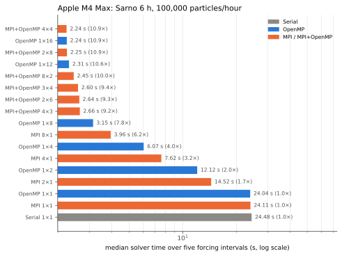

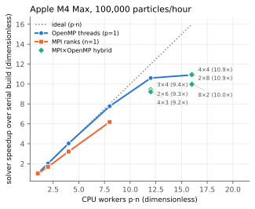

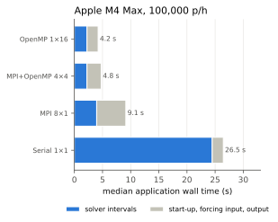

All three figures are measured model-execution diagnostics of the real Sarno forcing; the companion tables are [`results-m4max-q100000.json`](figures/backend-matrix/results-m4max-q100000.json) and [`results-m4max-q1000000.json`](figures/backend-matrix/results-m4max-q1000000.json).

| $q$ (particles/hour) | Serial $T$ (s) | OpenMP 1×8 | OpenMP 1×12 | OpenMP 1×16 | MPI 8×1 | MPI+OpenMP 4×4 |
| ---: | ---: | ---: | ---: | ---: | ---: | ---: |
| $10^5$ | 24.49 | 3.15 s, $E$=97% | 2.31 s, 88% | 2.24 s, 68% | 3.96 s, 77% | 2.24 s, 68% |
| $10^6$ | 237.7 | – | 23.39 s, 85% | 22.35 s, 66% | 39.41 s, 75% | 22.83 s, 65% |

Findings:

1. OpenMP scales almost ideally on the performance cores (101% at 4 threads, 97% at 8). Adding the four efficiency cores gains only 3–5%.
2. MPI alone is 20–25 points less efficient than OpenMP at equal worker count (84% at 2 ranks, 77% at 8). Rank 0's own particle block took 0.37 s of a 0.53 s interval at 8 ranks; the remainder is scatter, gather, packing, and waiting for slower ranks under the static contiguous partition.
3. Every rank holds the full forcing: 4.2 GiB resident per rank at $10^5$ and 5.8–6.5 GiB at $10^6$. Eight ranks need about 35–50 GiB, which caps the usable rank count on 64 GiB machines, and the parallel forcing reads raise 8-rank application time to 9.1 s against 4.0 s of solver.

**Best Mac configurations.** At $10^5$ particles/hour, OpenMP 1×16 (2.24 s) and MPI+OpenMP 4×4 (2.24 s) tie within their sample ranges; OpenMP 1×16 has the shortest application time (4.2 s). At $10^6$ particles/hour, OpenMP 1×16 is fastest (22.3 s, 10.6×). For throughput per core, OpenMP 1×12 on the performance cores is the efficient choice. MPI is not needed on one Mac node.

The earlier rainbow physical-core sweep ([Sarno performance evaluation](../examples/wacomm-sarno-lite/docs/performance-evaluation.md)) measured 12-thread CPU efficiency of 90–93% and one GPU 2.8× faster than twelve cores at $10^5$ and 4.8× faster at $10^6$. The [rainbow results](#results-on-rainbow-cpu-and-cuda) below repeat those tuples and add the MPI, MPI+CUDA, and MPI+OpenMP+CUDA builds.

## Issues found on hhcpu and their fixes

The `hhcpu` pass exposed five defects or omissions. None changed an equation, parameter, default, or result; each was fixed and the affected step repeated.

1. **Private OpenSSL needs Perl core modules.** OpenSSL 3.5.8 `Configure` loads `IPC::Cmd`, which in turn loads `ExtUtils::MM::Utils` inside `can_run`. Rocky Linux ships both outside the `perl` package (`perl-core`), so the first build failed deep inside the OpenSSL sub-build. [`cmake/WacommDependencies.cmake`](../cmake/WacommDependencies.cmake) now checks the modules, including the `can_run` call, during configuration and names the missing ones. On `hhcpu` the signed Rocky packages were extracted with `rpm2cpio` and placed on `PERL5LIB`; the [build guide](build.md#serial-build-with-private-openssl) documents the procedure.
2. **MPI tests need Slurm task slots.** With `--ntasks=1 --cpus-per-task=56`, Open MPI saw one slot and the two-rank `application_end_to_end`, `mpi_decomposition_parity`, and `mpi_openmp_multi_worker_parity` cases failed. The job scripts request `--ntasks-per-node=56`.
3. **NetCDF utilities for workflow fixtures.** The private NetCDF builds no utilities, so `webinar_roms_workflow` skipped for lack of `ncgen`/`ncdump`. The test job loads the site NetCDF module for CTest only; it is not linked into the application.
4. **Benchmark binaries were relative paths.** [`sarno_backend_matrix.py`](../examples/wacomm-sarno-lite/tools/sarno_backend_matrix.py) launched each sample inside its own directory with the path given on the command line. It now resolves binaries to absolute paths and refuses non-executable ones before preparing a suite.
5. **Multi-node placement and the scheduler memory default.** Under Slurm, Open MPI 4.1.4 binds `--map-by slot:PE=n` against one CPU per remote daemon and refuses multi-node bound runs. The tool's new `--nodes N` option uses `--map-by ppr:(p/N):node:PE=n`, which places equal rank counts per node, and rejects uneven placements. The `hhcpu` partition also grants 1 GiB per allocated CPU (56 GiB per node) unless `--mem` is given. Every 28-rank-per-node sample was killed by the cgroup out-of-memory handler at that limit, although the node has 239 GiB. Both job scripts now request `--mem=0`, and only the killed samples were repeated (jobs 1077321–1077323).

The job scripts are [`hhcpu_backend_test_job.sh`](../examples/wacomm-sarno-lite/tools/hhcpu_backend_test_job.sh) and [`hhcpu_backend_matrix_job.sh`](../examples/wacomm-sarno-lite/tools/hhcpu_backend_matrix_job.sh).

## Results on hhcpu

Three suites use the Sarno benchmark method above with `--bind` (ranks on consecutive physical cores, `OMP_PLACES=cores`, `OMP_PROC_BIND=close`) on exclusive nodes. The forcing is read from the NFS-mounted `/home`. Suite `hhcpu-q1e5` (one node, 18 tuples, job 1077303) and `hhcpu-q1e6` (one node, 8 tuples, job 1077304) ran concurrently on separate nodes. Suite `hhcpu-4node-q1e6` (four nodes, 6 tuples, job 1077305) followed. After the memory-limit rerun, all 96 measured samples and 32 warm-ups passed the equivalence gate against the serial build: particle states exactly, every gridded variable exactly. Each suite runs its own serial reference: 73.10 s at $10^5$ particles/hour, 731.2 s and 730.4 s at $10^6$. Solver time is linear in the particle count to within 0.03%.

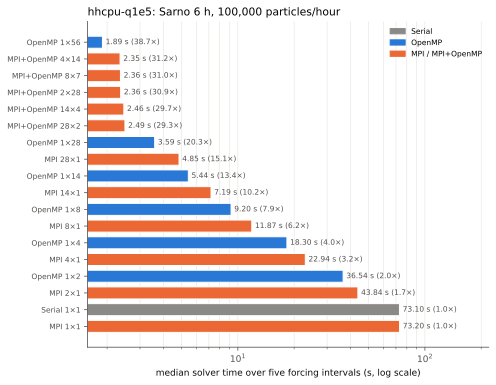

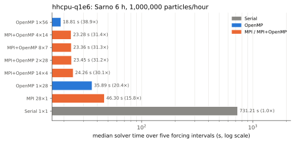

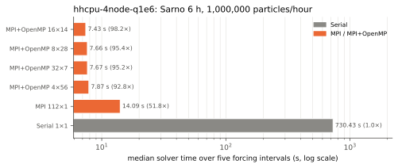

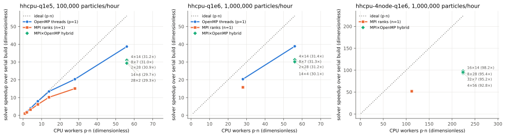

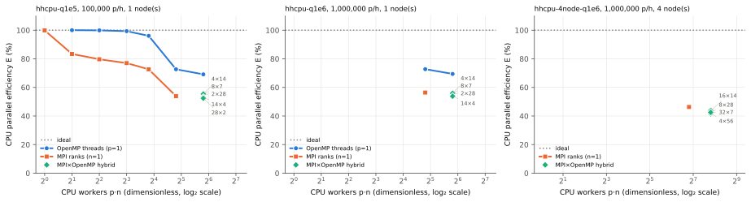

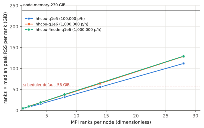

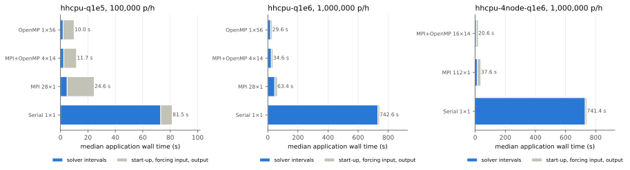

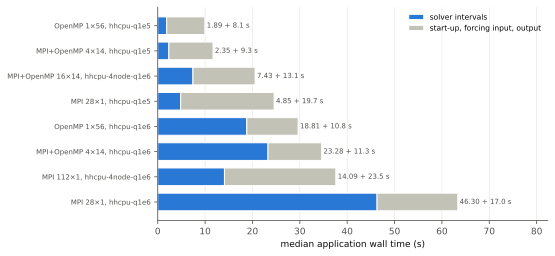

All eight figures are measured model-execution diagnostics of the real Sarno forcing, without confidence intervals. The first four and `application-breakdown` come from `sarno_backend_matrix.py collect`; `cpu-efficiency`, `memory-per-node`, and `application-split` come from [`backend_matrix_supplement.py`](../examples/wacomm-sarno-lite/tools/backend_matrix_supplement.py). The memory figure multiplies ranks per node by the median peak resident set of one rank. That product overestimates node demand, because shared library and page-cache pages are counted once per rank. Hybrid 14×4 tuples, with an estimated 64 GiB, completed inside the 56 GiB cgroup. The companion table is [`results-hhcpu.json`](figures/backend-matrix-hhcpu/results-hhcpu.json).

| $q$ (particles/hour) | Serial $T$ (s) | OpenMP 1×14 | OpenMP 1×28 | OpenMP 1×56 | MPI 28×1 | MPI+OpenMP 4×14 | 4 nodes, MPI+OpenMP 16×14 |
| ---: | ---: | ---: | ---: | ---: | ---: | ---: | ---: |
| $10^5$ | 73.10 | 5.44 s, $E$=96% | 3.59 s, 73% | **1.89 s**, 69% | 4.85 s, 54% | 2.35 s, 56% | – |
| $10^6$ | 731.2 | – | 35.89 s, 73% | **18.81 s**, 69% | 46.30 s, 56% | 23.28 s, 56% | **7.43 s**, 44% |

Findings:

1. **OpenMP is the efficient on-node decomposition.** It is ideal through 8 threads (99–100%) and keeps 96% at 14 threads. Efficiency drops to 73% at 28 threads (one full socket) and 69% at 56. The MPI rank-0 particle rate falls by a similar fraction at 28 ranks (17,600 against 25,300 particles/s serial), so the loss is a shared-resource effect of the full socket (memory bandwidth or all-core clock), not OpenMP overhead. Separating the two needs hardware counters, which this pass did not record.
2. **MPI loses 17 points at two ranks.** At two ranks, efficiency is already 83%. In the last interval, rank 0 processed its 264,358 particles at 23,458 particles/s, against the serial average of 25,309. The static contiguous partition gives rank 0 the oldest particles, which integrate the whole interval, while the newest particles, emitted part-way through, land on the last rank. The OpenMP loop avoids this imbalance with dynamic scheduling. Every hybrid placement on one node is 24–32% slower than OpenMP 1×56. The [load-balance model](#load-balance-model) attributes about 17 points of that to the partition; the rest was not separated.
3. **Forcing replication limits ranks and inflates input time.** Every rank holds the full forcing, 3.8–5.1 GiB. The time outside the solver grows from 8.1 s (OpenMP 1×56, $10^5$) to 19.7 s with 28 ranks reading the same NFS files, and to 23.5 s for 112 ranks on four nodes. At $10^5$ particles/hour, 81% of the fastest application run is outside the solver.
4. **Four nodes give 2.5× on the solver and 1.5× on the application.** The 16×14 placement is 2.53× faster than one-node OpenMP 1×56 on four times the cores, an inter-node relative efficiency of 63%. All four hybrid placements lie within 7.4–7.9 s. Application time falls only from 29.6 s to 19.9 s (8×28), because forcing input dominates.

### Load-balance model

The logged particle counts predict the efficiency that the contiguous partition allows. In interval $k$ of length $L_k$ (h), the $N^\mathrm{o}_k$ particles present at its start each integrate $L_k$. The $N^\mathrm{n}_k$ particles emitted during it are released uniformly at fractions $u\in[0,1)$ of the interval and integrate $L_k(1-u)$. The model takes work proportional to integrated time, so rank $r$ carries the summed time $W_{k,r}$ of its particles. The predicted efficiency is

$$
\eta=\frac{\sum_k \overline{W}_{k}}{\sum_k \max_r W_{k,r}},
$$

where $\overline{W}_k$ is the mean over the $p$ ranks, and $\eta$ is dimensionless. The intervals are 1, 1, 2, 1, and 1 h, because the 12:00 record is missing. The counts present at each interval's end are $10^5\times(1.00, 2.00, 3.95, 4.57, 5.29)$ at $10^5$ particles/hour, and ten times that at $10^6$. The model treats every counted particle as active for its whole integration time. With contiguous blocks and the remainder on rank 0, $\eta$ is 83.6% at $p=2$, 83.1% at 4, 82.7% at 16, and 82.5% at 28. Measured MPI 2×1 efficiency was 83.4%. With the interleaved partition of revision `32679ce` ([parallel execution](parallelism.md)), $\eta$ is 100% for every $p$. The model ignores communication, particle removal, per-particle cost differences such as coastal stranding, and memory contention. Multiplying the measured solver times by $\eta$ is an untested prediction for that revision: MPI+OpenMP 4×14 at $10^6$ particles/hour would fall from 23.28 s to about 19.3 s, within 3% of OpenMP 1×56, and four-node 16×14 from 7.43 s to about 6.1 s. Only a rerun at the new revision can check these predictions.

**Best hhcpu configurations.** On one node, use OpenMP 1×56 with `OMP_PLACES=cores OMP_PROC_BIND=close` at both rates: it is the fastest solver and the fastest application (9.9 s and 29.6 s). Pure MPI and on-node hybrid placements are slower and multiply memory. For independent ensemble members, four concurrent 14-thread runs per node have the best throughput per core ($E$=96%). For the shortest time to solution at $10^6$ particles/hour, use four nodes with MPI+OpenMP 16×14 (4 ranks/node, solver 7.43 s) or 8×28 (2 ranks/node, the fastest application at 19.9 s), always with `--mem=0`. Pure MPI with many ranks per node is never the best choice on this machine.

## Reruns after the first improvements

Two reruns repeat the `hhcpu` suites with the same method, tuples subset, Sarno forcing, and job scripts. Revision `94e9aa4` contains C5 (resource limits, `59f9b91`), C1 (interleaved decomposition, `32679ce`), and C2 step 1 (OpenMP packing and the `DISTRIBUTE`/`COLLECT` timers, `e2c9a21`). Revision `aa8378f` adds the fatal-error logging of `83e6337` and the atomic-free concentration counting of `aa8378f` ([parallel execution](parallelism.md)). The test jobs passed 39, 39, 42, and 44 tests in the Serial, OpenMP, MPI, and MPI+OpenMP builds at both revisions (jobs 1077482 and 1077961), with no skips. The matrix jobs are 1077483–1077485 and 1077962–1077964. Every measured sample and warm-up of both reruns passed the exact equivalence gate against its suite's serial build. Particle states and every gridded variable are therefore bit-identical across the decompositions and to the serial build.

Each suite runs its own serial reference. Between the two reruns the serial solver time changed by −0.4% (73.12 s to 72.83 s at $10^5$ particles/hour, 730.3 s to 727.6 s at $10^6$). The serial path is the same at both revisions, so differences of this size between revisions are job-to-job variation and are not attributed to the code. The concentration column is `EVALUATE sec:`, summed over the five intervals. It includes the land-mask pass. The distribution and collection columns are the rank-0 `DISTRIBUTE sec:` and `COLLECT sec:` sums. All values are medians of three samples, in seconds. The three samples of every tuple lie within 1% of the median, except MPI 4×1 at `94e9aa4` (3.2%).

| Suite | Tuple | Solver `5a49653` | Solver `94e9aa4` | Solver `aa8378f` | $E$ at `aa8378f` | Concentration `94e9aa4` → `aa8378f` | Distribution, collection at `aa8378f` | Non-solver at `aa8378f` |
| --- | --- | ---: | ---: | ---: | ---: | ---: | ---: | ---: |
| $10^5$, one node | OpenMP 1×56 | 1.89 | 1.90 | **1.82** | 71% | 0.089 → 0.016 | – | 7.68 |
| | MPI 2×1 | 43.84 | 36.80 | 36.80 | 99% | 0.099 → 0.100 | 0.071, 0.048 | 8.45 |
| | MPI 4×1 | – | 18.50 | 18.48 | 98% | 0.101 → 0.100 | 0.061, 0.053 | 8.67 |
| | MPI 28×1 | 4.85 | 3.91 | 3.92 | 66% | 0.143 → 0.141 | 0.101, 0.055 | 18.44 |
| | MPI+OpenMP 4×14 | 2.35 | 1.93 | 1.90 | 69% | 0.059 → 0.020 | 0.047, 0.022 | 8.59 |
| $10^6$, one node | OpenMP 1×56 | 18.81 | 18.88 | **18.14** | 72% | 0.793 → 0.070 | – | 10.92 |
| | MPI+OpenMP 4×14 | 23.28 | 19.16 | 18.83 | 69% | 0.479 → 0.086 | 0.420, 0.229 | 12.20 |
| $10^6$, four nodes | MPI+OpenMP 8×28 | – | 6.20 | 5.70 | 57% | 0.618 → 0.077 | 0.405, 0.199 | 12.45 |
| | MPI+OpenMP 16×14 | 7.43 | 6.01 | **5.65** | 58% | 0.478 → 0.086 | 0.369, 0.206 | 12.96 |

The `5a49653` column repeats the [first results](#results-on-hhcpu). The 8×28 tuple there was not measured with the `--nodes` placement. "–" marks tuples a suite did not run.

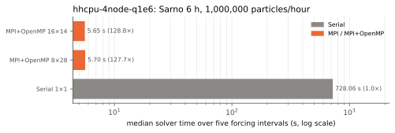

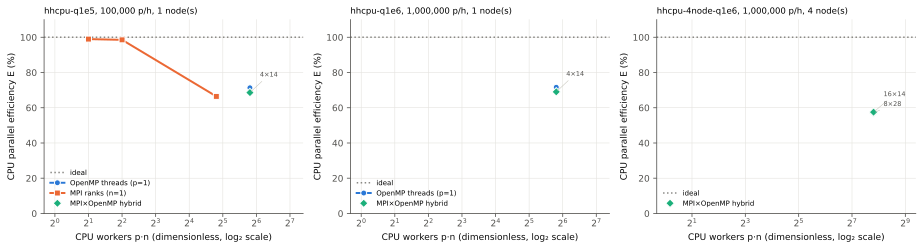

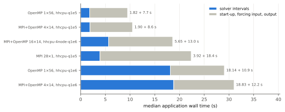

The three figures are measured model-execution diagnostics of the real Sarno forcing at revision `aa8378f`, without confidence intervals. They come from `sarno_backend_matrix.py collect` and `backend_matrix_supplement.py`, as in the first pass. The companion tables are [`results-94e9aa4.json`](figures/backend-matrix-hhcpu-rerun/results-94e9aa4.json) and [`results-aa8378f.json`](figures/backend-matrix-hhcpu-rerun/results-aa8378f.json).

Findings:

1. **The interleaved decomposition removed the MPI imbalance.** MPI 2×1 efficiency rose from 83.4% to 99.3%, and 4×1 reached 98.8%. The [load-balance model](#load-balance-model) predicted 100%. Its two time predictions also held: MPI+OpenMP 4×14 at $10^6$ particles/hour fell from 23.28 s to 19.16 s (predicted 19.3 s), and four-node 16×14 from 7.43 s to 6.01 s (predicted 6.1 s). On one node, 4×14 is now 1.5–4.4% slower than OpenMP 1×56, against 24% before. MPI 28×1 improved less (54% to 66%). Its efficiency is close to that of OpenMP 1×28 in the first pass (73%), so the full-socket loss described there remains.
2. **Atomic-free concentration removed most of the rank-0 counting time.** Sarno particles crowd into few cells (at 14:00 at $10^6$ particles/hour, 20 occupied cells hold 3.49 million particles, and 56.5% of them share one cell), so the atomic updates of all threads contended for one cache line. `EVALUATE sec:` fell from 0.793 s to 0.070 s for OpenMP 1×56 and from 0.478 s to 0.086 s for 16×14. Pure MPI rows count on one thread and are unchanged, as expected. The remaining time includes the land-mask pass, which was not timed separately. The solver gains match the concentration savings: 0.74 s against 0.72 s for 1×56, and 0.36 s against 0.39 s for 16×14.
3. **The C2 acceptance is met for efficiency, not for time.** The plan defines four-node relative efficiency as the one-node OpenMP 1×56 time divided by four times the 16×14 time. It rose from 63% at `5a49653` to 78.5% at `94e9aa4` and 80.3% at `aa8378f`. Over the three-sample ranges this spans 80.1–80.5%, above the 80% target by less than one point. The 16×14 solver time is 5.65 s, 0.15 s above the 5.5 s target.
4. **Distribution and collection are now the largest rank-0 terms.** At 16×14 they take 0.37 s and 0.21 s of the 5.65 s solver time. The Sarno run writes histories and gridded counts every hour, and each forcing window is one interval, so particle states must reach rank 0 every interval. Keeping particles resident (C2 step 2) could therefore save at most the scatter of the particles already present, a part of the 0.37 s. Outside the solver, 12–13 s of the 18–19 s application time on four nodes is start-up, forcing input, and output, which this pass did not separate.

**Best hhcpu configurations at `aa8378f`.** On one node, OpenMP 1×56 remains the fastest solver and application at both rates (1.82 s and 9.50 s at $10^5$ particles/hour, 18.14 s and 29.06 s at $10^6$). MPI+OpenMP 4×14 is now within 5% of it and is no longer a poor choice, but it multiplies forcing memory by four. On four nodes at $10^6$ particles/hour, 16×14 gives the fastest solver (5.65 s) and 8×28 the fastest application (18.15 s). Both need `--mem=0`.

## Time outside the solver

Revision `a0ea55d` adds rank-0 timers for the phases outside the solver interval ([parallel execution](parallelism.md)). `FORCING` is the preparation of one forcing window (reading, normalization, appended boundary record, regridding), reported for rank 0 and for the slowest rank. `SETUP` covers sources and restart loading, `OUTPUT` the output section after the solver intervals, `FLUSH` the final wait for queued writes, and `RUN` the whole run. Five suites at $10^5$ particles/hour ran one after another (jobs 1078223–1078227, after test job 1078222 passed 39, 39, 42, and 44 tests), so they did not share the NFS-mounted forcing with each other. Every sample passed the exact equivalence gate. The settings are the default synchronous output, `io.async=true`, and `numactl --interleave=all`, on one node and on four. Values are medians of three samples, in seconds, summed over the run. "Launch" is application time minus `RUN sec:`: process start, MPI initialization, and configuration parsing. "Rest" is `RUN sec:` minus the listed phases.

| Nodes | Setting | Tuple | Application | Solver | Forcing (slowest rank) | Output | Flush | Launch | Rest |
| ---: | --- | --- | ---: | ---: | ---: | ---: | ---: | ---: | ---: |
| 1 | synchronous | Serial | 80.50 | 72.84 | 4.62 | 2.73 | – | 0.01 | 0.30 |
| 1 | synchronous | OpenMP 1×56 | 9.75 | 1.82 | 4.83 | 2.97 | – | 0.01 | 0.11 |
| 1 | synchronous | MPI+OpenMP 4×14 | 10.52 | 1.89 | 4.81 | 3.00 | – | 0.67 | 0.15 |
| 1 | `io.async` | OpenMP 1×56 | 8.47 | 1.82 | 5.93 | 0.03 | 0.56 | 0.01 | 0.11 |
| 1 | `io.async` | MPI+OpenMP 4×14 | 9.39 | 1.89 | 5.78 | 0.02 | 0.83 | 0.68 | 0.19 |
| 1 | interleaved | OpenMP 1×56 | 10.79 | 1.83 | 5.47 | 3.39 | – | 0.01 | 0.09 |
| 4 | synchronous | MPI+OpenMP 16×14 | 10.37 | 0.63 | 4.86 | 3.00 | – | 1.73 | 0.15 |
| 4 | synchronous | MPI 112×1 | 20.80 | 1.35 | 10.49 | 4.89 | – | 1.70 | 2.36 |
| 4 | `io.async` | MPI+OpenMP 16×14 | 9.22 | 0.62 | 5.80 | 0.03 | 0.83 | 1.82 | 0.11 |

The companion table is [`results-a0ea55d.json`](figures/backend-matrix-hhcpu-rerun/results-a0ea55d.json). It also holds OpenMP 1×14 and 1×28, with and without interleaving.

Findings:

1. **Forcing preparation is the largest phase outside the solver.** It takes 4.6–4.9 s for one process and for four ranks per node, about 0.8 s for each of the six windows. The native forcing files are uncompressed, contiguous NetCDF: five of 1.76 GB and one of 0.91 GB, 9.7 GB per run, so preparation proceeds at about 2 GB/s. Repeated samples on one node read the same files, which are probably in the page cache; this pass did not record cache state, so the cold-read cost is not measured. Whether reading or normalization dominates is not separated.
2. **Output takes 2.7–3.0 s when synchronous.** With `io.async=true` the output section falls to 0.03 s and the final flush takes 0.56–0.83 s. For the parallel runs, forcing preparation grows by 0.9–1.1 s instead, and the net saving is 1.1–1.3 s. The [forcing preparation split](#forcing-preparation-split) shows that the growth is in the boundary-record append, not in waiting for the NetCDF lock. The serial run's 73 s solver leaves time for the writes to finish, so its forcing preparation is unchanged (4.65 s against 4.62 s) and it saves 2.2 s on one node and 2.7 s on four.
3. **Read contention appears only with many ranks per node.** At four ranks per node the slowest rank prepares its forcing as fast as one process (4.86 s against 4.83 s). With 28 ranks per node it takes 10.49 s, output 4.89 s, and 2.36 s remain unattributed, presumably waits at the interval barriers.
4. **Interleaving memory pages does not recover the full-socket efficiency.** With `numactl --interleave=all`, OpenMP efficiency is 71.2% at 56 threads and 73.1% at 28, against 71.4% and 73.2% without. Forcing preparation became 0.6 s slower, consistent with single-threaded reading from remote memory. Page placement is therefore not the cause of the drop from 96% at 14 threads. The cause remains unmeasured.
5. **MPI launch costs 0.7 s on one node and 1.7 s on four.**

**Best hhcpu configurations, updated.** Use `io.async=true`: it shortened every measured run, by 1.1–1.3 s for the parallel tuples and 2.2–2.7 s for serial, and leaves results unchanged. The configurations above remain best otherwise.

## Forcing preparation split

Revision `9cd10e4` splits rank 0's forcing preparation into the wait for the process-wide NetCDF lock, the NetCDF variable reads of the ocean adapter, the rest of the adapter's processing (normalization), and the appended boundary record ([parallel execution](parallelism.md)). Four suites at $10^5$ particles/hour ran one after another (jobs 1079089–1079092, after test job 1079088 passed 39, 39, 42, and 44 tests). All 44 samples passed the exact equivalence gate. Values are medians of three samples, in seconds, summed over the six windows. Forcing is rank 0's.

| Nodes | Setting | Tuple | Application | Solver | Forcing | Wait | Read | Normalization | Boundary record |
| ---: | --- | --- | ---: | ---: | ---: | ---: | ---: | ---: | ---: |
| 1 | synchronous | Serial | 80.48 | 72.82 | 4.64 | 0.00 | 2.22 | 0.07 | 2.35 |
| 1 | synchronous | OpenMP 1×56 | 10.03 | 1.83 | 4.83 | 0.00 | 2.46 | 0.03 | 2.34 |
| 1 | synchronous | MPI+OpenMP 4×14 | 10.30 | 1.89 | 4.85 | 0.00 | 2.43 | 0.03 | 2.39 |
| 1 | `io.async` | Serial | 78.32 | 72.84 | 4.64 | 0.00 | 2.17 | 0.07 | 2.41 |
| 1 | `io.async` | OpenMP 1×56 | 8.65 | 1.82 | 5.90 | 0.00 | 2.43 | 0.03 | 3.39 |
| 1 | `io.async` | MPI+OpenMP 4×14 | 9.26 | 1.89 | 5.74 | 0.00 | 2.28 | 0.03 | 3.36 |
| 4 | synchronous | MPI+OpenMP 16×14 | 10.35 | 0.62 | 4.76 | 0.00 | 2.40 | 0.02 | 2.33 |
| 4 | synchronous | MPI 112×1 | 19.97 | 1.36 | 9.40 | 0.00 | 6.26 | 0.13 | 3.00 |
| 4 | `io.async` | MPI+OpenMP 16×14 | 9.21 | 0.62 | 5.68 | 0.00 | 2.26 | 0.03 | 3.36 |

The companion table is [`results-9cd10e4.json`](figures/backend-matrix-hhcpu-rerun/results-9cd10e4.json). The four parts account for rank 0's forcing time to within 0.07 s. The Sarno configuration has no weather or wave forcing.

Findings:

1. **Appending the boundary record costs as much as reading.** It takes 2.3–2.4 s per run, about 0.46 s per window, single-threaded. Each Sarno file holds two hourly records, and its second equals the next file's first. `OceanModelAdapter::appendBoundaryRecord` therefore always takes its duplicate path: it checks that the window's endpoint and the adjacent first record agree in every stored value, then keeps the window unchanged. The check visited the values cell by cell with the vertical index innermost, which strides through memory by a whole horizontal layer, $1135 \times 1528$ values, at every step. (This finding first blamed two whole-window copies; those occur only for files without a duplicate endpoint, and the Sarno windows never reach them.)
2. **Reading takes 2.2–2.5 s, normalization 0.02–0.07 s.** About 9.7 GB per run are read at roughly 4 GB/s, probably from the page cache. Native files need almost no normalization, so parallelizing it cannot help this workload.
3. **The NetCDF lock is not what slows forcing under `io.async`.** The lock wait is zero in every run. Instead, the boundary-record append grows by 1.0–1.05 s in the parallel tuples. It does not grow in the serial run, whose writes finish during its 73 s solver. This contradicts the lock explanation given in [time outside the solver](#time-outside-the-solver). The append probably competes with the writer thread for memory bandwidth or page allocation, but this pass did not measure that.
4. **Read contention with 28 ranks per node is in reading.** For MPI 112×1, rank 0 reads for 6.26 s against 2.2–2.5 s for one process per node or four.

## Contiguous boundary-record check

Revision `a9345dc` compares the duplicate boundary record one contiguous time record at a time, in parallel under OpenMP (C9 in the [plan](improvement-plan.md)). Revision `7671ddd` before it had only replaced the append's copies. On Sarno it left the boundary time unchanged (2.33–2.38 s per run for OpenMP 1×56, job 1082912), because the Sarno windows never reach those copies. The suites of the [forcing preparation split](#forcing-preparation-split) were repeated at `a9345dc` (jobs 1082993–1082996, after test job 1082992 passed 40, 40, 43, and 45 tests). All 44 samples passed the exact equivalence gate. Values are medians of three samples, in seconds, summed over the run. Each cell shows `9cd10e4` → `a9345dc`.

| Nodes | Setting | Tuple | Application | Forcing (slowest rank) | Boundary record | Output | Flush |
| ---: | --- | --- | ---: | ---: | ---: | ---: | ---: |
| 1 | synchronous | Serial | 80.48 → 79.20 | 4.64 → 3.13 | 2.35 → 0.86 | 2.67 → 2.73 | – |
| 1 | synchronous | OpenMP 1×56 | 10.03 → 7.90 | 4.83 → 2.69 | 2.34 → 0.15 | 3.10 → 3.28 | – |
| 1 | synchronous | MPI+OpenMP 4×14 | 10.30 → 8.10 | 4.89 → 2.60 | 2.39 → 0.12 | 2.66 → 2.92 | – |
| 1 | `io.async` | Serial | 78.32 → 77.02 | 4.64 → 3.14 | 2.41 → 0.89 | 0.02 → 0.02 | 0.54 → 0.56 |
| 1 | `io.async` | OpenMP 1×56 | 8.65 → 6.71 | 5.90 → 2.76 | 3.39 → 0.22 | 0.02 → 1.10 | 0.61 → 0.91 |
| 1 | `io.async` | MPI+OpenMP 4×14 | 9.26 → 7.07 | 5.74 → 2.68 | 3.36 → 0.21 | 0.02 → 0.58 | 0.83 → 1.06 |
| 4 | synchronous | MPI+OpenMP 16×14 | 10.35 → 8.44 | 4.87 → 2.70 | 2.33 → 0.12 | 2.94 → 3.32 | – |
| 4 | synchronous | MPI 112×1 | 19.97 → 20.48 | 10.23 → 9.04 | 3.00 → 1.47 | 4.49 → 5.20 | – |
| 4 | `io.async` | MPI+OpenMP 16×14 | 9.21 → 8.17 | 5.75 → 2.80 | 3.36 → 0.20 | 0.03 → 1.87 | 0.86 → 0.90 |

The companion table is [`results-a9345dc.json`](figures/backend-matrix-hhcpu-rerun/results-a9345dc.json). Solver times are unchanged within 0.1 s, except with `io.async`: OpenMP 1×56 1.82 → 1.90 s, 4×14 1.89 → 2.00 s, and four-node 16×14 0.62 → 0.73 s. This is consistent with the writer thread now overlapping the solver intervals, but that was not measured.

Findings:

1. **With threads, the boundary record now costs 0.12–0.22 s per run instead of 2.3–3.4 s, a 93–95% reduction, synchronous and asynchronous.** Forcing preparation falls by about 2.1 s synchronous and 2.9–3.1 s asynchronous, and reading (2.2–2.5 s) is now nearly all of it.
2. **Single-threaded tuples gain less.** For serial runs the check falls by 63% (2.35 → 0.86 s). For MPI 112×1, whose 28 ranks per node compare on one thread each, it falls by 51% (3.00 → 1.47 s). These miss the 75% target, which the multithreaded tuples meet.
3. **Applications are 1.0–2.2 s faster, except MPI 112×1.** OpenMP 1×56 takes 7.90 s synchronous and 6.71 s asynchronous, against 10.03 and 8.65 s. MPI 112×1 became 0.5 s slower: its 1.2 s forcing saving was offset by 0.7 s more output time and longer waits elsewhere in the run. These are medians of three samples of a contended placement, and the change is not attributed.
4. **The asynchronous writer now limits the output section.** With faster forcing, the next window's output reaches the writer while the previous one is still being written. The output section, which includes waiting for a full queue, grows from 0.02 s to 0.58–1.87 s. Asynchronous output still saves 1.0–1.2 s against synchronous output for the parallel tuples.

**Best hhcpu configurations, updated.** At `a9345dc` the shortest $10^5$ particles/hour run is OpenMP 1×56 with `io.async=true`, at 6.71 s, and four-node 16×14 with `io.async=true` takes 8.17 s. One node is faster than four at this rate, because launch and output dominate. MPI+OpenMP 16×14 remains the fastest tuple at $10^6$ particles/hour, measured at `aa8378f`; that rate has not been rerun.

## Forcing prefetch

Revision `b2195ce` reads input $k\pm2$ on a prefetch thread while window $k$ integrates, when `io.prefetch=true` (C4 in the [plan](improvement-plan.md), [forcing prefetch](parallelism.md#forcing-prefetch)). The suites of the [contiguous boundary-record check](#contiguous-boundary-record-check) were repeated with `--io-prefetch`, with and without `--io-async` (jobs 1083153–1083156, after test job 1083152 passed 41, 41, 44, and 46 tests). All 44 samples passed the exact equivalence gate, so prefetched runs produced the same outputs as the serial reference. Values are medians of three samples, in seconds, summed over the run. Each cell shows `a9345dc` without prefetch → `b2195ce` with prefetch and the same output setting. Outside the solver is application time minus solver time. Prefetch wait and background are rank 0's.

| Nodes | Setting | Tuple | Application | Solver | Outside the solver | Forcing (slowest rank) | Prefetch wait | Background | Output |
| ---: | --- | --- | ---: | ---: | ---: | ---: | ---: | ---: | ---: |
| 1 | synchronous | Serial | 79.20 → 77.75 | 73.00 → 72.86 | 6.20 → 4.89 | 3.13 → 1.69 | 0.00 | 1.43 | 2.73 → 2.88 |
| 1 | synchronous | OpenMP 1×56 | 7.90 → 7.53 | 1.82 → 1.91 | 6.08 → 5.62 | 2.69 → 1.08 | 0.00 | 2.41 | 3.28 → 4.43 |
| 1 | synchronous | MPI+OpenMP 4×14 | 8.10 → 7.58 | 1.89 → 2.23 | 6.21 → 5.34 | 2.60 → 1.71 | 0.00 | 2.35 | 2.92 → 3.38 |
| 1 | `io.async` | Serial | 77.02 → 75.39 | 73.01 → 72.82 | 4.02 → 2.57 | 3.14 → 1.69 | 0.00 | 1.45 | 0.02 → 0.02 |
| 1 | `io.async` | OpenMP 1×56 | 6.71 → 6.90 | 1.90 → 1.94 | 4.82 → 4.96 | 2.76 → 1.96 | 0.86 | 2.34 | 1.10 → 2.42 |
| 1 | `io.async` | MPI+OpenMP 4×14 | 7.07 → 7.58 | 2.00 → 2.24 | 5.07 → 5.33 | 2.68 → 1.84 | 0.74 | 2.33 | 0.58 → 2.07 |
| 4 | synchronous | MPI 112×1 | 20.48 → 18.80 | 1.36 → 2.28 | 19.12 → 16.52 | 9.04 → 7.16 | 0.00 | 6.16 | 5.20 → 5.65 |
| 4 | synchronous | MPI+OpenMP 16×14 | 8.44 → 8.68 | 0.62 → 1.43 | 7.81 → 7.25 | 2.70 → 2.09 | 0.00 | 2.23 | 3.32 → 3.84 |
| 4 | `io.async` | MPI+OpenMP 16×14 | 8.17 → 8.30 | 0.73 → 1.49 | 7.44 → 6.81 | 2.80 → 2.09 | 0.69 | 2.20 | 1.87 → 2.53 |

The companion table is [`results-b2195ce.json`](figures/backend-matrix-hhcpu-rerun/results-b2195ce.json). The comparison spans two revisions, but `b2195ce` changes no computation when `io.prefetch=false`.

Findings:

1. **The acceptance criterion is not met.** For OpenMP 1×56 at $10^5$ particles/hour, time outside the solver falls by 8% with synchronous output (6.08 → 5.62 s) and grows by 3% with asynchronous output (4.82 → 4.96 s), against a target of a 40% reduction. The shortest run is still OpenMP 1×56 with `io.async=true` and no prefetch, at 6.71 s.
2. **Reading leaves the forcing timer but largely reappears in output.** Forcing preparation on rank 0 falls by 0.8–1.6 s (3.5 s for MPI 112×1), and for the threaded placements the background thread prepares 2.2–2.4 s of forcing per run. Synchronous output grows by 0.2–1.2 s, and the asynchronous output section by 0.7–1.5 s, with 0.7–0.9 s of prefetch wait. The prefetch thread holds the process-wide NetCDF lock for a whole file, and output takes the same lock. This is consistent with output waiting for the read, but the lock wait during output was not timed.
3. **The solver slows when every core runs a solver thread.** Solver time grows from 0.62 to 1.43 s for four-node 16×14, 1.36 to 2.28 s for MPI 112×1, and 1.89 to 2.23 s for 4×14, with non-overlapping sample ranges. All these placements use all 56 cores of a node, and every rank reads its own forcing. The reading thread therefore shares a core, and memory bandwidth, with the solver threads, and the slowest thread sets the interval time. Neither cause was isolated. The gain outside the solver is cancelled for 16×14, whose application time rises from 8.44 to 8.68 s.
4. **Single-threaded and pure-MPI runs gain.** Serial runs are 1.4–1.6 s faster, and time outside the solver falls by 21% synchronous and 36% asynchronous. MPI 112×1 is 1.7 s faster, though one of its samples is an outlier at 21.7 s.
5. **Peak memory grows by one window, as estimated.** Maximum resident memory per process rises from 4.0 to 5.75 GB for synchronous one-node runs, matching one additional 1.76 GB window.

The prefetch therefore stays off by default. Two changes could make it pay for parallel placements: releasing the NetCDF lock between variable reads, so that output can interleave with a prefetched file, and leaving one core per process for the reading thread. Neither has been implemented or measured.

## Lock handover and prefetch affinity

The [forcing prefetch](#forcing-prefetch) measurement left two candidate causes, and two changes address them ([forcing prefetch](parallelism.md#forcing-prefetch)).

- **Output waiting for the reader.** Revision `929b4a8` gives output, and forcing reads on the solver thread, priority on the NetCDF lock. The prefetch thread releases the lock to them before each ocean variable read.
- **The solver slowing on full nodes.** A read-only probe (job 1083333, at `b2195ce`) listed every thread's allowed CPUs during an OpenMP run with `OMP_PLACES=cores OMP_PROC_BIND=close`. The prefetch thread was allowed only CPU 0, the core of the solver's master thread. With 55 threads, no thread used the free core 55. Revision `d47c35c` lets the prefetch thread run on every processor of the OpenMP places. The backend matrix gains `--spare-cores=1`, which binds each MPI rank to one core more than its threads.

All suites ran at `d47c35c`, baselines included (jobs 1083335–1083344, after test job 1083334 passed 42, 42, 45, and 47 tests). All 104 samples passed the exact equivalence gate. Values are medians of three samples, in seconds, summed over the run. Each cell shows the run without prefetch → the run with it, at the same revision and output setting. "Spare core" runs use one OpenMP thread per process fewer. Prefetch wait and background are rank 0's. Background time now includes the time the prefetch thread spends giving the lock to output.

| Nodes | Output | Prefetch | Tuple | Application | Solver | Outside the solver | Forcing (slowest rank) | Prefetch wait | Background | Output |
| ---: | --- | --- | --- | ---: | ---: | ---: | ---: | ---: | ---: | ---: |
| 1 | synchronous | prefetch | Serial | 79.05 → 77.71 | 72.89 → 72.94 | 6.15 → 4.77 | 3.09 → 1.69 | 0.00 | 1.43 | 2.69 → 2.75 |
| 1 | synchronous | prefetch | OpenMP 1×56 | 7.26 → 6.76 | 1.83 → 1.90 | 5.44 → 4.87 | 2.69 → 1.51 | 0.43 | 3.39 | 2.65 → 3.30 |
| 1 | synchronous | prefetch, spare core | OpenMP 1×56 → 1×55 | 7.26 → 7.04 | 1.83 → 1.87 | 5.44 → 5.18 | 2.69 → 1.40 | 0.32 | 2.69 | 2.65 → 3.64 |
| 1 | synchronous | prefetch | MPI+OpenMP 4×14 | 8.20 → 7.97 | 1.88 → 2.00 | 6.31 → 5.97 | 2.57 → 1.73 | 0.43 | 3.35 | 2.95 → 3.62 |
| 1 | synchronous | prefetch, spare core | MPI+OpenMP 4×14 → 4×13 | 8.20 → 7.79 | 1.88 → 2.04 | 6.31 → 5.75 | 2.57 → 1.71 | 0.32 | 2.81 | 2.95 → 3.55 |
| 1 | `io.async` | prefetch, spare core | Serial | 76.96 → 75.53 | 72.94 → 72.94 | 4.01 → 2.59 | 3.08 → 1.70 | 0.00 | 1.45 | 0.02 → 0.02 |
| 1 | `io.async` | prefetch, spare core | OpenMP 1×56 → 1×55 | 6.51 → 6.37 | 1.88 → 1.87 | 4.63 → 4.50 | 2.78 → 3.58 | 2.47 | 3.85 | 0.89 → 0.25 |
| 1 | `io.async` | prefetch, spare core | MPI+OpenMP 4×14 → 4×13 | 6.62 → 7.63 | 2.00 → 2.06 | 4.62 → 5.57 | 2.73 → 3.54 | 2.47 | 4.12 | 0.47 → 0.42 |
| 4 | synchronous | prefetch | MPI+OpenMP 16×14 | 8.44 → 7.62 | 0.62 → 0.73 | 7.82 → 6.90 | 2.71 → 2.32 | 0.69 | 3.90 | 3.35 → 3.27 |
| 4 | synchronous | prefetch, spare core | MPI+OpenMP 16×14 → 16×13 | 8.44 → 8.01 | 0.62 → 0.69 | 7.82 → 7.32 | 2.71 → 2.22 | 0.54 | 3.58 | 3.35 → 3.87 |
| 4 | `io.async` | prefetch, spare core | MPI+OpenMP 16×14 → 16×13 | 8.11 → 7.99 | 0.73 → 0.74 | 7.38 → 7.25 | 2.78 → 4.10 | 3.04 | 3.62 | 1.68 → 0.37 |

The companion table is [`results-d47c35c.json`](figures/backend-matrix-hhcpu-rerun/results-d47c35c.json).

Findings:

1. **The solver no longer slows down with prefetch.** Four-node 16×14 integrates in 0.73 s with prefetch, against 1.43 s at `b2195ce` and 0.62 s without prefetch; the sample ranges at the two revisions are disjoint. For MPI+OpenMP 4×14 the cost falls from 0.34 to 0.12 s, and for OpenMP 1×56 it stays at 0.07–0.09 s.
2. **The acceptance criterion is still not met.** For OpenMP 1×56, time outside the solver falls by 10% with synchronous output (5.44 → 4.87 s). With `io.async=true` and a spare core it falls by 3% (4.63 → 4.50 s). The target is 40%.
3. **Most application differences are within the sample spread.** Only the serial gains of 1.3–1.4 s have disjoint sample ranges. OpenMP 1×56 synchronous (7.26 → 6.76 s) and four-node 16×14 synchronous (8.44 → 7.62 s) have overlapping ranges, as do the spare-core runs. Asynchronous MPI+OpenMP 4×13 with prefetch is 1.0 s slower in median than 4×14 without it, also with overlapping ranges.
4. **Reading and writing share one lock, which bounds the overlap.** Per run, NetCDF reading takes about 2.4 s and synchronous output 2.7–3.0 s on one node; the solver takes 1.9 s on one node and 0.6–0.7 s on four. With asynchronous output the writer almost always holds or waits for the lock, so the prefetch thread keeps giving it up. The solver thread then waits 2.5–3.0 s for the prefetched window, and forcing preparation grows. With synchronous output, output still grows by 0.6–1.0 s on one node. Overlap within one process cannot bring the time outside the solver below the sum of reading and writing under the lock.
5. **A spare core does not help once the reader is unpinned.** Spare-core runs are within the sample spread of full-core runs with prefetch, and use one thread per process fewer.

`io.prefetch` therefore stays off by default. Reaching the C4 target needs reading and writing that do not share one process-wide NetCDF lock. Options are a reader process instead of a thread, outputs that do not use NetCDF, or a thread-safe NetCDF stack. None of them has been implemented or measured.

## Results on rainbow (CPU and CUDA)

Two suites use the Sarno benchmark method above with `--bind` (ranks on consecutive physical cores, `OMP_PLACES=cores`, `OMP_PROC_BIND=close`) on the exclusive Slurm node, with the forcing on local disk. Suite `rainbow-q1e5` covers 27 tuples of all eight builds and suite `rainbow-q1e6` covers seven (job 1754). All 136 samples, warm-ups included, passed the equivalence gate against the serial build. CPU tuples matched the particle states exactly. CUDA tuples matched identities, counts, ages, and alive/dead states exactly, with living-particle health within $1.1\times10^{-16}$ and positions within 0.26 µm horizontally and 3.5 nm in depth, inside the declared $10^{-15}$, 1 µm, and 10 nm limits. Every gridded variable matched exactly. The serial references are 35.15 s at $10^5$ and 351.1 s at $10^6$ particles/hour.

This pass ran at revision `ffa9c18`, which predates the interleaved MPI decomposition (`32679ce`) and the atomic-free concentration counting (`aa8378f`). Its MPI rows therefore measure the contiguous partition, like the [first hhcpu pass](#results-on-hhcpu).

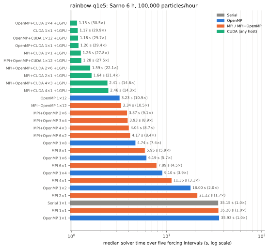

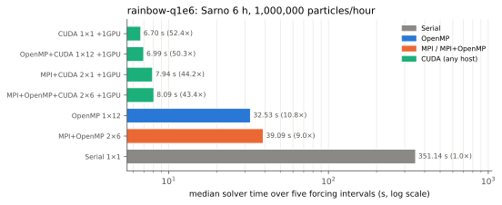

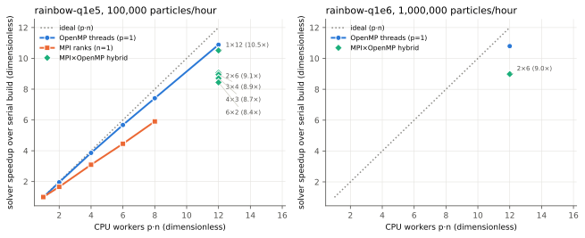

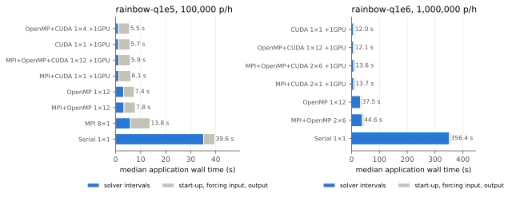

All four figures are measured model-execution diagnostics of the real Sarno forcing, without confidence intervals, produced by `sarno_backend_matrix.py collect`. The companion table is [`results-rainbow.json`](figures/backend-matrix-rainbow/results-rainbow.json).

| $q$ (particles/hour) | Serial $T$ (s) | OpenMP 1×12 | MPI 8×1 | MPI+OpenMP 2×6 | CUDA 1×1 | OpenMP+CUDA 1×12 | MPI+CUDA 2×1 | MPI+OpenMP+CUDA 2×6 |
| ---: | ---: | ---: | ---: | ---: | ---: | ---: | ---: | ---: |
| $10^5$ | 35.15 | 3.23 s, $E$=91% | 5.95 s, 74% | 3.87 s, 76% | **1.18 s**, 29.9× | 1.18 s, 29.7× | 1.64 s, 21.4× | 1.59 s, 22.1× |
| $10^6$ | 351.1 | 32.53 s, 90% | – | 39.09 s, 75% | **6.70 s**, 52.4× | 6.99 s, 50.3× | 7.94 s, 44.2× | 8.09 s, 43.4× |

GPU entries give the speedup $S$ over the serial build, because CPU efficiency is undefined for them. The rank-0 log separates two GPU-interval terms: `CUDA HOST2DEV sec:` (host clock around allocation and upload of the device forcing) and `GPU Processed in sec:` (CUDA events around the particle transfers and kernels on the stream). The table below gives the median, over three samples, of each term summed over the five intervals. With several ranks, the upload is the mean over ranks and the kernel term is rank 0's.

| $q$ | Tuple | Forcing upload per rank (s) | Particle transfers and kernels (s) | Solver $T$ (s) | Upload share |
| ---: | --- | ---: | ---: | ---: | ---: |
| $10^5$ | CUDA 1×1 | 0.49 | 0.54 | 1.18 | 41% |
| | MPI+CUDA 2×1 | 0.85 | 0.56 | 1.64 | 52% |
| | MPI+CUDA 4×1 | 1.66 | 0.58 | 2.46 | 68% |
| $10^6$ | CUDA 1×1 | 0.66 | 5.35 | 6.70 | 10% |
| | MPI+CUDA 2×1 | 0.94 | 5.56 | 7.94 | 12% |

Findings:

1. **One GPU is the fastest configuration at both rates.** CUDA 1×1 is 2.75× faster than OpenMP 1×12 on the solver at $10^5$ particles/hour and 4.86× faster at $10^6$, matching the 2.8× and 4.8× of the earlier sweep. On application time the gain is 1.29× and 3.11×, because 4.6–5.3 s of each GPU run lies outside the solver.
2. **Forcing upload dominates the GPU solver at small $q$.** Every interval allocates the device forcing, uploads all of it, and frees it again. That upload is 41% of the CUDA solver time at $10^5$ particles/hour and 10% at $10^6$, while the particle term scales with $q$ (0.54 s to 5.35 s).
3. **Several ranks on one GPU are slower, not faster.** Each rank uploads the full forcing over the same PCIe link. The per-rank upload grows from 0.47 s at one rank to 0.85 s at two and 1.66 s at four, while rank 0's particle term does not fall. MPI+CUDA 4×1 is therefore 2.1× slower than CUDA 1×1. MPI+CUDA is useful only with one rank per GPU, which this one-GPU node cannot test.
4. **Host threads barely affect CUDA builds.** OpenMP+CUDA 1×4 is 2% faster than CUDA 1×1 at $10^5$ particles/hour, with disjoint sample ranges, and 1×12 is 4% slower at $10^6$. These differences were not attributed to a phase.
5. **CPU scaling repeats the other machines.** OpenMP keeps 91% efficiency at 12 threads. Contiguous-partition MPI reaches 83% at two ranks, as the [load-balance model](#load-balance-model) predicts (83.6%), and 74% at eight. Each rank holds 3.8–4.0 GiB at $10^5$ and 4.4–5.0 GiB at $10^6$ particles/hour.

**Best rainbow configurations.** Use one process with the GPU: the CUDA build, or OpenMP+CUDA with a few host threads. At $10^5$ particles/hour, OpenMP+CUDA 1×4 has the shortest solver (1.15 s) and OpenMP+CUDA 1×12 the shortest application (5.53 s), both within 4% of CUDA 1×1. At $10^6$, CUDA 1×1 is fastest on both (6.70 s and 12.04 s). Never place more MPI ranks than GPUs. Without the GPU, use OpenMP 1×12 with `OMP_PLACES=cores OMP_PROC_BIND=close` (3.23 s and 32.53 s).

## Cross-platform pass at `ed8f731`

This pass repeats the build, test, and benchmark matrix on five machines at revision `ed8f731`, the first revision with persistent CUDA device forcing (C7, `cd2a3bf`). The working tree adds only the Perl-module check described [below](#issues-found-in-this-pass-and-their-fixes) and the job script [`backend_matrix_job.sh`](../examples/wacomm-sarno-lite/tools/backend_matrix_job.sh). Neither changes the model or the timed code. The request labelled 193.205.230.76 as sunbow and 193.205.230.23 as rainbow. The machines report the opposite host names, and this section uses the host names: rainbow has the RTX 4080 SUPER, sunbow the RTX PRO 6000. The rainbow suites are queued behind another user's job and are not reported here.

### Test matrix at `ed8f731`

| Machine | Builds | Result |
| --- | --- | --- |
| Apple M4 Max (12 performance + 4 efficiency cores, 64 GiB), macOS 26.6.2, AppleClang 21, Open MPI 5.0.11 | Serial, OpenMP, MPI, MPI+OpenMP | 41, 41, 44, and 46 tests passed; no skips |
| sunbow (AMD Ryzen 9 9900X, 12 cores with SMT, 60 GiB, one NVIDIA RTX PRO 6000 Blackwell Server Edition with 96 GiB, sm_120, driver 595.99.02), Ubuntu 24.04.4, GCC 13.3, Open MPI 4.1.8, CUDA 12.8.93, CMake 3.31.6, no scheduler | All eight builds | 42, 42, 45, 47, 44, 44, 47, and 49 tests passed; no skips (Python 3.12.3). `compute-sanitizer --tool memcheck` reported zero errors for `cuda_particle_parity_test` and `cuda_device_forcing_test` in the CUDA and MPI+OpenMP+CUDA builds |
| PurpleJeans `low-gn` (2 × Intel Xeon Gold 5218, 32 cores, no SMT, 2 NUMA domains, 187 GiB, 4 × Tesla V100-SXM2-32GB, sm_70, driver 570.86.10), Rocky Linux 8.10, GCC 12.2.1, Open MPI 4.1.4, CUDA 12.8.0, CMake 3.26.5, Slurm 23.11.3 | All eight builds | 42, 42, 45, 47, 44, 44, 47, and 49 tests passed; no skips (Slurm job 19645, Python 3.11.13). Memcheck reported zero errors for both programs in both builds |
| PurpleJeans `low-wn` (same CPU nodes without GPUs) | Serial, OpenMP, MPI, MPI+OpenMP | 42, 42, 45, and 47 tests passed; no skips (job 19644) |
| BlueJeans `hhcpu` (2 × Intel Xeon Gold 5520+, 56 cores, no SMT, 2 NUMA domains, 239 GiB), toolchain as in the [first test matrix](#test-matrix) | Serial, OpenMP, MPI, MPI+OpenMP | 42, 42, 45, and 47 tests passed; no skips (job 1085592, Python 3.13.2) |

The Mac suite has one test fewer per build than the Linux suites. In the CUDA builds, `application_end_to_end` requires that the second forcing window reuses the boundary record on the device. On sunbow the first window's upload took 0.058–0.069 s and the second, with reuse, $9\times10^{-5}$ s; with two MPI ranks, 0.11 s and 0.0016 s. In the PurpleJeans MPI+CUDA builds the figures are 0.50 s and 0.0025–0.0032 s.

### Issues found in this pass and their fixes

1. **sunbow had no CUDA toolkit.** Only the driver was installed; `/opt/share/cuda/cuda-13.2.1` was an empty directory and `nvcc` was absent. The CUDA 12.8 toolkit of the NVIDIA HPC SDK 25.3 from rainbow was copied to a private toolchain directory, without the profiler and debugger. `nvcc` 12.8.93 supports sm_120. Revision `ed8f731` was therefore not compiled with CUDA 13, where `cudaDeviceProp::memoryClockRate`, read in `main.cpp`, no longer exists (computational item 12).
2. **PurpleJeans compute nodes lack Perl core modules that the login node has.** The private OpenSSL build stopped at configure (`IPC::Cmd`) and then in its generated Makefile (`Time::Piece`). The modules were extracted from the signed Rocky Linux 8.10 RPMs into a user directory passed as `WACOMM_PERL5LIB`. The configure check in `cmake/WacommDependencies.cmake` now also requires `Time::Piece`, so the failure appears at configure instead of minutes into the build, and the [build guide](build.md) names `perl-Time-Piece`.
3. **Two-node MPI runs on PurpleJeans hung in `MPI_Finalize`.** After an 8×8 run on two nodes completed its simulation in 47 s, one rank spun for three hours. Its stack ended in `hmca_bcol_ucx_p2p_disconnect`, called from `hcoll_context_free` in `ompi_mpi_finalize`. The job script selects the `ob1` PML because the site UCX fails on these nodes, but the Mellanox HCOLL collectives open their own UCX endpoints. The PurpleJeans profile now also sets `OMPI_MCA_coll_hcoll_enable=0`. The rerun suites (`*-nohcoll-*`, jobs 19673 and 19674) completed every tuple. The hung job was cancelled; its two completed samples are archived but not used.
4. **Earlier rainbow failures came from the file-system quota.** Benchmark job 1762 failed with `NetCDF: HDF error` while writing snapshots. The home quota was full; after cleanup the failure did not recur. It was not a code defect.

### Comparison across machines

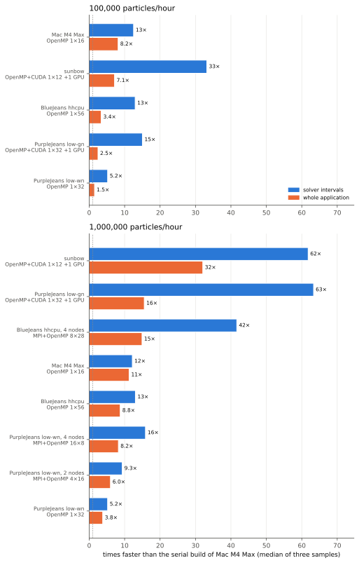

The figure is a measured computational diagnostic, not observational validation. [`backend_matrix_compare.py`](../examples/wacomm-sarno-lite/tools/backend_matrix_compare.py) selects, for each suite, the tuple with the shortest median application time. It divides that tuple's solver and application medians into the medians of the Mac serial build at the same release rate:

$$
X_\mathrm{solver}=\frac{T_\mathrm{Mac\,serial}}{T},\qquad X_\mathrm{app}=\frac{A_\mathrm{Mac\,serial}}{A},
$$

where $T$ is the solver time (s), $A$ the application wall time (s), and $X$ is dimensionless ("$X$× faster"). The reference times are $T=23.68$ s and $A=24.78$ s at $10^5$ particles/hour, and $236.2$ s and $237.9$ s at $10^6$. $X$ compares machines on one workload; it is not a parallel speedup, and the per-machine speedups and efficiencies below keep each machine's own serial run as denominator. The companion table is [`machine-speedup.json`](figures/backend-matrix-machines/machine-speedup.json).

| $q$ (particles/hour) | Machine | Fastest configuration | Solver × | Application × |
| ---: | --- | --- | ---: | ---: |
| $10^5$ | Mac M4 Max | OpenMP 1×16 | 12.5× | **8.2×** |
| | sunbow | OpenMP+CUDA 1×12, 1 GPU | **33.2×** | 7.1× |
| | BlueJeans, 1 node | OpenMP 1×56 | 13.0× | 3.4× |
| | PurpleJeans `low-gn` | OpenMP+CUDA 1×32, 1 GPU | 15.0× | 2.5× |
| | PurpleJeans `low-wn`, 1 node | OpenMP 1×32 | 5.2× | 1.5× |
| $10^6$ | sunbow | OpenMP+CUDA 1×12, 1 GPU | 61.8× | **32.1×** |
| | PurpleJeans `low-gn` | OpenMP+CUDA 1×32, 1 GPU | **63.3×** | 15.5× |
| | BlueJeans, 4 nodes | MPI+OpenMP 8×28 | 41.7× | 14.9× |
| | Mac M4 Max | OpenMP 1×16 | 12.2× | 11.3× |
| | BlueJeans, 1 node | OpenMP 1×56 | 13.0× | 8.8× |
| | PurpleJeans `low-wn`, 4 nodes | MPI+OpenMP 16×8 | 15.9× | 8.2× |
| | PurpleJeans `low-wn`, 2 nodes | MPI+OpenMP 4×16 | 9.3× | 6.0× |
| | PurpleJeans `low-wn`, 1 node | OpenMP 1×32 | 5.2× | 3.8× |

Findings:

1. **One RTX PRO 6000 gives the shortest run at $10^6$ particles/hour,** 32× faster than the Mac serial build end to end, twice the V100 and the four BlueJeans nodes.
2. **The two GPUs integrate equally fast, but the V100 run spends 11.6 s outside the solver against 3.6 s on sunbow.** At $10^6$ the V100 solver is 2% faster; end to end it is 2.1× slower. On PurpleJeans the forcing is read from shared storage, and the V100 forcing upload is slower ([C7 on the GPUs](#c7-on-the-gpus)).
3. **At $10^5$ particles/hour the Mac has the shortest application.** The GPUs integrate 1.2–2.7× faster than the Mac's 16 threads, but the Mac spends 1.2 s outside the solver and the other machines 2.8–11.9 s, so the solver advantage does not reach the application.
4. **On one node, BlueJeans and the Mac integrate at the same rate** (13.0× and 12.2–12.5×), with 56 Xeon cores against 12 performance and 4 efficiency cores.

### Results per machine

All figures in this subsection are measured model-execution diagnostics of the real Sarno forcing, without confidence intervals, produced by `sarno_backend_matrix.py collect`. Every one of the 508 samples, warm-ups included, passed the equivalence gate against its suite's serial build: exactly for CPU tuples, within the GPU health tolerance for CUDA tuples, and exactly for every gridded variable. Ranks and threads were bound to physical cores (`--bind`); SMT siblings stayed idle. Factors are speedups $S$ over the machine's own serial build; $E=S/(pn)$ is the CPU efficiency.

#### sunbow (RTX PRO 6000 Blackwell)

sunbow has no batch scheduler, so the suites ran from an interactive shell with no other user job; this is not an exclusive allocation. Suites `sunbow-q1e5` (23 tuples) and `sunbow-q1e6` (8 tuples) hold 124 samples; the serial references are 37.00 s and 368.5 s. The companion table is [`results-sunbow.json`](figures/backend-matrix-sunbow/results-sunbow.json).

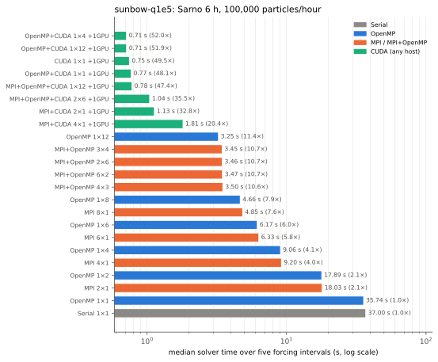

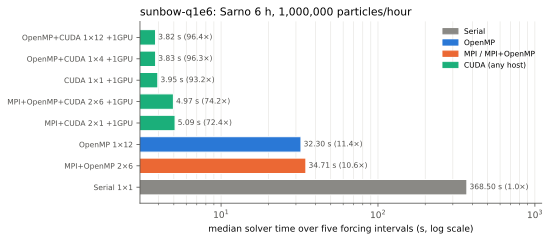

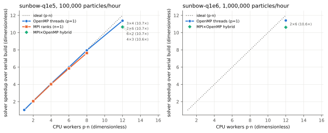

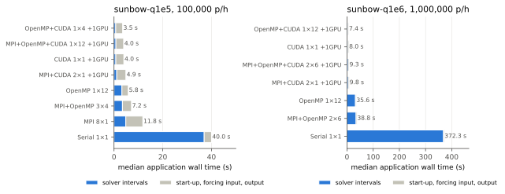

| $q$ | OpenMP 1×12 | MPI 8×1 | MPI+OpenMP 3×4 | CUDA 1×1 | OpenMP+CUDA 1×4 | MPI+CUDA 2×1 | MPI+CUDA 4×1 |
| ---: | ---: | ---: | ---: | ---: | ---: | ---: | ---: |
| $10^5$ | 11.4×, $E$=95% | 7.6×, 95% | 10.7×, 89% | 49.5× | **52.0×** | 32.8× | 20.4× |
| $10^6$ | 11.4×, 95% | – | 10.6×, 89% (2×6) | 93.3× | 96.3× | 72.4× | – |

OpenMP keeps 99% efficiency at 8 threads and 95% at 12; MPI keeps 95% at 8 ranks with the interleaved decomposition. All hybrid splits of the 12 cores lie within 1.2% of each other. Host threads make the CUDA build 3–5% faster (1×4 and 1×12 against 1×1). Every additional rank on the one GPU slows the solver: 1×1 49.5×, 2×1 32.8×, 4×1 20.4×.

#### PurpleJeans `low-gn` (4 × V100)

Suites `purplejeans-gn-q1e5` (19 tuples, job 19650) and `purplejeans-gn-q1e6` (9 tuples, job 19651) ran on exclusive nodes with all four GPUs allocated. A CUDA tuple with $g$ GPUs exposes devices $0,\dots,g-1$ to every rank. The serial references are 101.98 s and 1017.3 s. The companion table is [`results-purplejeans-gn.json`](figures/backend-matrix-purplejeans-gn/results-purplejeans-gn.json).

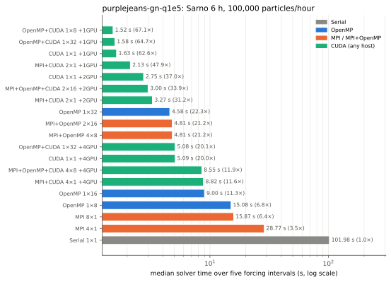

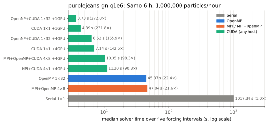

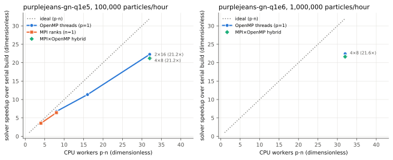

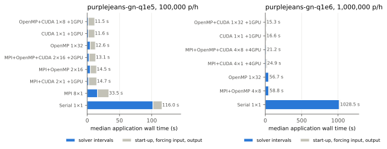

| $q$ | GPUs | CUDA 1×1 | OpenMP+CUDA 1×32 | MPI+CUDA | MPI+OpenMP+CUDA |
| ---: | ---: | ---: | ---: | ---: | ---: |
| $10^5$ | 1 | 62.6× | 64.7× (1×8: **67.1×**) | 47.9× (2×1, both ranks on one GPU) | – |
| | 2 | 37.0× | – | 31.2× (2×1) | 33.9× (2×16) |
| | 4 | 20.0× | 20.1× | 11.6× (4×1) | 11.9× (4×8) |
| $10^6$ | 1 | 231.8× | **272.8×** | – | – |
| | 4 | 142.5× | 155.9× | 90.8× (4×1) | 98.3× (4×8) |

**More GPUs make every CUDA tuple slower.** At $10^5$ particles/hour the CUDA solver takes 1.63 s on one GPU, 2.75 s on two, and 5.09 s on four. [C7 on the GPUs](#c7-on-the-gpus) traces this to the forcing upload. The CPU builds repeat the BlueJeans pattern on 32 cores: OpenMP efficiency is 85% at 8 threads, 71% at 16 (one socket), and 70% at 32.

#### PurpleJeans `low-wn` (CPU nodes, one to four nodes)

Suites `purplejeans-wn-q1e5` (15 tuples, job 19646), `purplejeans-wn-q1e6` (5 tuples, job 19647), and the two-node and four-node `purplejeans-wn-*node-q1e6` (3 tuples each, jobs 19673 and 19674) hold 100 samples. The serial references are 101.93 s and 1019.5 s. The companion table is [`results-purplejeans-wn.json`](figures/backend-matrix-purplejeans-wn/results-purplejeans-wn.json).

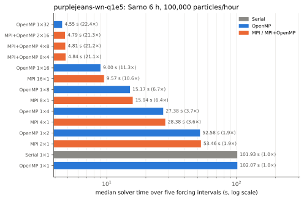

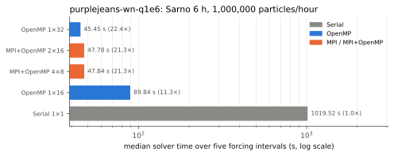

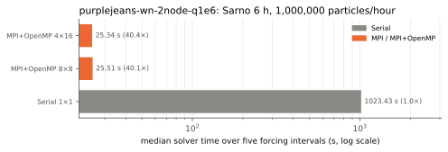

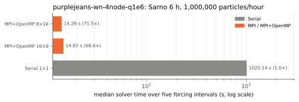

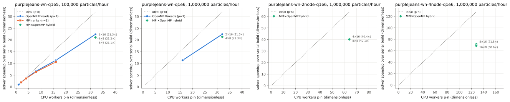

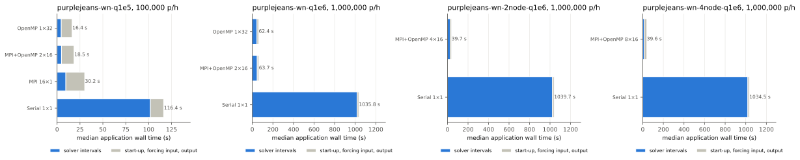

| $q$ | Nodes | OpenMP 1×16 | OpenMP 1×32 | MPI 16×1 | Best MPI+OpenMP |
| ---: | ---: | ---: | ---: | ---: | ---: |
| $10^5$ | 1 | 11.3×, $E$=71% | **22.4×**, 70% | 10.7×, 67% | 21.3×, 67% (2×16) |
| $10^6$ | 1 | 11.3×, 71% | **22.4×**, 70% | – | 21.3×, 67% (2×16) |
| | 2 | – | – | – | **40.4×**, 63% (4×16) |
| | 4 | – | – | – | **71.5×**, 56% (8×16) |

Relative to one node with OpenMP 1×32, two nodes integrate 1.79× and four nodes 3.19× faster. End to end the gain is 1.57× and 2.16× (16×8 has the shorter application, 28.9 s). The four-node 8×16 application range (28.9–39.6 s) is wide; the slowest sample is not attributed to a phase.

#### BlueJeans `hhcpu` (one and four nodes)

Suites `bluejeans-q1e5` (17 tuples, job 1085593), `bluejeans-q1e6` (4 tuples, job 1085594), and `bluejeans-4node-q1e6` (3 tuples, job 1085595) hold 96 samples. The serial references are 72.94 s and 729.0 s, within 0.3% of the [first pass](#results-on-hhcpu). The companion table is [`results-bluejeans.json`](figures/backend-matrix-bluejeans-ed8f731/results-bluejeans.json).

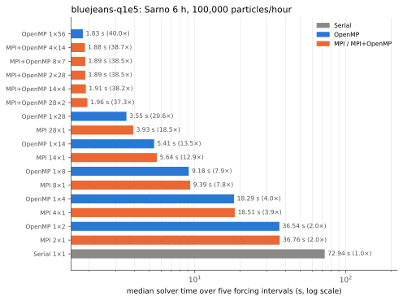

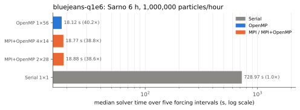

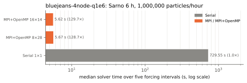

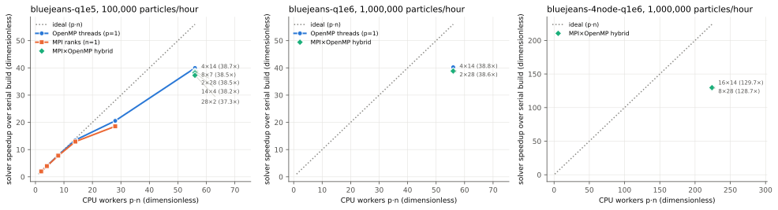

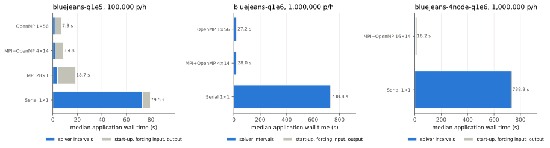

| $q$ | Nodes | OpenMP 1×14 | OpenMP 1×56 | MPI 14×1 | MPI 28×1 | MPI+OpenMP 4×14 | MPI+OpenMP 16×14 |
| ---: | ---: | ---: | ---: | ---: | ---: | ---: | ---: |
| $10^5$ | 1 | 13.5×, $E$=96% | **40.0×**, 71% | 12.9×, 92% | 18.5×, 66% | 38.7×, 69% | – |
| $10^6$ | 1 | – | **40.2×**, 72% | – | – | 38.8×, 69% | – |
| | 4 | – | – | – | – | – | **129.7×**, 58% |

Against the first pass at `5a49653`, MPI 28×1 rose from 54% to 66% efficiency, and four-node 16×14 integrates in 5.63 s instead of 7.43 s, as at `aa8378f` ([reruns](#reruns-after-the-first-improvements)). The full-socket OpenMP drop (96% at 14 threads, 73% at 28) is unchanged (computational item 6).

#### Apple M4 Max

Suites `mac-q1e5` and `mac-q1e6` hold 76 samples; the serial references are 23.68 s and 236.2 s. The companion table is [`results-mac.json`](figures/backend-matrix-mac-ed8f731/results-mac.json).

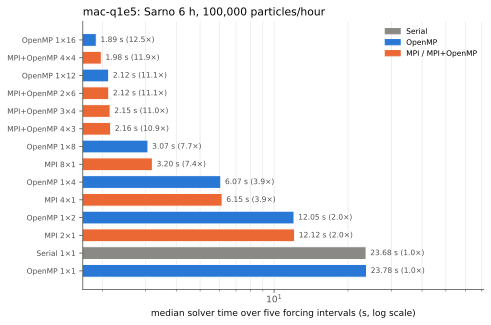

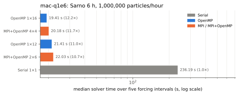

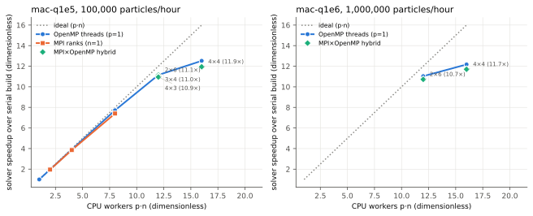

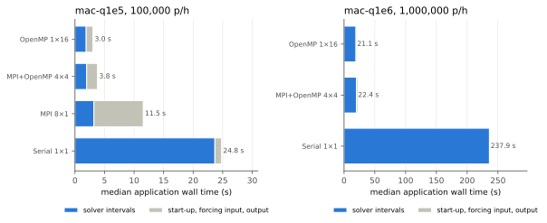

| $q$ | OpenMP 1×8 | OpenMP 1×12 | OpenMP 1×16 | MPI 2×1 | MPI 8×1 | MPI+OpenMP 4×4 |
| ---: | ---: | ---: | ---: | ---: | ---: | ---: |
| $10^5$ | 7.7×, $E$=96% | 11.1×, 93% | **12.5×** | 1.95×, 98% | 7.4×, 92% | 12.0× |
| $10^6$ | – | 11.0×, 92% | **12.2×** | – | – | 11.7× |

The interleaved decomposition raised two-rank MPI efficiency from 84% at `ffa9c18` to 98%. As before, the four efficiency cores add 10–12% beyond 12 threads, so efficiency above 12 workers is not a homogeneous-core measure.

### C7 on the GPUs

The rank-0 log reports `CUDA HOST2DEV sec:` for every window: the host time to allocate, when needed, and upload the device forcing. With C7 the first window uploads both records, and every later window copies the shared boundary record on the device and uploads one. The table gives one sample of each tuple at $10^5$ particles/hour; the other samples agree within 2%.

| Machine | Tuple | First window (s) | Each later window (s) | Upload per run (s) | Solver $T$ (s) | Upload share |
| --- | --- | ---: | ---: | ---: | ---: | ---: |
| sunbow | CUDA 1×1 | 0.149 | 0.048 | 0.34 | 0.75 | 46% |
| sunbow | MPI+CUDA 4×1, one GPU | 0.542 per rank | 0.185 per rank | 1.28 per rank | 1.81 | 71% |
| PurpleJeans | CUDA 1×1, 1 GPU | 0.427 | 0.187–0.205 | 1.20 | 1.63 | 74% |
| PurpleJeans | CUDA 1×1, 2 GPUs | 0.858 | 0.370–0.381 | 2.35 | 2.75 | 85% |
| PurpleJeans | CUDA 1×1, 4 GPUs | 1.725 | 0.741–0.757 | 4.71 | 5.09 | 93% |

1. **C7 works on both GPU generations.** Later windows upload one of two records and take 32% (sunbow) and 44% (V100) of the first window's time.
2. **The C7 acceptance target is met.** The target was a per-window fall by at least the share of unchanged records (one of two).
3. **The upload is now serial across devices.** `uploadForcing` sets each device in turn and copies the window to it with synchronous `cudaMemcpy` calls from pageable host memory. Upload time is therefore proportional to the number of GPUs. Solver time minus upload stays at 0.38–0.43 s for one, two, and four V100s: at $10^5$ particles/hour the particle work gains nothing from extra devices, while the upload grows linearly with them. Per-rank device selection and concurrent upload are computational items 10 and 11.
4. **Several ranks still contend for one GPU.** On sunbow four ranks upload 3.6× slower each than one rank, and MPI+CUDA 4×1 is 2.4× slower than CUDA 1×1.

### Best configurations at `ed8f731`

| Machine | $10^5$ particles/hour | $10^6$ particles/hour | Without the GPU |
| --- | --- | --- | --- |
| sunbow | OpenMP+CUDA 1×4 or 1×12, one rank | OpenMP+CUDA 1×12, one rank | OpenMP 1×12 |
| PurpleJeans `low-gn` | OpenMP+CUDA 1×8 or 1×32, **one GPU** | OpenMP+CUDA 1×32, **one GPU** | OpenMP 1×32 |
| PurpleJeans `low-wn` | OpenMP 1×32 | MPI+OpenMP 8×16 on 4 nodes (16×8 for the shortest application) | – |
| BlueJeans `hhcpu` | OpenMP 1×56 | MPI+OpenMP 16×14 (solver) or 8×28 (application) on 4 nodes; OpenMP 1×56 on one | – |
| Mac M4 Max | OpenMP 1×16 | OpenMP 1×16 | – |

Use `OMP_PLACES=cores OMP_PROC_BIND=close` everywhere. On GPU nodes, start one process per job and expose exactly one GPU (`CUDA_VISIBLE_DEVICES`) until items 10 and 11 are implemented; for independent runs, start one job per GPU. On multi-node PurpleJeans runs, set `OMPI_MCA_coll_hcoll_enable=0`.

## Improvement plan

Status: computational items 5 (revision `59f9b91`) and 1 (`32679ce`), the OpenMP packing step of item 2 (`e2c9a21`), and atomic-free concentration counting (`aa8378f`) are implemented. They were measured on `hhcpu` at revisions `94e9aa4` and `aa8378f` ([reruns](#reruns-after-the-first-improvements)). Items 1 and 5 meet their targets: an oversubscribed 28-rank launch under the 56 GiB default grant now stops before reading forcing with a logged WaComM++ error (job 1078221). Item 2 meets its efficiency target but not its time target, and its resident-particle step is not implemented. Item 9 is done (`a9345dc`) and item 4 is implemented without meeting its target ([lock handover and prefetch affinity](#lock-handover-and-prefetch-affinity)). Item 7 is implemented at `cd2a3bf` and meets its target on the RTX PRO 6000 and the V100 ([C7 on the GPUs](#c7-on-the-gpus)). Items 10–12 come from the [cross-platform pass](#cross-platform-pass-at-ed8f731). Every other item is planned and not implemented. Items are ordered by measured or documented impact. Physical and numerical items change the governing configuration: each needs a mathematical description with units, peer-reviewed support, backend-equivalence, forward/backward, and restart evidence, and documentation and example updates. The [Claude Code improvement plan](improvement-plan.md) restates every item as an executable task with files, tests, and acceptance criteria.

### Computational

1. **Balanced MPI decomposition (done, `32679ce`).** `Wacomm.cpp` scattered the particle vector in contiguous blocks, with the remainder on rank 0. Particles are stored in emission order, so rank 0 received the oldest particles, which integrate the full interval. On `hhcpu`, rank 0 ran 7% below the serial particle rate at two ranks and MPI efficiency was 83%, against 100% for two OpenMP threads. Particles are now assigned cyclically ($i \bmod p$), and the original order is restored on gather. The result is invariant because each update depends only on its own state and identity-keyed random numbers. Target: MPI and hybrid efficiency within 5 points of OpenMP at equal workers. Result: MPI 2×1 reached 99.3%, and one-node MPI+OpenMP 4×14 is within 1.5–4.4% of OpenMP 1×56 ([reruns](#reruns-after-the-first-improvements)).
2. **Shrink the serial rank-0 section (partly done).** Every solver interval runs source emission, particle packing, `MPI_Scatterv`, `MPI_Gatherv`, unpacking, dead-particle removal, and concentration on rank 0, plus a full scatter/gather of the population. Packing and unpacking run as OpenMP loops since `e2c9a21`, which also logs rank-0 distribution and collection times (`DISTRIBUTE sec:`, `COLLECT sec:`). Concentration counting no longer uses atomic updates since `aa8378f`. Four-node relative efficiency rose from 63% to 80.3%, and 16×14 at $10^6$ particles/hour takes 5.65 s against a 5.5 s target. The remaining step keeps particles resident on their ranks: send only new emissions, and gather states only at output cadence. The Sarno run writes histories and gridded counts every hour, and each forcing window is one interval, so states reach rank 0 every interval in any case. That step can therefore save at most part of the 0.37 s distribution time at 16×14, and it is deferred.
3. **Shared forcing per node.** Each rank holds 3.8–5.1 GiB of forcing. Read contention appears only with many ranks per node: at four ranks per node the slowest rank prepares its forcing in 4.86 s, as fast as one process (4.83 s), while 28 ranks per node take 10.49 s ([time outside the solver](#time-outside-the-solver)). Read each record once per node and expose it through an MPI-3 shared-memory window (`MPI_Win_allocate_shared`, Hoefler et al., 2013), or read on one rank and broadcast. This mainly benefits pure-MPI placements and memory per node; hybrid placements already avoid the contention. Target: node memory independent of ranks per node, and non-solver time within 20% of one-process input.
4. **Overlap forcing input with solving (implemented at `b2195ce`, `929b4a8`, and `d47c35c`; acceptance not met).** Outside the solver, forcing preparation takes 4.8 s and output 3.0 s of the 9.75 s OpenMP 1×56 run at $10^5$ particles/hour ([time outside the solver](#time-outside-the-solver)). Asynchronous output already hides most of the output, but it slows forcing preparation by 1.1 s. The [forcing preparation split](#forcing-preparation-split) shows that reading takes 2.2–2.5 s and the boundary-record append 2.3–2.4 s, while normalization is negligible. First make the boundary-record check and append contiguous (C9 in the [plan](improvement-plan.md)). Then prefetch window $k+1$ on a dedicated thread while interval $k$ integrates, using double-buffered adapter arrays. Overlap can hide at most the solver time, 1.8 s at $10^5$ particles/hour and about 3.6 s per interval at $10^6$. Restart and backward ordering must not change. C9 is done, and the prefetch is implemented as `io.prefetch=true` ([forcing prefetch](parallelism.md#forcing-prefetch)), which reads input $k\pm2$ on one thread while window $k$ integrates instead of double-buffering adapter arrays. It cuts time outside the solver by 8% for OpenMP 1×56 with synchronous output and none with asynchronous output, and slows the solver on fully used nodes ([forcing prefetch](#forcing-prefetch)). Releasing the lock to output between variable reads and unpinning the reading thread ([lock handover and prefetch affinity](#lock-handover-and-prefetch-affinity)) removed the solver slowdown, but time outside the solver falls by at most 10%: NetCDF reading and writing share one process-wide lock.
5. **Fail fast on resource limits (done, `59f9b91` and `83e6337`).** Particle counts and displacements are `int` in the scatter/gather path, and `(int)` casts truncated silently above $2^{31}-1$ particles: 1,000,000 particles/hour for 90 days is $2.16\times10^9$. Such runs now stop with an explicit error. At start-up, the estimated per-node forcing memory is compared with the cgroup or `MemAvailable` limit. Before this change, runs were killed by the out-of-memory handler, as in jobs 1077303–1077305. Under the 56 GiB default grant, a 28-rank launch now stops after 1.1 s with a logged estimate (job 1078221).
6. **NUMA placement and the full-socket drop.** OpenMP efficiency falls from 96% at 14 threads to 73% at 28 on one socket. Interleaving pages with `numactl --interleave=all` left it unchanged (71.2% against 71.4% at 56 threads), so page placement is not the cause. Measure memory bandwidth and clock with hardware counters before changing code.
7. **Persistent CUDA device state (done, `cd2a3bf`).** Each interval allocated the device forcing, copied all time records, and freed them again inside the solver interval (`CUDA HOST2DEV`). On rainbow that upload is 41% of the CUDA solver time at $10^5$ particles/hour and 10% at $10^6$, and with several ranks on one GPU each rank repeats it over the shared PCIe link ([rainbow results](#results-on-rainbow-cpu-and-cuda)). Allocate once per run and upload only the new forcing record. Also log a warning when more ranks than visible devices share a GPU. Target: `CUDA HOST2DEV` time per interval falls by at least the share of unchanged records, with particle results identical to the earlier CUDA build. The arrays now persist for the whole run, and the record shared by consecutive windows is copied on the device instead of uploaded ([CUDA device forcing](parallelism.md#cuda-device-forcing)). The other records of each window are still uploaded. Result at `ed8f731`: later windows take 32% (RTX PRO 6000) and 44% (V100) of the first window's upload, which meets the target ([C7 on the GPUs](#c7-on-the-gpus)).
8. **Heterogeneous-core awareness.** On hybrid-core CPUs, document a performance-cores-only default and report per-core-class efficiency.
9. **Contiguous boundary-record append and check (done, `7671ddd` and `a9345dc`).** For Sarno the append was the duplicate-record check, which strided through memory: 2.3–2.4 s per run, and 3.4 s with `io.async=true`. Comparing whole time records in storage order, in parallel under OpenMP, cut it to 0.12–0.22 s for multithreaded tuples, synchronous and asynchronous. Serial runs fell by 63%, and MPI 112×1 by 51%, below the 75% target ([contiguous boundary-record check](#contiguous-boundary-record-check)). The append itself now copies whole records once.

10. **One GPU per MPI rank.** Every rank selects devices $0,\dots,g-1$ of the GPUs it sees. With several ranks per node they all upload to, and launch on, the same devices. Assign each rank the device of its node-local rank (`MPI_Comm_split_type` with `MPI_COMM_TYPE_SHARED`, then local rank modulo device count), and keep the multi-device split only for ranks that own several devices. Target: MPI+CUDA 4×1 on four V100s at least as fast as CUDA 1×1 on one, with particle results unchanged within the GPU tolerance.
11. **Concurrent, pinned forcing upload.** `uploadForcing` copies each window to device 0, then 1, and so on, with synchronous `cudaMemcpy` from pageable memory. Upload time is therefore proportional to the device count: 1.20, 2.35, and 4.71 s per run for one, two, and four V100s, 74–93% of the CUDA solver at $10^5$ particles/hour ([C7 on the GPUs](#c7-on-the-gpus)). Upload to all devices concurrently, one host thread or stream per device, from page-locked staging buffers (`cudaHostRegister` or `cudaMallocHost`), and overlap the upload of window $k+1$ with the kernels of window $k$ where device memory allows. Target: upload time per run independent of the device count, and a multi-GPU tuple faster than one GPU at $10^6$ particles/hour.
12. **CUDA 13 compatibility.** `main.cpp` logs `cudaDeviceProp::memoryClockRate` and `memoryBusWidth`; the first no longer exists in CUDA 13. Read the clock with `cudaDeviceGetAttribute(..., cudaDevAttrMemoryClockRate, ...)`, which exists in CUDA 12 and 13, and add a CUDA 13 build to the GPU test matrix.

### Numerical

1. **Position-dependent zonal metric.** Evaluate $D_x$ at the particle latitude rather than on the cell's southern node line, removing the documented $\tan\phi\,\eta\,\Delta\phi$ relative bias ([model](model.md#metric-conversion-and-position-update)).
2. **Horizontal Courant check.** Add a validated warning or limiter when $|\Delta x|/D_x$ exceeds a declared fraction of a cell, with a step-convergence test.
3. **Higher-order boundary fallback.** Replace the first-order Euler fallback of the midpoint step near coasts and open boundaries with a clipped-stage midpoint, and verify the order with the sheared-current test.
4. **Application step-convergence study.** Bilinear and trilinear sampling has discontinuous derivatives at cell faces, so the midpoint step's formal second order is not guaranteed on real forcing (Nordam and Duran, 2020). Run the deterministic Sarno case at `physics.dti` of 120, 60, 30, and 15 s, and report endpoint separation against the finest step per halving. The backend-matrix scripts already provide the validated execution path.

### Physical

1. **Standard random-displacement vertical diffusion.** Offer $\sqrt{2K_v\Delta t}\,Z$ with the drift correction $\partial K_v/\partial z\,\Delta t$ as an opt-in operator (Visser, 1997), keeping the legacy form for reproduction of archived runs.
2. **Horizontal diffusivity in physical units.** The horizontal increment $\sigma Z\sqrt{\Delta t/\Delta t_0}$ is a displacement scale in metres tied to `dti`. Offer an opt-in $\sqrt{2K_h\Delta t}\,Z$ with $K_h$ in m$^2$ s$^{-1}$, constant or scale-dependent following Okubo (1971), and document the conversion from archived `sigma`.
3. **Time-dependent vertical coordinate.** The depth mapping uses $z_w=h\,|\sigma_w|$ without free-surface elevation or ROMS stretching ([model](model.md#vertical-coordinate-mapping)). Offer the full ROMS transform of $(\sigma,\zeta,h)$ (Shchepetkin and McWilliams, 2005) as explicit configuration, with a fixture for each stretching type.
4. **Shoreline interaction.** Add an explicit, documented beaching/refloating parameterization as a separate opt-in boundary operator instead of relying on reflection or constraint.

## Reproducibility

Revision `ffa9c18` with the working-tree patch archived in each suite's `provenance/suite.json`; binary and CMake-cache SHA-256, forcing checksums, configuration, and source definition are archived under `data/matrix-mac/mac-q*/provenance`. Mac command:

```bash
python3 -I examples/wacomm-sarno-lite/tools/sarno_backend_matrix.py run --root data/matrix-mac/mac-q100000 --rate 100000 --blocks 3 --forcing data/wacomm-sarno-lite --prune-snapshots --build serial=BUILD/wacommplusplus --config omp:1:16:0
```

The `hhcpu` suites ran on revision `5a49653` with the working-tree patch of this change, which is archived in each suite's `provenance/suite.json` together with binary and CMake-cache SHA-256 values, `lscpu`, `mpirun --version`, forcing checksums, configuration, and source definition. The forcing passed `sha256sum -c prepared-forcing.sha256` on the cluster. From the repository root on the `hhcpu` login node:

```bash
sbatch examples/wacomm-sarno-lite/tools/hhcpu_backend_test_job.sh
```

```bash
sbatch examples/wacomm-sarno-lite/tools/hhcpu_backend_matrix_job.sh 100000 hh-q100000 serial:1:1:0 omp:1:56:0 mpi:28:1:0 mpi-omp:4:14:0
```

```bash
sbatch --nodes=4 examples/wacomm-sarno-lite/tools/hhcpu_backend_matrix_job.sh 1000000 hh4-q1000000 serial:1:1:0 mpi-omp:16:14:0
```

```bash
python3 -I examples/wacomm-sarno-lite/tools/sarno_backend_matrix.py collect --suite hhcpu-q1e5=data/matrix-hhcpu/hh-q100000 --suite hhcpu-q1e6=data/matrix-hhcpu/hh-q1000000 --suite hhcpu-4node-q1e6=data/matrix-hhcpu/hh4-q1000000 --output docs/figures/backend-matrix-hhcpu
```

```bash
python3 -I examples/wacomm-sarno-lite/tools/backend_matrix_supplement.py docs/figures/backend-matrix-hhcpu/results-hhcpu.json docs/figures/backend-matrix-hhcpu --node-memory-gib 239 --default-memory-gib 56
```

The reruns use the suite roots `hh-q100000-REV`, `hh-q1000000-REV`, and `hh4-q1000000-REV`, with `REV` the short revision, and the tuples listed in [the reruns](#reruns-after-the-first-improvements). For revision `aa8378f`:

```bash
sbatch examples/wacomm-sarno-lite/tools/hhcpu_backend_matrix_job.sh 100000 hh-q100000-aa8378f serial:1:1:0 omp:1:56:0 mpi:2:1:0 mpi:4:1:0 mpi:28:1:0 mpi-omp:4:14:0
```

```bash
sbatch examples/wacomm-sarno-lite/tools/hhcpu_backend_matrix_job.sh 1000000 hh-q1000000-aa8378f serial:1:1:0 omp:1:56:0 mpi-omp:4:14:0
```

```bash
sbatch --nodes=4 examples/wacomm-sarno-lite/tools/hhcpu_backend_matrix_job.sh 1000000 hh4-q1000000-aa8378f serial:1:1:0 mpi-omp:16:14:0 mpi-omp:8:28:0
```

```bash
python3 -I examples/wacomm-sarno-lite/tools/sarno_backend_matrix.py collect --suite hhcpu-q1e5=data/matrix-hhcpu/hh-q100000-aa8378f --suite hhcpu-q1e6=data/matrix-hhcpu/hh-q1000000-aa8378f --suite hhcpu-4node-q1e6=data/matrix-hhcpu/hh4-q1000000-aa8378f --output data/matrix-hhcpu/collect-aa8378f
```

Each rerun suite archives its revision, with no working-tree patch, in `provenance/suite.json`. `sarno_backend_matrix.py run --io-async` sets `io.async=true` in the suite configuration, and `--interleave` runs every process under `numactl --interleave=all`. Both are recorded in `provenance/suite.json`, and a suite refuses to resume with other settings. The job script takes them from `WACOMM_MATRIX_OPTIONS`, for example:

```bash
WACOMM_MATRIX_OPTIONS=--interleave sbatch examples/wacomm-sarno-lite/tools/hhcpu_backend_matrix_job.sh 100000 hh-q100000-interleave serial:1:1:0 omp:1:56:0
```

From the revision that adds them, the collector also records the rank-0 `FORCING`, `SETUP`, `OUTPUT`, `FLUSH`, and `RUN` times described in [parallel execution](parallelism.md). From `9cd10e4`, it also records the forcing parts: NetCDF lock wait, ocean reads, ocean normalization, and boundary-record appends.

The [forcing preparation split](#forcing-preparation-split) at `9cd10e4` used these suites, each submitted after the previous one with `--dependency=afterok`:

```bash
sbatch examples/wacomm-sarno-lite/tools/hhcpu_backend_test_job.sh
sbatch examples/wacomm-sarno-lite/tools/hhcpu_backend_matrix_job.sh 100000 hh-q100000-9cd10e4 serial:1:1:0 omp:1:56:0 mpi-omp:4:14:0
WACOMM_MATRIX_OPTIONS=--io-async sbatch examples/wacomm-sarno-lite/tools/hhcpu_backend_matrix_job.sh 100000 hh-q100000-9cd10e4-async serial:1:1:0 omp:1:56:0 mpi-omp:4:14:0
sbatch --nodes=4 examples/wacomm-sarno-lite/tools/hhcpu_backend_matrix_job.sh 100000 hh4-q100000-9cd10e4 serial:1:1:0 mpi-omp:16:14:0 mpi:112:1:0
WACOMM_MATRIX_OPTIONS=--io-async sbatch --nodes=4 examples/wacomm-sarno-lite/tools/hhcpu_backend_matrix_job.sh 100000 hh4-q100000-9cd10e4-async serial:1:1:0 mpi-omp:16:14:0
python3 -I examples/wacomm-sarno-lite/tools/sarno_backend_matrix.py collect --suite sync=data/matrix-hhcpu/hh-q100000-9cd10e4 --suite async=data/matrix-hhcpu/hh-q100000-9cd10e4-async --suite 4node-sync=data/matrix-hhcpu/hh4-q100000-9cd10e4 --suite 4node-async=data/matrix-hhcpu/hh4-q100000-9cd10e4-async --output data/matrix-hhcpu/collect-9cd10e4 --no-figures
```

The [contiguous boundary-record check](#contiguous-boundary-record-check) repeated those four suites at `a9345dc`, with `9cd10e4` replaced by `a9345dc` in the suite names (jobs 1082992–1082996), and collected them into `data/matrix-hhcpu/collect-a9345dc`. The `7671ddd` suites `hh-q100000-7671ddd` and `hh-q100000-7671ddd-async` (jobs 1082912 and 1082913) were not collected; their four-node suites were cancelled.

The [forcing prefetch](#forcing-prefetch) suites ran at `b2195ce` with `WACOMM_MATRIX_OPTIONS=--io-prefetch` in place of no options and `WACOMM_MATRIX_OPTIONS="--io-async --io-prefetch"` in place of `--io-async`, with suffixes `-prefetch` and `-async-prefetch` in the suite names, the four-node synchronous suite adding `mpi:112:1:0` (jobs 1083152–1083156). They were collected together with the `a9345dc` suites into `data/matrix-hhcpu/collect-b2195ce`.

The [lock handover and prefetch affinity](#lock-handover-and-prefetch-affinity) suites ran at `d47c35c` (jobs 1083334–1083344). The one-node suites `hh-q100000-d47c35c{,-async,-prefetch}` used the tuples `serial:1:1:0 omp:1:56:0 mpi-omp:4:14:0`. The suites `hh-q100000-d47c35c-prefetch-spare` and `hh-q100000-d47c35c-async-prefetch-spare` used `serial:1:1:0 omp:1:55:0 mpi-omp:4:13:0`, with `WACOMM_MATRIX_OPTIONS="--io-prefetch --spare-cores=1"` and `"--io-async --io-prefetch --spare-cores=1"`. The four-node suites `hh4-q100000-d47c35c` with the same five suffixes used `serial:1:1:0` and `mpi-omp:16:14:0`, or `mpi-omp:16:13:0` with a spare core, submitted with `--nodes=4`. All ten were collected into `data/matrix-hhcpu/collect-d47c35c`. The affinity probe was a one-off read-only job and is not part of the repository; it printed `Cpus_allowed_list` of every task of the running process once per second.

The rainbow suites ran on revision `ffa9c18` with the dependency-cache patch, archived in each suite's `provenance/suite.json` together with binary and CMake-cache SHA-256 values, `nvidia-smi` and `lscpu` output, `mpirun --version`, forcing checksums, configuration, and source definition. The eight builds used the modules `sw/cmake-3.31.6 comps/gcc-13.3.0/openmpi-4.1.8 comps/nvidia/nvhpc-byo-compiler/25.3`, `OMPI_CXX=g++-13`, `CMAKE_CUDA_ARCHITECTURES=89`, and `-DWACOMM_DEPENDENCY_DOWNLOAD_DIR` pointing at one pre-seeded archive directory. The benchmark job (`sbatch --partition=gpu --exclusive --gres=gpu:1`) ran, for each rate, with one `--build NAME=build-NAME/wacommplusplus` per build and one `--config` per tuple listed in [`results-rainbow.json`](figures/backend-matrix-rainbow/results-rainbow.json):

```bash
python -I examples/wacomm-sarno-lite/tools/sarno_backend_matrix.py run --root rainbow-q100000 --rate 100000 --blocks 3 --forcing forcing --bind --prune-snapshots --build cuda=build-cuda/wacommplusplus --config cuda:1:1:1
```

The collector ran on rainbow, because each sample's validation record names its reference by absolute path:

```bash
python -I examples/wacomm-sarno-lite/tools/sarno_backend_matrix.py collect --suite rainbow-q1e5=$PWD/rainbow-q100000 --suite rainbow-q1e6=$PWD/rainbow-q1000000 --output collect-rainbow
```

The hhcpu matrix commands list a subset of each suite's tuples; the full lists are in the job output and in [`results-hhcpu.json`](figures/backend-matrix-hhcpu/results-hhcpu.json). The test job reads `WACOMM_PERL5LIB` for the extracted Perl modules and `WACOMM_PYTHON` for the figure interpreter.

The [cross-platform pass](#cross-platform-pass-at-ed8f731) ran revision `ed8f731` with the Perl-module check and [`backend_matrix_job.sh`](../examples/wacomm-sarno-lite/tools/backend_matrix_job.sh) in the working tree, archived in each suite's `provenance/suite.json`. The job script prints the revision, working-tree status, compilers, MPI, CMake, Python, `lscpu`, `nvcc`, `nvidia-smi` with PCI bus identifiers, and the Open MPI and Slurm environment. On PurpleJeans the runs used the earlier profile names `e4-gn` and `e4-wn`, so their build trees and suites are `build-e4-*` and `data/matrix-e4-{gn,wn}/`; the profiles are now `purplejeans-gn` and `purplejeans-wn`, with the same settings plus `OMPI_MCA_coll_hcoll_enable=0`. Each machine ran a test job and then its benchmark jobs, for example:

```bash
sbatch -p low-gn -N1 --ntasks-per-node=32 --exclusive --mem=0 --gres=gpu:tesla:4 examples/wacomm-sarno-lite/tools/backend_matrix_job.sh purplejeans-gn test
```

```bash
sbatch -p low-gn -N1 --ntasks-per-node=32 --exclusive --mem=0 --gres=gpu:tesla:4 examples/wacomm-sarno-lite/tools/backend_matrix_job.sh purplejeans-gn bench 100000 gn-ed8f731-q100000 serial:1:1:0 omp:1:32:0 cuda:1:1:1 cuda:1:1:4 omp-cuda:1:8:1 mpi-cuda:4:1:4
```

```bash
sbatch -p low-wn -N4 --ntasks-per-node=32 --exclusive --mem=0 examples/wacomm-sarno-lite/tools/backend_matrix_job.sh purplejeans-wn bench 1000000 wn4-ed8f731-nohcoll-q1000000 serial:1:1:0 mpi-omp:8:16:0 mpi-omp:16:8:0
```

```bash
examples/wacomm-sarno-lite/tools/backend_matrix_job.sh sunbow bench 1000000 sb-ed8f731-q1000000 serial:1:1:0 omp:1:12:0 cuda:1:1:1 omp-cuda:1:12:1
```

On BlueJeans the repository's `hhcpu` scripts ran with suite roots `hh-ed8f731-q100000`, `hh-ed8f731-q1000000`, and `hh4-ed8f731-q1000000` (jobs 1085592–1085595). Each suite was collected on its own machine with absolute suite paths, as above, and the machine comparison was drawn from the collected tables:

```bash
python3 -I examples/wacomm-sarno-lite/tools/backend_matrix_compare.py --reference "Mac M4 Max" --results "Mac M4 Max=docs/figures/backend-matrix-mac-ed8f731/results-mac.json" --results "sunbow=docs/figures/backend-matrix-sunbow/results-sunbow.json" --results "BlueJeans hhcpu=docs/figures/backend-matrix-bluejeans-ed8f731/results-bluejeans.json:bluejeans-q1e5,bluejeans-q1e6" --output docs/figures/backend-matrix-machines
```

This command lists three inputs; [`machine-speedup.json`](figures/backend-matrix-machines/machine-speedup.json) records every input of the full comparison, PurpleJeans and four-node suites included. The tuples of every suite are in its companion table.

## Limitations

One workload, three samples per tuple, and no confidence intervals. In the cross-platform pass, sunbow has no scheduler, so its suites did not run in an exclusive allocation; the machine comparison mixes forcing on local disk (Mac, sunbow) with forcing on shared file systems (PurpleJeans, BlueJeans), which accounts for much of the difference in time outside the solver. Its factors compare machines on one workload and are not parallel speedups. The rainbow suites at `ed8f731` are not yet reported, and the serial and OpenMP builds on sunbow were configured before the Perl-module check was added, which affects only configure. The reruns ran on whichever `hhcpu` nodes were free, so a revision-to-revision difference below about 0.5% is not separated from node and job variation. Threads are unpinned on macOS. On `hhcpu`, the forcing is read over NFS from a shared file system that other jobs may load. The 28-rank and 112-rank tuples were measured in a second job on the same nodes after the memory-limit fix, so they lie outside their original rotated blocks. Hardware counters, clocks, and energy were not recorded, so the full-socket efficiency loss is attributed to shared resources by elimination, not by measurement. The rainbow pass predates the MPI and concentration improvements, has one GPU, and therefore cannot measure MPI+CUDA with one rank per device. Its upload and particle terms come from rank-0 log lines with different clocks (host clock and CUDA events), and the small OpenMP+CUDA differences were not attributed to a phase.

## References

- Amdahl, G. M. (1967). Validity of the single processor approach to achieving large scale computing capabilities. *AFIPS Spring Joint Computer Conference*, 30, 483–485. [doi:10.1145/1465482.1465560](https://doi.org/10.1145/1465482.1465560).
- Hoefler, T., and Belli, R. (2015). Scientific benchmarking of parallel computing systems. *Proceedings of SC15*, article 73. [doi:10.1145/2807591.2807644](https://doi.org/10.1145/2807591.2807644).
- Hoefler, T., Dinan, J., Buntinas, D., Balaji, P., Barrett, B., Brightwell, R., Gropp, W., Kale, V., and Thakur, R. (2013). MPI + MPI: a new hybrid approach to parallel programming with MPI plus shared memory. *Computing*, 95(12), 1121–1136. [doi:10.1007/s00607-013-0324-2](https://doi.org/10.1007/s00607-013-0324-2).
- Nordam, T., and Duran, R. (2020). Numerical integrators for Lagrangian oceanography. *Geoscientific Model Development*, 13(12), 5935–5957. [doi:10.5194/gmd-13-5935-2020](https://doi.org/10.5194/gmd-13-5935-2020).
- Okubo, A. (1971). Oceanic diffusion diagrams. *Deep Sea Research and Oceanographic Abstracts*, 18(8), 789–802. [doi:10.1016/0011-7471(71)90046-5](https://doi.org/10.1016/0011-7471(71)90046-5).
- Shchepetkin, A. F., and McWilliams, J. C. (2005). The regional oceanic modeling system (ROMS): a split-explicit, free-surface, topography-following-coordinate oceanic model. *Ocean Modelling*, 9(4), 347–404. [doi:10.1016/j.ocemod.2004.08.002](https://doi.org/10.1016/j.ocemod.2004.08.002).
- Visser, A. W. (1997). Using random walk models to simulate the vertical distribution of particles in a turbulent water column. *Marine Ecology Progress Series*, 158, 275–281. [doi:10.3354/meps158275](https://doi.org/10.3354/meps158275).
