# Backend matrix evaluation and improvement plan (November 2026)

## Purpose and scope

This report records verification and performance passes over the execution backends of revision `ffa9c18` plus the dependency-cache change below, and of revision `5a49653` plus the build and benchmark-tool fixes described in [Issues found on hhcpu](#issues-found-on-hhcpu-and-their-fixes). It answers two computational questions: do all backend combinations build and pass the offline suite, and which resource configuration runs the six-hour Sarno workload fastest on each machine. Timings characterize implementation and hardware. They are not observational validation, and no physical equation, parameter, or default changed.

## Test matrix

| Machine | Builds | Result |
| --- | --- | --- |
| Apple M4 Max (12 performance + 4 efficiency cores, 64 GiB), macOS 26.6.2, AppleClang 21, Open MPI 5.0.11, libomp 23.1.2 | Serial, OpenMP, MPI, MPI+OpenMP | 35, 35, 36, and 38 tests passed; no skips (Python 3.12 with `tools/requirements-figures.txt`) |
| `hhcpu` partition, E4 cluster (4 nodes, each 2 × Intel Xeon Gold 5520+, 56 cores, no SMT, 2 NUMA domains, 239 GiB), Rocky Linux 8.10 kernel, GCC 12.2.1, Open MPI 4.1.4, CMake 3.26.5, Slurm 23.11.3 | Serial, OpenMP, MPI, MPI+OpenMP | At `5a49653`: 37, 37, 38, and 40 tests passed (Slurm job 1077295). At `25b716d` with this change: 38, 38, 39, and 41 passed (job 1077326). No skips (Python 3.13.2 with `tools/requirements-figures.txt`) |
| rainbow (Ryzen 9 9900X, RTX 4080 SUPER), GCC 13.3, Open MPI 4.1.8, CUDA 12.8 | Serial, OpenMP, MPI, MPI+OpenMP, CUDA, OpenMP+CUDA, MPI+CUDA, MPI+OpenMP+CUDA | **Pending.** Slurm job 1753 (tests, then `compute-sanitizer` memcheck) and job 1754 (benchmark, `afterany:1753`) are queued behind another user's job that holds all 24 CPUs of the only node |

The first rainbow attempt (job 1747) failed in all eight configures on a transient HTTP 504 from GitHub while fetching nlohmann/json. This is an infrastructure fault, not a code defect, but it exposed that every build tree downloads every pinned archive again. The fix is the opt-in `WACOMM_DEPENDENCY_DOWNLOAD_DIR` cache described in the [build guide](build.md): archives are fetched once, their pinned SHA-256 is verified before every reuse, and a pre-seeded directory lets configures proceed during an outage. The four Mac builds were reconfigured with the option and passed again.

## Benchmark method

The workload is the Sarno-lite six-hour run (native WaComM forcing prepared from ROMS, five forcing intervals, stochastic forward tracking, seed 5489) at a uniform release of $q$ particles/hour, $q\in\{10^5,10^6\}$. [`sarno_backend_matrix.py`](../examples/wacomm-sarno-lite/tools/sarno_backend_matrix.py) runs every (build, $p$ MPI ranks, $n$ OpenMP threads, $g$ GPUs) tuple once as a warm-up and in three rotated replicate blocks. Every sample is compared with the serial-build warm-up: particle states exactly for CPU tuples, within the documented GPU health tolerance for CUDA tuples, and every gridded variable exactly. All 144 Mac samples passed. Solver time $T$ (s) is the sum of the five rank-0 solver intervals, timed between MPI barriers; it excludes forcing input and output. Application time is the launcher wall time. The estimator is the median of the three measured samples. Speedup is $S=T_{\mathrm{serial}}/T$ and CPU efficiency is $E=S/(pn)$, both dimensionless. On macOS ranks and threads are not pinned, and the efficiency cores are slower than performance cores, so efficiency above 12 workers is not a homogeneous-core measure.

## Results on the Apple M4 Max

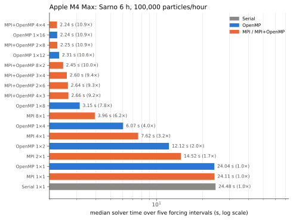

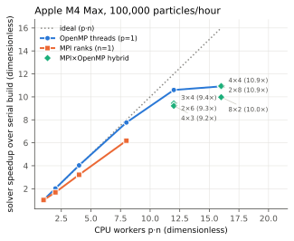

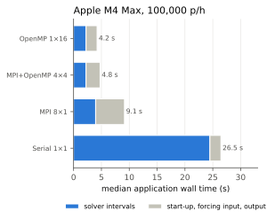

All three figures are measured model-execution diagnostics of the real Sarno forcing; the companion tables are [`results-m4max-q100000.json`](figures/backend-matrix/results-m4max-q100000.json) and [`results-m4max-q1000000.json`](figures/backend-matrix/results-m4max-q1000000.json).

| $q$ (particles/hour) | Serial $T$ (s) | OpenMP 1×8 | OpenMP 1×12 | OpenMP 1×16 | MPI 8×1 | MPI+OpenMP 4×4 |
| ---: | ---: | ---: | ---: | ---: | ---: | ---: |
| $10^5$ | 24.49 | 3.15 s, $E$=97% | 2.31 s, 88% | 2.24 s, 68% | 3.96 s, 77% | 2.24 s, 68% |
| $10^6$ | 237.7 | – | 23.39 s, 85% | 22.35 s, 66% | 39.41 s, 75% | 22.83 s, 65% |

Findings:

1. OpenMP scales almost ideally on the performance cores (101% at 4 threads, 97% at 8). Adding the four efficiency cores gains only 3–5%.
2. MPI alone is 20–25 points less efficient than OpenMP at equal worker count (84% at 2 ranks, 77% at 8). Rank 0's own particle block took 0.37 s of a 0.53 s interval at 8 ranks; the remainder is scatter, gather, packing, and waiting for slower ranks under the static contiguous partition.
3. Every rank holds the full forcing: 4.2 GiB resident per rank at $10^5$ and 5.8–6.5 GiB at $10^6$. Eight ranks need about 35–50 GiB, which caps the usable rank count on 64 GiB machines, and the parallel forcing reads raise 8-rank application time to 9.1 s against 4.0 s of solver.

**Best Mac configurations.** At $10^5$ particles/hour, OpenMP 1×16 (2.24 s) and MPI+OpenMP 4×4 (2.24 s) tie within their sample ranges; OpenMP 1×16 has the shortest application time (4.2 s). At $10^6$ particles/hour, OpenMP 1×16 is fastest (22.3 s, 10.6×). For throughput per core, OpenMP 1×12 on the performance cores is the efficient choice. MPI is not needed on one Mac node.

The earlier rainbow physical-core sweep ([Sarno performance evaluation](../examples/wacomm-sarno-lite/docs/performance-evaluation.md)) measured 12-thread CPU efficiency of 90–93% and one GPU 2.8× faster than twelve cores at $10^5$ and 4.8× faster at $10^6$. The MPI, MPI+CUDA, and MPI+OpenMP+CUDA rainbow tuples of this matrix are what jobs 1753/1754 will add.

## Issues found on hhcpu and their fixes

The `hhcpu` pass exposed five defects or omissions. None changed an equation, parameter, default, or result; each was fixed and the affected step repeated.

1. **Private OpenSSL needs Perl core modules.** OpenSSL 3.5.8 `Configure` loads `IPC::Cmd`, which in turn loads `ExtUtils::MM::Utils` inside `can_run`. Rocky Linux ships both outside the `perl` package (`perl-core`), so the first build failed deep inside the OpenSSL sub-build. [`cmake/WacommDependencies.cmake`](../cmake/WacommDependencies.cmake) now checks the modules, including the `can_run` call, during configuration and names the missing ones. On `hhcpu` the signed Rocky packages were extracted with `rpm2cpio` and placed on `PERL5LIB`; the [build guide](build.md#serial-build-with-private-openssl) documents the procedure.
2. **MPI tests need Slurm task slots.** With `--ntasks=1 --cpus-per-task=56`, Open MPI saw one slot and the two-rank `application_end_to_end`, `mpi_decomposition_parity`, and `mpi_openmp_multi_worker_parity` cases failed. The job scripts request `--ntasks-per-node=56`.
3. **NetCDF utilities for workflow fixtures.** The private NetCDF builds no utilities, so `webinar_roms_workflow` skipped for lack of `ncgen`/`ncdump`. The test job loads the site NetCDF module for CTest only; it is not linked into the application.
4. **Benchmark binaries were relative paths.** [`sarno_backend_matrix.py`](../examples/wacomm-sarno-lite/tools/sarno_backend_matrix.py) launched each sample inside its own directory with the path given on the command line. It now resolves binaries to absolute paths and refuses non-executable ones before preparing a suite.
5. **Multi-node placement and the scheduler memory default.** Under Slurm, Open MPI 4.1.4 binds `--map-by slot:PE=n` against one CPU per remote daemon and refuses multi-node bound runs. The tool's new `--nodes N` option uses `--map-by ppr:(p/N):node:PE=n`, which places equal rank counts per node, and rejects uneven placements. The `hhcpu` partition also grants 1 GiB per allocated CPU (56 GiB per node) unless `--mem` is given. Every 28-rank-per-node sample was killed by the cgroup out-of-memory handler at that limit, although the node has 239 GiB. Both job scripts now request `--mem=0`, and only the killed samples were repeated (jobs 1077321–1077323).

The job scripts are [`hhcpu_backend_test_job.sh`](../examples/wacomm-sarno-lite/tools/hhcpu_backend_test_job.sh) and [`hhcpu_backend_matrix_job.sh`](../examples/wacomm-sarno-lite/tools/hhcpu_backend_matrix_job.sh).

## Results on hhcpu

Three suites use the Sarno benchmark method above with `--bind` (ranks on consecutive physical cores, `OMP_PLACES=cores`, `OMP_PROC_BIND=close`) on exclusive nodes. The forcing is read from the NFS-mounted `/home`. Suite `hhcpu-q1e5` (one node, 18 tuples, job 1077303) and `hhcpu-q1e6` (one node, 8 tuples, job 1077304) ran concurrently on separate nodes. Suite `hhcpu-4node-q1e6` (four nodes, 6 tuples, job 1077305) followed. After the memory-limit rerun, all 96 measured samples and 32 warm-ups passed the equivalence gate against the serial build: particle states exactly, every gridded variable exactly. Each suite runs its own serial reference: 73.10 s at $10^5$ particles/hour, 731.2 s and 730.4 s at $10^6$. Solver time is linear in the particle count to within 0.03%.

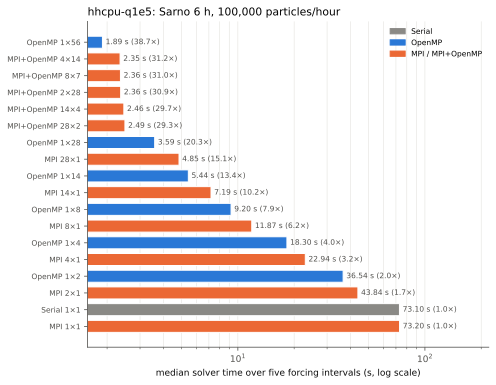

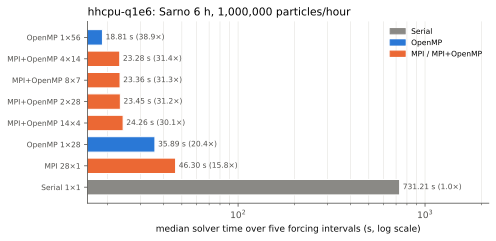

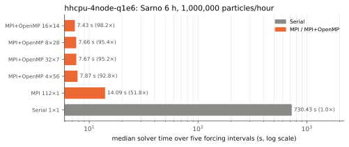

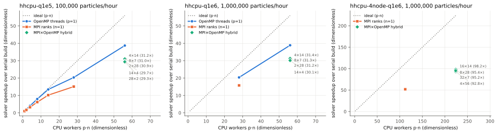

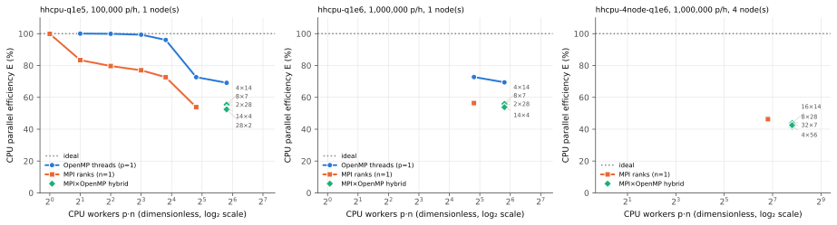

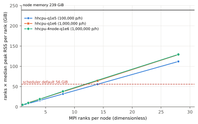

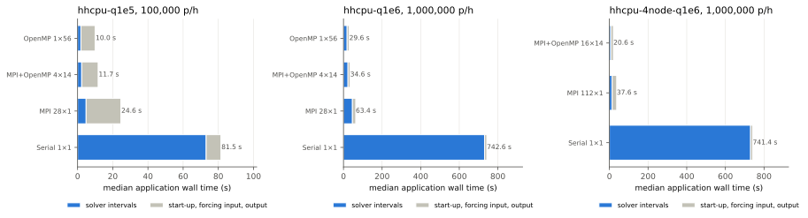

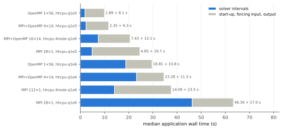

All eight figures are measured model-execution diagnostics of the real Sarno forcing, without confidence intervals. The first four and `application-breakdown` come from `sarno_backend_matrix.py collect`; `cpu-efficiency`, `memory-per-node`, and `application-split` come from [`backend_matrix_supplement.py`](../examples/wacomm-sarno-lite/tools/backend_matrix_supplement.py). The memory figure multiplies ranks per node by the median peak resident set of one rank. That product overestimates node demand, because shared library and page-cache pages are counted once per rank. Hybrid 14×4 tuples, with an estimated 64 GiB, completed inside the 56 GiB cgroup. The companion table is [`results-hhcpu.json`](figures/backend-matrix-hhcpu/results-hhcpu.json).

| $q$ (particles/hour) | Serial $T$ (s) | OpenMP 1×14 | OpenMP 1×28 | OpenMP 1×56 | MPI 28×1 | MPI+OpenMP 4×14 | 4 nodes, MPI+OpenMP 16×14 |
| ---: | ---: | ---: | ---: | ---: | ---: | ---: | ---: |
| $10^5$ | 73.10 | 5.44 s, $E$=96% | 3.59 s, 73% | **1.89 s**, 69% | 4.85 s, 54% | 2.35 s, 56% | – |
| $10^6$ | 731.2 | – | 35.89 s, 73% | **18.81 s**, 69% | 46.30 s, 56% | 23.28 s, 56% | **7.43 s**, 44% |

Findings:

1. **OpenMP is the efficient on-node decomposition.** It is ideal through 8 threads (99–100%) and keeps 96% at 14 threads. Efficiency drops to 73% at 28 threads (one full socket) and 69% at 56. The MPI rank-0 particle rate falls by a similar fraction at 28 ranks (17,600 against 25,300 particles/s serial), so the loss is a shared-resource effect of the full socket (memory bandwidth or all-core clock), not OpenMP overhead. Separating the two needs hardware counters, which this pass did not record.
2. **MPI loses 17 points at two ranks.** At two ranks, efficiency is already 83%. In the last interval, rank 0 processed its 264,358 particles at 23,458 particles/s, against the serial average of 25,309. The static contiguous partition gives rank 0 the oldest particles, which integrate the whole interval, while the newest particles, emitted part-way through, land on the last rank. The OpenMP loop avoids this imbalance with dynamic scheduling. Every hybrid placement on one node is 24–32% slower than OpenMP 1×56 for the same reason.
3. **Forcing replication limits ranks and inflates input time.** Every rank holds the full forcing, 3.8–5.1 GiB. The time outside the solver grows from 8.1 s (OpenMP 1×56, $10^5$) to 19.7 s with 28 ranks reading the same NFS files, and to 23.5 s for 112 ranks on four nodes. At $10^5$ particles/hour, 81% of the fastest application run is outside the solver.
4. **Four nodes give 2.5× on the solver and 1.5× on the application.** The 16×14 placement is 2.53× faster than one-node OpenMP 1×56 on four times the cores, an inter-node relative efficiency of 63%. All four hybrid placements lie within 7.4–7.9 s. Application time falls only from 29.6 s to 19.9 s (8×28), because forcing input dominates.

**Best hhcpu configurations.** On one node, use OpenMP 1×56 with `OMP_PLACES=cores OMP_PROC_BIND=close` at both rates: it is the fastest solver and the fastest application (9.9 s and 29.6 s). Pure MPI and on-node hybrid placements are slower and multiply memory. For independent ensemble members, four concurrent 14-thread runs per node have the best throughput per core ($E$=96%). For the shortest time to solution at $10^6$ particles/hour, use four nodes with MPI+OpenMP 16×14 (4 ranks/node, solver 7.43 s) or 8×28 (2 ranks/node, the fastest application at 19.9 s), always with `--mem=0`. Pure MPI with many ranks per node is never the best choice on this machine.

## Improvement plan

Every item below is planned and has not been implemented. Items are ordered by measured or documented impact. Physical and numerical items change the governing configuration: each needs a mathematical description with units, peer-reviewed support, backend-equivalence, forward/backward, and restart evidence, and documentation and example updates. The [Claude Code improvement plan](improvement-plan.md) restates every item as an executable task with files, tests, and acceptance criteria.

### Computational

1. **Balanced MPI decomposition.** `Wacomm.cpp` scatters the particle vector in contiguous blocks, with the remainder on rank 0. Particles are stored in emission order, so rank 0 receives the oldest particles, which integrate the full interval. On `hhcpu`, rank 0 ran 7% below the serial particle rate at two ranks and MPI efficiency was 83%, against 100% for two OpenMP threads. Assign particles cyclically ($i \bmod p$) or by a cost estimate (remaining interval time), and restore the original order on gather. The result is invariant because each update depends only on its own state and identity-keyed random numbers. Target: MPI and hybrid efficiency within 5 points of OpenMP at equal workers. Evidence: `mpi_decomposition_parity` and `application_end_to_end` unchanged and exact; matrix rerun.
2. **Shrink the serial rank-0 section.** Every solver interval runs source emission, particle packing, `MPI_Scatterv`, `MPI_Gatherv`, unpacking, dead-particle removal, and concentration on rank 0, plus a full scatter/gather of the population. Parallelize packing and unpacking with OpenMP. Then keep particles resident on their ranks: send only new emissions, and gather states only at output cadence. This is the Amdahl term that limits four-node scaling to 63% relative efficiency.
3. **Shared forcing per node.** Each rank holds 3.8–5.1 GiB of forcing, and its non-solver time grew from 8.1 s (one process) to 19.7 s (28 ranks) and 23.5 s (112 ranks). Read each record once per node and expose it through an MPI-3 shared-memory window (`MPI_Win_allocate_shared`, Hoefler et al., 2013), or read on one rank and broadcast. Target: node memory independent of ranks per node, and non-solver time within 20% of one-process input.
4. **Overlap forcing input with solving.** At $10^5$ particles/hour, 81% of the fastest application run is outside the solver. These timings predate asynchronous output (`io.async`, revision `d960e54`), so first re-measure with it enabled to separate output from input. Then prefetch record $k+1$ on a dedicated thread while interval $k$ integrates, using double-buffered adapter arrays. Restart and backward ordering must not change.
5. **Fail fast on resource limits.** Particle counts and displacements are `int` in the scatter/gather path, and `(int)` casts truncate silently above $2^{31}-1$ particles: 1,000,000 particles/hour for 90 days is $2.16\times10^9$. Reject such runs with an explicit error, or move to MPI-4 large-count calls. At start-up, compare the estimated per-node forcing memory with the cgroup or `MemAvailable` limit and fail with a message, rather than being killed by the out-of-memory handler as in jobs 1077303–1077305.
6. **NUMA placement and the full-socket drop.** OpenMP efficiency falls from 96% at 14 threads to 73% at 28 on one socket. Forcing arrays are first-touched by one thread, so at 56 threads half the cores read remote memory. Measure memory bandwidth and clock with hardware counters, then test parallel first-touch initialization or `numactl --interleave=all` against the archived timings.
7. **Persistent CUDA device state.** Each interval currently allocates the device forcing, copies all time records, and frees them again inside the solver interval (`CUDA HOST2DEV`). Allocate once per run and upload only the new forcing record. This should dominate GPU-time gains at small $q$.
8. **Heterogeneous-core awareness.** On hybrid-core CPUs, document a performance-cores-only default and report per-core-class efficiency.

### Numerical

1. **Position-dependent zonal metric.** Evaluate $D_x$ at the particle latitude rather than on the cell's southern node line, removing the documented $\tan\phi\,\eta\,\Delta\phi$ relative bias ([model](model.md#metric-conversion-and-position-update)).
2. **Horizontal Courant check.** Add a validated warning or limiter when $|\Delta x|/D_x$ exceeds a declared fraction of a cell, with a step-convergence test.
3. **Higher-order boundary fallback.** Replace the first-order Euler fallback of the midpoint step near coasts and open boundaries with a clipped-stage midpoint, and verify the order with the sheared-current test.
4. **Application step-convergence study.** Bilinear and trilinear sampling has discontinuous derivatives at cell faces, so the midpoint step's formal second order is not guaranteed on real forcing (Nordam and Duran, 2020). Run the deterministic Sarno case at `physics.dti` of 120, 60, 30, and 15 s, and report endpoint separation against the finest step per halving. The backend-matrix scripts already provide the validated execution path.

### Physical

1. **Standard random-displacement vertical diffusion.** Offer $\sqrt{2K_v\Delta t}\,Z$ with the drift correction $\partial K_v/\partial z\,\Delta t$ as an opt-in operator (Visser, 1997), keeping the legacy form for reproduction of archived runs.
2. **Horizontal diffusivity in physical units.** The horizontal increment $\sigma Z\sqrt{\Delta t/\Delta t_0}$ is a displacement scale in metres tied to `dti`. Offer an opt-in $\sqrt{2K_h\Delta t}\,Z$ with $K_h$ in m$^2$ s$^{-1}$, constant or scale-dependent following Okubo (1971), and document the conversion from archived `sigma`.
3. **Time-dependent vertical coordinate.** The depth mapping uses $z_w=h\,|\sigma_w|$ without free-surface elevation or ROMS stretching ([model](model.md#vertical-coordinate-mapping)). Offer the full ROMS transform of $(\sigma,\zeta,h)$ (Shchepetkin and McWilliams, 2005) as explicit configuration, with a fixture for each stretching type.
4. **Shoreline interaction.** Add an explicit, documented beaching/refloating parameterization as a separate opt-in boundary operator instead of relying on reflection or constraint.

## Reproducibility

Revision `ffa9c18` with the working-tree patch archived in each suite's `provenance/suite.json`; binary and CMake-cache SHA-256, forcing checksums, configuration, and source definition are archived under `data/matrix-mac/mac-q*/provenance`. Mac command:

```bash
python3 -I examples/wacomm-sarno-lite/tools/sarno_backend_matrix.py run --root data/matrix-mac/mac-q100000 --rate 100000 --blocks 3 --forcing data/wacomm-sarno-lite --prune-snapshots --build serial=BUILD/wacommplusplus --config omp:1:16:0
```

The `hhcpu` suites ran on revision `5a49653` with the working-tree patch of this change, which is archived in each suite's `provenance/suite.json` together with binary and CMake-cache SHA-256 values, `lscpu`, `mpirun --version`, forcing checksums, configuration, and source definition. The forcing passed `sha256sum -c prepared-forcing.sha256` on the cluster. From the repository root on the `hhcpu` login node:

```bash
sbatch examples/wacomm-sarno-lite/tools/hhcpu_backend_test_job.sh
```

```bash
sbatch examples/wacomm-sarno-lite/tools/hhcpu_backend_matrix_job.sh 100000 hh-q100000 serial:1:1:0 omp:1:56:0 mpi:28:1:0 mpi-omp:4:14:0
```

```bash
sbatch --nodes=4 examples/wacomm-sarno-lite/tools/hhcpu_backend_matrix_job.sh 1000000 hh4-q1000000 serial:1:1:0 mpi-omp:16:14:0
```

```bash
python3 -I examples/wacomm-sarno-lite/tools/sarno_backend_matrix.py collect --suite hhcpu-q1e5=data/matrix-hhcpu/hh-q100000 --suite hhcpu-q1e6=data/matrix-hhcpu/hh-q1000000 --suite hhcpu-4node-q1e6=data/matrix-hhcpu/hh4-q1000000 --output docs/figures/backend-matrix-hhcpu
```

```bash
python3 -I examples/wacomm-sarno-lite/tools/backend_matrix_supplement.py docs/figures/backend-matrix-hhcpu/results-hhcpu.json docs/figures/backend-matrix-hhcpu --node-memory-gib 239 --default-memory-gib 56
```

The matrix commands list a subset of each suite's tuples; the full lists are in the job output and in [`results-hhcpu.json`](figures/backend-matrix-hhcpu/results-hhcpu.json). The test job reads `WACOMM_PERL5LIB` for the extracted Perl modules and `WACOMM_PYTHON` for the figure interpreter.

## Limitations

One workload, three samples per tuple, and no confidence intervals. Threads are unpinned on macOS. On `hhcpu`, the forcing is read over NFS from a shared file system that other jobs may load. The 28-rank and 112-rank tuples were measured in a second job on the same nodes after the memory-limit fix, so they lie outside their original rotated blocks. Hardware counters, clocks, and energy were not recorded, so the full-socket efficiency loss is attributed to shared resources by elimination, not by measurement. The rainbow matrix and all CUDA tuples are not yet measured in this pass.

## References

- Amdahl, G. M. (1967). Validity of the single processor approach to achieving large scale computing capabilities. *AFIPS Spring Joint Computer Conference*, 30, 483–485. [doi:10.1145/1465482.1465560](https://doi.org/10.1145/1465482.1465560).
- Hoefler, T., and Belli, R. (2015). Scientific benchmarking of parallel computing systems. *Proceedings of SC15*, article 73. [doi:10.1145/2807591.2807644](https://doi.org/10.1145/2807591.2807644).
- Hoefler, T., Dinan, J., Buntinas, D., Balaji, P., Barrett, B., Brightwell, R., Gropp, W., Kale, V., and Thakur, R. (2013). MPI + MPI: a new hybrid approach to parallel programming with MPI plus shared memory. *Computing*, 95(12), 1121–1136. [doi:10.1007/s00607-013-0324-2](https://doi.org/10.1007/s00607-013-0324-2).
- Nordam, T., and Duran, R. (2020). Numerical integrators for Lagrangian oceanography. *Geoscientific Model Development*, 13(12), 5935–5957. [doi:10.5194/gmd-13-5935-2020](https://doi.org/10.5194/gmd-13-5935-2020).
- Okubo, A. (1971). Oceanic diffusion diagrams. *Deep Sea Research and Oceanographic Abstracts*, 18(8), 789–802. [doi:10.1016/0011-7471(71)90046-5](https://doi.org/10.1016/0011-7471(71)90046-5).
- Shchepetkin, A. F., and McWilliams, J. C. (2005). The regional oceanic modeling system (ROMS): a split-explicit, free-surface, topography-following-coordinate oceanic model. *Ocean Modelling*, 9(4), 347–404. [doi:10.1016/j.ocemod.2004.08.002](https://doi.org/10.1016/j.ocemod.2004.08.002).
- Visser, A. W. (1997). Using random walk models to simulate the vertical distribution of particles in a turbulent water column. *Marine Ecology Progress Series*, 158, 275–281. [doi:10.3354/meps158275](https://doi.org/10.3354/meps158275).
