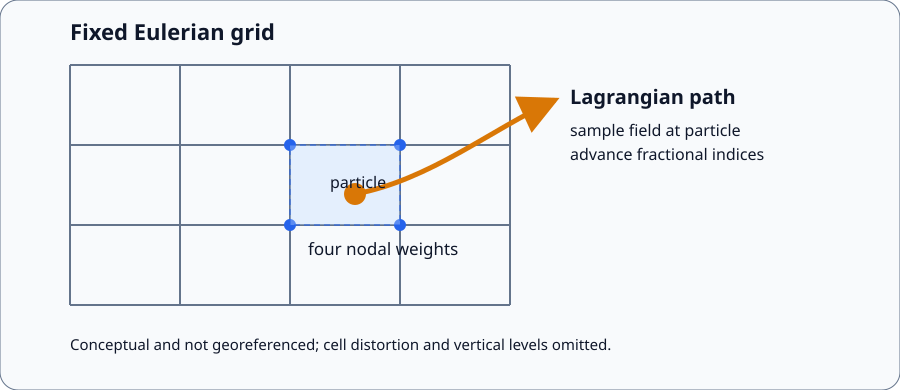
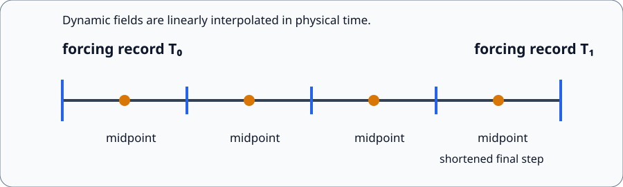
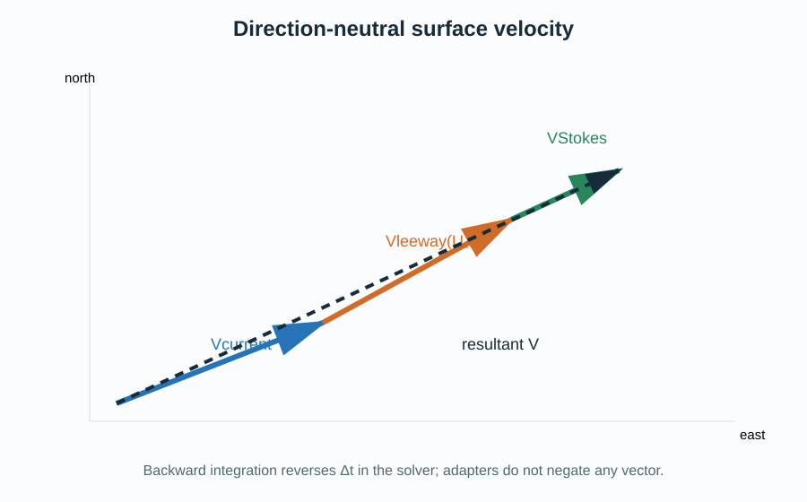
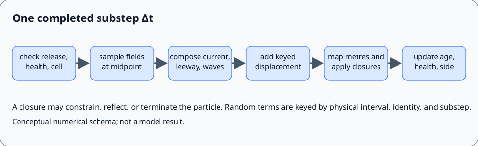

# Physical and numerical model

The [native webinar protocol](../examples/webinar-native-usecase/docs/performance-evaluation.md) exercises the common forward passive model over 24 hourly intervals from 2026-09-15 00:00 to 2026-09-16 00:00 UTC. Its ROMS preprocessing step is dry; performance-rate sweeps preserve physical parameters, random source placement, seed and output cadence and require independent numerical equivalence.

The [ROMS webinar download example](../examples/webinar-roms-usecase-download/docs/webinar-roms-usecase-download.md) exercises forcing normalization and serialization in dry mode. Particle integration, stochastic evolution, and restart trajectories are not executed; its timing evidence concerns preprocessing only.

WaComM++ is an offline Lagrangian transport model. It follows discrete computational particles through velocity and diffusivity fields supplied by Eulerian ocean products; optionally it adds wind-induced leeway and surface Stokes drift. A computational particle is a carrier of position, identity, age, health, release time, and object state. It is not necessarily one molecule, organism, person, or unit mass. Any mapping from particles to a physical inventory belongs to the experiment definition and must be reported with the source and concentration conventions.

This page is the normative overview of the implemented equations. Product normalization is specified in [adapters](adapters.md), surface-object parameterization in [surface drift](sar-drift.md), configuration names in [configuration](configuration.md), temporal inversion in [backtracking](backtracking.md), and continuation in [restart](restart.md).

The figure is a conceptual, non-georeferenced schema. The environmental model supplies values at fixed grid locations; WaComM++ samples those values at a moving fractional grid position and advances that position. It does not solve the Eulerian tracer advection–diffusion equation on a concentration grid.

## ROMS vector normalization

ROMS horizontal velocities are normalized before the shared solver: the existing
wet-face averages are rotated by the declared rho-point angle into east/north.
The [adapter equations and input contract](adapters.md#roms-horizontal-vector-basis)
define the signs, units, missing-data policy and explicit Earth-relative bypass.
This is a coordinate-basis operation, not backward-time policy or an additional
force (Shchepetkin and McWilliams, 2005). All execution backends receive these
same normalized fields; old native forcing produced without rotation must be
regenerated before comparing trajectories or performance. A corrected-forcing
restart must originate from a corrected-forcing trajectory.

## Lagrangian formulation

Let the physical position of particle $p$ be $\boldsymbol{x}_p(t)=(x_p,y_p,z_p)$ in metres in a local east–north–vertical basis. The deterministic trajectory is the characteristic of the resolved velocity field,

$$
\frac{\mathrm{d}\boldsymbol{x}_p}{\mathrm{d}t}=\boldsymbol{V}(\boldsymbol{x}_p,t)=\boldsymbol{u}_o+\boldsymbol{u}_\ell+\boldsymbol{u}_s+w_t\boldsymbol{e}_z,
$$

where $\boldsymbol{u}_o=(u_o,v_o,w_o)$ is ocean velocity in m s$^{-1}$, $\boldsymbol{u}_\ell=(u_\ell,v_\ell,0)$ is optional leeway in m s$^{-1}$, $\boldsymbol{u}_s=(u_s,v_s,0)$ is optional surface Stokes velocity in m s$^{-1}$, $w_t$ is configured settling or rise velocity in m s$^{-1}$, and $\boldsymbol{e}_z$ is the model vertical unit vector. Adapters normalize fields; they do not reverse velocities. Leeway and Stokes terms are zero unless explicitly enabled and supplied.

For a smooth resolved field, this ordinary differential equation states that a particle moves with the sampled material velocity. In practice, WaComM++ stores the position as fractional indices $\boldsymbol{q}_p=(k_p,j_p,i_p)$ on the normalized ocean grid. Longitude, latitude, bathymetry, free-surface elevation, and vertical layer fractions define a local map $\mathcal{G}:\boldsymbol{q}\mapsto\boldsymbol{x}$. The solver advances $\boldsymbol{q}$ using local metric distances rather than constructing a global Cartesian coordinate. This distinction matters on distorted or coarse grids: the algorithm is a grid-following approximation to the continuous characteristic, not an exact geodesic integrator.

In stochastic mode the numerical model adds discrete random displacements,

$$
\Delta\boldsymbol{x}_{p,n}=s\,\boldsymbol{V}(\boldsymbol{q}_{p,n},t_{n+1/2})\,\Delta t_n+\boldsymbol{R}_{p,n},\qquad s\in\{-1,+1\},
$$

where $s=+1$ for forward and $s=-1$ for backward tracking, $\Delta t_n>0$ is the physical duration of the substep, and $\boldsymbol{R}_{p,n}$ is a zero-mean keyed random displacement. This is the implemented discrete stochastic model. It must not be silently reinterpreted as a particular continuous stochastic differential equation: the horizontal scale is configured directly as a displacement scale, while the vertical term uses the supplied AKT field through the legacy parameterization described below.

## Particle state and coordinates

The restart-relevant state is

$$
S_p=(n_p,k_p,j_p,i_p,H_p,A_p,T_p,O_p,C_p),
$$

where $n_p$ is a stable unsigned 64-bit identity; $(k_p,j_p,i_p)$ are dimensionless fractional grid coordinates; $H_p$ is dimensionless health; $A_p$ is age in seconds; $T_p$ is emission time in WaComM seconds; $O_p$ is the restart-stable object identifier; and $C_p$ is the resolved crosswind side. The horizontal origin cell is $(\lfloor j\rfloor,\lfloor i\rfloor)$. Thus a negative horizontal coordinate is outside the grid and never aliases cell zero.

Vertical coordinate $k\leq0$ increases upward, with the free surface at $k=0$. For $k_u=\lceil k\rceil$ and $\beta=k_u-k$, $0\leq\beta<1$. A W-level field is sampled between logical levels $k_u$ and $k_u-1$ as

$$F(k)=(1-\beta)F(k_u)+\beta F(k_u-1).$$

Logical level $-N+1,\ldots,0$ maps to contiguous storage index $k+N-1$. Horizontal current components use the containing rho level, whereas vertical velocity and AKT use the two adjacent W levels.

### Horizontal position mapping

`kji2deplatlon` maps fractional horizontal indices to geographic position by bilinear interpolation of the node longitude $\lambda_{j,i}$ and latitude $\phi_{j,i}$, both in degrees. For cell $(j_c,i_c)=(\lfloor j\rfloor,\lfloor i\rfloor)$ with fractions $\eta=j-j_c$ and $\xi=i-i_c$,

$$\boldsymbol{X}(\eta,\xi)=(1-\xi)(1-\eta)\boldsymbol{X}_{j_c,i_c}+(1-\xi)\eta\,\boldsymbol{X}_{j_c+1,i_c}+\xi\eta\,\boldsymbol{X}_{j_c+1,i_c+1}+\xi(1-\eta)\boldsymbol{X}_{j_c,i_c+1},\qquad \boldsymbol{X}=(\lambda,\phi).$$

This is defined for $0\le j_c\le N_j-2$ and $0\le i_c\le N_i-2$, the cells the solver accepts. `deplatlon2kji` inverts this map exactly. It does not use a separate approximation. Cells are visited in source order, $j_c$ then $i_c$. A cell is skipped if the target lies outside its node bounding box, padded by $10^{-9}$ of the box width; this test only discards cells and does not change the operator. For each remaining cell it solves $\boldsymbol{X}(\eta,\xi)=\boldsymbol{X}^\star$ by Newton iteration from $(\tfrac12,\tfrac12)$ with the analytic $2\times2$ Jacobian. It stops when both index updates are below $10^{-11}$; that threshold sits above the round-off floor for degree-valued coordinates. A converged solution is accepted when $\eta,\xi\in[-10^{-9},1+10^{-9}]$. Fractions within $10^{-9}$ of 0 or 1 are snapped onto the cell edge, so a position on a shared edge gets the same index whichever cell is found first. The first accepted cell gives $j=j_c+\eta$ and $i=i_c+\xi$, provided $(\lfloor j\rfloor,\lfloor i\rfloor)$ is itself a valid interpolation cell. As a consequence, the southern and western node lines are inside the domain, and the outermost northern and eastern node lines are outside it, as in the solver.

A position that no cell accepts, or a cell with a singular Jacobian, raises an out-of-domain error. Non-finite coordinates are rejected. Source loading reports either error together with the source identifier, instead of placing the source at an undefined index. Longitude is not treated as cyclic. Source and grid longitudes must therefore use the same convention, and grids that cross the antimeridian with a discontinuous longitude are not supported. The mask is not consulted, so a source in a land cell is placed there and is subject to the solver's shore treatment. Bilinear inversion of a non-degenerate convex quadrilateral has at most one solution in the unit square. On strongly non-convex cells the first accepted cell in source order is used.

The previous inverse took the nearest node by haversine distance, then computed $j$ from latitude alone and $i$ from longitude alone, relative to a diagonal neighbour. This is exact on rectilinear longitude–latitude grids: there the new inverse gives the same indices to rounding. It is not an inverse on rotated or curvilinear grids. On the rotated, sheared fixture of `vertical_coordinate_round_trip`, it misplaced interior positions by up to 1.12 grid cells, against $4\times10^{-13}$ for the bilinear inversion. Near the northern and eastern boundaries it also read outside the coordinate and bathymetry arrays.

### Vertical coordinate mapping

Source depths are converted to $k$ once, at source loading, by `OceanModelAdapter::deplatlon2kji`. Output and source export use the inverse `kji2deplatlon`. Both are host code shared by the serial, OpenMP, MPI, and CUDA builds; CUDA kernels receive the resulting $k$ and contain no depth conversion. Let $\sigma_w(k)\in[-1,0]$ be the dimensionless W-level s-coordinate stored in `s_w`, with $\sigma_w(0)=0$ at the surface and $|\sigma_w|$ increasing downward, and let $h$ be the bilinearly interpolated bathymetry in metres at $(j,i)$. The W-level depth below the reference surface is $z_w(k)=h\,|\sigma_w(k)|$ in metres, positive down. Following the existing WaComM convention, the mapping uses the stored $\sigma_w$ directly and omits the instantaneous free-surface elevation $\zeta$ and any ROMS stretching transform. It is therefore the topography-following coordinate of the exported grid (Shchepetkin and McWilliams, 2005), not the full time-dependent ROMS depth. For $k_u=\lceil k\rceil$ and $\beta=k_u-k$, the forward map is

$$d(k)=(1-\beta)\,z_w(k_u)+\beta\,z_w(k_u-1)\quad[\mathrm{m}],$$

and the reported depth is $-d$. It is piecewise linear and strictly increasing in $-k$ on each W interval. Let $k_b=-N+2$ be the lowest valid particle level, the same limit the solver applies to the lower closure on CPU and CUDA. For a requested depth $d\geq0$ (the sign of the input is ignored), the inverse is

$$
k(d)=\begin{cases}
0, & d\leq z_w(0),\\
k_b, & d\geq z_w(k_b),\\
k_u-\dfrac{d-z_w(k_u)}{z_w(k_u-1)-z_w(k_u)}, & z_w(k_u)\leq d<z_w(k_u-1),\ k_b<k_u\leq0.
\end{cases}
$$

The interval is found by descending from the surface. On $[k_b,0]$ the two maps are mutual inverses, $d(k(d))=d$ and $k(d(k))=k$, up to floating-point rounding. A depth below $z_w(k_b)$, including one below $h$, is placed on $k_b$, so the release is not removed by the lower closure. The lowest W interval, between $k_b$ and $-N+1$, is not representable as a particle position under this limit; a source requested there is moved up to $z_w(k_b)$, at most one bottom-cell thickness. Non-finite depths or bathymetry are rejected.

Until this correction, the inverse stepped toward the wrong neighbouring W level. For an interior depth just below a level it moved the particle upward instead of downward, and for depths above the first W level below the surface it read $\sigma_w(1)$, which lies outside the array. Debug builds aborted on that read; Release builds placed the source at an undefined level. Surface sources ($d=0$) map to $k=0$ in both versions and are unchanged. Every checked-in example source, including Sarno, is at the surface. Restart files store $k$ directly and are not affected. Placement occurs before tracking, so the correction is identical in forward and backward runs. Continuous and restarted runs re-read the same sources and obtain the same $k$. `vertical_coordinate_round_trip` checks both vertical compositions on a stretched five-level grid with sloping bathymetry: at 400 depths it requires agreement within $10^{-9}$ m, and at 301 levels in $[k_b,0]$ and at every W level within $10^{-12}$ in $k$. It also checks surface, $k_b$, and below-bottom clamping, monotonicity, and rejection of non-finite input. On a rotated, sheared, non-parallelogram curvilinear grid it requires the horizontal round trip $(j,i)\to(\lambda,\phi)\to(j,i)$ to agree within $10^{-9}$ at 2,091 positions. It also checks node lines on the domain edges, out-of-domain and non-finite rejection, and agreement with the analytic linear inverse on a rectilinear grid. `application_end_to_end` releases its source at 10 m and requires $k=-0.2$ within $10^{-12}$ at the forward end and the backward origin.

### Polygon releases

A polygon release is an instantaneous initial condition: $N$ particles placed inside a geographic area at one depth and one physical time, and written as a version 3 restart. It is produced by `createRestartFileFromJson` (`PolygonRelease.cpp`) before the run and loaded by the ordinary restart reader. The solver contains no polygon code, so serial, OpenMP, MPI, and CUDA runs integrate the same initial state.

*Geometry.* Each feature is a GeoJSON `Polygon` (RFC 7946) whose positions are $(\lambda,\phi)$ in degrees east and north, in the longitude convention of the forcing grid. The first ring is the exterior and any further rings are holes. Edges are straight lines in the $(\lambda,\phi)$ plane, as RFC 7946 specifies; they are not geodesics. The release region $P$ is the set of points inside the exterior ring and outside every hole. Membership is decided by the even–odd crossing rule for a ray toward increasing $\lambda$ (Hormann and Agathos, 2001). A boundary point has probability zero under the sampling below, so its classification does not affect the result. Loading fails when a ring is open, has fewer than four positions, repeats a consecutive position, or self-intersects; when rings touch or cross each other; when a hole lies outside the exterior ring or inside another hole; when the exterior ring has zero area or spans 180° of longitude or more; when a position is non-finite, has $|\phi|>90°$, or carries a third coordinate; and when the geometry is not a `Polygon` (including `MultiPolygon`). The `particles` property must be a positive integer, and `depth` must be a finite number of metres below the surface, $d\ge0$.

*Sampling density.* On a sphere of radius $R$ the area element is $dA=R^2\cos\phi\,d\phi\,d\lambda$. Positions are drawn with density proportional to area on $P$,

$$p(\lambda,\phi)=\frac{\cos\phi\;\mathbf{1}_P(\lambda,\phi)}{\iint_P\cos\phi'\,d\phi'\,d\lambda'}\qquad[\mathrm{deg}^{-2}],$$

which a degree-uniform draw would not give. Let $[\lambda_0,\lambda_1]\times[\phi_0,\phi_1]$ be the bounding box of the exterior ring. Candidate $c=0,1,\ldots$ for the particle with identity $n$ is

$$\lambda_{n,c}=\lambda_0+u_{n,c,0}(\lambda_1-\lambda_0),\qquad \phi_{n,c}=\arcsin\!\big(\sin\phi_0+u_{n,c,1}(\sin\phi_1-\sin\phi_0)\big),$$

which is area-uniform on the box. The first candidate in $P$ is accepted. The sine is evaluated as its Taylor polynomial through $\phi^{25}$ (truncation error below $2\times10^{-23}$ on $|\phi|\le\pi/2$), and the arcsine by bisection of that polynomial on $[\phi_0,\phi_1]$ down to adjacent doubles. Both use only IEEE-754 addition, multiplication, and division. `PolygonRelease.cpp` is compiled without floating-point contraction (`-ffp-contract=off`, or `/fp:precise` with MSVC). The sampled $(\lambda,\phi)$ therefore do not depend on the C library's `sin` and `asin`, whose last bits differ between implementations, and are bitwise identical on every supported platform. `polygon_release` checks four golden positions bit for bit, and checks agreement with the C library within $10^{-12}$ degrees. Rejection of an area-uniform box sample is exactly area-uniform on $P$. Here $u_{n,c,m}\in[0,1)$ is `NumericalHelpers::uniform` with key $(s,n,I_P,c,m)$. $s$ is `physics.random_seed`, and $I_P=-2^{63}+3$ is an interval coordinate reserved for this stream, disjoint from forcing intervals and from the source-offset ($-2^{63}+2$) and leeway ($-2^{63}$, $-2^{63}+1$) streams. A particle's position therefore depends only on $(s,n,P)$, not on the rejection history of other particles. Identities continue from 0 in feature order, so the first $M$ particles of an $N$-particle release coincide with an $M$-particle release. The sampler is recorded as `polygon-rejection-spherical-area-v1`. If $10^6$ consecutive candidates are all rejected, which needs $P$ to fill less than about $10^{-5}$ of its box, the release fails.

*Grid placement.* Each accepted $(d,\phi_n,\lambda_n)$ is converted by `deplatlon2kji`. That function is compiled with each compiler's default contraction, like the rest of the solver, so the resulting indices can differ in their last bits between compilers that fuse multiply–add (for example Clang on ARM64) and those that do not. `deplatlon2kji` is the exact inverse of the [horizontal](#horizontal-position-mapping) and [vertical](#vertical-coordinate-mapping) maps that Point sources use. A position outside the interpolation domain fails with the feature name and identity. Unlike a Point source, a polygon sample also fails if any of the four rho nodes of its interpolation cell $(\lfloor j\rfloor,\lfloor i\rfloor)$ has mask $\ne1$. A polygon that reaches the coast must therefore be clipped to wet cells; the tool does not move or discard samples. The grid is read from the first forcing window in the tracking direction, through the adapter the solver uses.

*State and time.* Each particle has $A_p=0$, $H_p=H_0$, the configured drift object and crosswind side (resolved as for [source emission](#age-health-sources-and-concentration)), and $T_p=t_r$. The release stamp `YYYYMMDDZhhmm` is converted to seconds since 1968-05-23 00:00:00 GMT and rounded to the declared resolution of 1 s; if it rounds to the same second as a forcing record, $t_r$ takes the record value exactly. $t_r$ must lie within the first forcing window and is written as `checkpoint_time`. The run therefore starts at $t_r$ in either direction, by the [restart interval clipping](restart.md). The release is the same for forward and backward runs, and only the configured direction differs. A backward run from a polygon gives a candidate-origin ensemble for that area, not an inverse of a particular forward cloud. The tool writes the restart with the production writer and reads it back with the production loader. It fails unless identity, $(k,j,i)$, health, age, time, object, and side are reproduced exactly.

*Limitations and interpretation.* The sampled cloud is a computational initial condition of unit-weight particles. It is not a distribution of oil volume, thickness, or mass, and the area-uniform density is a modelling choice, not an observation. A single depth is applied to all particles, with the same bottom-level clamping as Point sources. Longitude is not cyclic. `deplatlon2kji` scans grid cells in source order, so preparation costs $O(N\,N_jN_i)$ operations. `polygon_release` verifies containment, count, identities, agreement with `deplatlon2kji`, seeded reproducibility, the $\cos\phi$ density, and failure cases. `application_end_to_end` runs a polygon release forward from 00:00 and backward from 02:00 through the production executable, and compares every particle with the analytic solution ([application verification](application-verification.md)).

## Space and time interpolation

At $(j,i)=(j_0+\eta,i_0+\xi)$ with $\xi,\eta\in[0,1)$, any normalized two-dimensional field is bilinearly sampled:

$$
\mathcal{I}_{xy}[F]=(1-\xi)(1-\eta)F_{00}+\xi(1-\eta)F_{01}+(1-\xi)\eta F_{10}+\xi\eta F_{11}.
$$

W-level quantities use the tensor product of these four horizontal weights and the two vertical weights, yielding trilinear interpolation over eight values. The weights sum to one, so constants are preserved. This particle-sampling operator is separate from optional adapter-layer regridding.

For chronological forcing records at $T_0<T_1$, the solver samples dynamic fields at a substep time $t$ with weight $\alpha(t)=(t-T_0)/(T_1-T_0)$. Diffusivity, free-surface elevation, closure checks, and the second stage of the default integrator use the substep midpoint $t_{n+1/2}$:

$$
\alpha_n=\frac{t_{n+1/2}-T_0}{T_1-T_0},\qquad F(t_{n+1/2})=(1-\alpha_n)F(T_0)+\alpha_nF(T_1).
$$

The implementation clips $\alpha_n$ to $[0,1]$. Static coordinates and bathymetry are not interpolated in time. The maximum step `physics.dti` is in seconds, and the final step is shortened so that the trajectory lands exactly on the forcing boundary. Midpoint sampling alone integrates a velocity that is linear in time exactly only if its spatial value is constant along the substep. Second-order accuracy for spatially varying flow comes from the explicit midpoint integrator described under [temporal integration](#temporal-integration).

The timeline is conceptual. Physical timestamps, not file order or a nominal record period, define each interval. An interior restart begins at its checkpoint and changes only the first clipped substep.

## Metric conversion and position update

The deterministic and random displacements are formed in metres. Local meridional and zonal grid distances $D_y$ and $D_x$ are evaluated with the haversine formula and Earth radius $R_E=6\,371\,000$ m between adjacent coordinate nodes:

$$
D_x=2R_E\operatorname{atan2}(\sqrt{a_x},\sqrt{1-a_x}),\qquad
a_x=\sin^2\!\left(\frac{\lambda_{j,i+1}-\lambda_{j,i}}{2}\right)
\cos(\phi_{j,i+1})\cos(\phi_{j,i}),
$$

where $\lambda$ and $\phi$ are node longitude and latitude in radians. $D_y$ applies the same haversine operator to nodes $(j,i)$ and $(j+1,i)$. Both distances are in metres. The zonal cosine factors use the actual east–west segment endpoints; older CPU calculations used the latitude of the north node for one factor, causing a latitude-dependent mismatch with CUDA. The vertical cell thickness is

$D_x$ and $D_y$ are evaluated on the southern and western node lines of the particle's cell $(j_c,i_c)$, not at the particle's position. For a particle a fraction $\eta$ of the way north across a cell spanning $\Delta\phi$ radians, the zonal width therefore uses $\cos\phi_{j_c}$ instead of $\cos\phi$. That gives a relative eastward-displacement error of about $\tan\phi\,\eta\,\Delta\phi$, an underestimate in the northern hemisphere. On the $0.01^\circ$ grid of `application_end_to_end`, at $40.75^\circ$N, this is about $1.5\times10^{-4}\eta$. Over the 720 m eastward path it accounts for the measured 0.018 m endpoint error of the node-centred source and the 0.03–0.085 m errors of off-node releases ([application verification](application-verification.md)). The error vanishes as the grid is refined, and it is part of the fractional-index metric approximation listed under [known limits](#verification-validation-and-known-limits).

$$D_z=(h+\zeta)\,\Delta s_k,$$

where bathymetry $h$ and free-surface elevation $\zeta$ are in metres and $\Delta s_k$ is the dimensionless normalized layer interval. The candidate fractional coordinate is

$$
j^*=j+\frac{\Delta y}{D_y},\qquad i^*=i+\frac{\Delta x}{D_x},\qquad k^*=k+\frac{\Delta z}{D_z}.
$$

The implementation limits $|\Delta z|$ to one local vertical cell thickness before calculating $k^*$. No corresponding horizontal Courant limiter is applied. Consequently users must select `dti` so horizontal displacements remain small relative to local cells and must demonstrate step-size convergence for the intended forcing resolution. Degenerate or unsuitable grid geometry is not repaired by the Lagrangian solver and should fail during adapter validation where detectable.

## Temporal integration

Let $\boldsymbol{X}=(i,j,k)$ be the fractional grid position and

$$
\boldsymbol{F}(\boldsymbol{X},t)=\left(\frac{V_x}{D_x},\ \frac{V_y}{D_y},\ \frac{w_o+w_t}{D_z}\right)\quad[\mathrm{s}^{-1}]
$$

the deterministic velocity of the next section divided by the local cell sizes, i.e. the rate of change of the grid indices. With tracking sign $s=\pm1$, substep length $\Delta t$ (s), substep start time $t_n$, and $t_{n+1/2}=t_n+s\Delta t/2$, the default `physics.integrator="midpoint"` is the explicit midpoint (second-order Runge–Kutta) method of Runge (1895):

$$
\boldsymbol{X}^{*}=\boldsymbol{X}_n+\frac{s\Delta t}{2}\,\boldsymbol{F}(\boldsymbol{X}_n,t_n),\qquad
\boldsymbol{X}_{n+1}=\boldsymbol{X}_n+s\Delta t\,\boldsymbol{F}(\boldsymbol{X}^{*},t_{n+1/2})+\boldsymbol{R}_n,
$$

where $\boldsymbol{R}_n$ is the stochastic displacement converted with the start-cell metric. For a velocity field that is twice continuously differentiable along the trajectory, the local deterministic error is $O(\Delta t^3)$ and the global error over a fixed interval is $O(\Delta t^2)$. Nordam and Duran (2020) review this and higher-order integrators for interpolated ocean currents, including the loss of formal order where interpolated fields have discontinuous derivatives at cell faces; WaComM++'s bilinear and trilinear sampling has such discontinuities, so step-size convergence must still be demonstrated for each application.

The implementation keeps the metre-based update of the previous section. The second-stage displacement is expressed in metres of the start cell, $\Delta x=s\,V_x(\boldsymbol{X}^*)\,\Delta t\,D_x(\boldsymbol{X}_n)/D_x(\boldsymbol{X}^*)$, and likewise for $y$ and $z$, so that division by $D_x(\boldsymbol{X}_n)$ in the index update recovers $s\Delta t\,F_x(\boldsymbol{X}^*)$ exactly; the vertical cap, closures, and boundary operators are applied unchanged to the final candidate. The half-step vertical displacement is capped at one start-cell thickness and $k^*$ is clipped to $[k_b,0]$. If the cell of $\boldsymbol{X}^*$ lies outside the interpolation domain, or its water depth $h+\zeta$ is not above `physics.shore_limit`, the second stage is replaced by the legacy step defined below. This fallback is a numerical safeguard with first-order local accuracy; it is not a boundary parameterization.

`physics.integrator="euler"` selects the legacy forward Euler step $\boldsymbol{X}_{n+1}=\boldsymbol{X}_n+s\Delta t\,\boldsymbol{F}(\boldsymbol{X}_n,t_{n+1/2})+\boldsymbol{R}_n$, which samples the start position at the substep midpoint time. It is globally first-order in space for spatially varying flow and reproduces revisions before the midpoint integrator bit for bit. Results archived from those revisions were produced with this step.

The stochastic increment is added once per substep from start-position quantities in Euler–Maruyama form. The midpoint construction improves only the deterministic drift; it does not raise the strong or weak order of the stochastic scheme, and no such claim is made. Both stages use the same direction $s$, environmental fields, and forcing bracket, so forward and backward runs share one solver. Substep boundaries do not depend on the integrator, so restart equivalence at completed substeps holds for either choice; the integrator is part of the configuration that a restarted run must reproduce.

Verification (`particle_physical_interval`) integrates a steady sheared current $u=b\,i$ with known exponential solution: halving $\Delta t$ from 600 s to 300 s reduces the error by a factor of 1.96 with Euler and 3.92 with the midpoint step, the midpoint error at 600 s is 56 times smaller, midpoint backward tracking returns within the $O(\Delta t^2)$ error, a restarted run matches the continuous one, and a midpoint outside the domain reproduces the Euler step exactly. `cuda_particle_parity` compares CPU and CUDA under both integrators. These are verification of the discrete operator, not observational validation.

## Deterministic velocity composition

For passive particles, $\boldsymbol{u}_\ell=\boldsymbol{u}_s=0$. For a configured surface object,

$$\boldsymbol{V}_h=\boldsymbol{u}_{o,h}+\boldsymbol{u}_\ell+\boldsymbol{u}_s.$$

Leeway is a wind-relative empirical regression with downwind and side-specific crosswind components. Stokes velocity is read as an Earth-relative surface velocity. The complete vector is assembled first and multiplied by $s$ only in the solver. Thus current, wind, waves, and object coefficients retain the same physical sign in forward and backward runs.

Vertical deterministic displacement is $s(w_o+w_t)\Delta t$. The sign of `physics.sv` is therefore defined in the same vertical basis as normalized ocean $w$. Users must verify the selected adapter's declared vertical convention and the intended rise/settling sign with an analytical constant-field case.

## Stochastic displacement

With `physics.random=true`, three independent standard normal variates $Z_{x,p,n}$, $Z_{y,p,n}$, and $Z_{z,p,n}$ are derived from the configured seed, stable identity, absolute physical interval, substep ordinal, and process component. Let $\sigma$ be `physics.sigma` in metres, $k_b<0$ the lowest logical particle level, $K_v$ the interpolated AKT value in m$^2$ s$^{-1}$, $c_r$ the configured reduction coefficient, and $\Delta t_0=\mathrm{dti}$. The implementation is

$$\sigma_k=\sigma\left(1-\frac{k}{k_b}\right),$$

$$
R_x=\sigma_k Z_x\sqrt{\frac{\Delta t}{\Delta t_0}},\quad R_y=\sigma_k Z_y\sqrt{\frac{\Delta t}{\Delta t_0}},\quad R_z=\sigma_k K_v c_r Z_z\sqrt{\frac{\Delta t}{\Delta t_0}}.
$$

The square-root factor preserves increment variance under a shortened final step. The horizontal variance per complete configured step is $\sigma_k^2$ m$^2$. This corresponds diagnostically to an effective one-component diffusivity $K_{h,\mathrm{eff}}=\sigma_k^2/(2\Delta t_0)$ only under independent increments and away from closures. It is not a claim that `sigma` is a universal turbulent diffusivity.

The legacy vertical expression multiplies a metre displacement scale by AKT and `crid`; its dimensional closure therefore depends on the configured interpretation of `crid`. It is not the standard random-displacement form $\sqrt{2K_v\Delta t}\,Z$ and should not be described as such. Scientific use must report `sigma`, `crid`, `dti`, the AKT units and provenance, and a sensitivity analysis. A future change to this operator is a physical-model change requiring migration documentation and backend-equivalence tests.

Each variate is a stateless function of its key coordinates, in the counter-based sense of Salmon et al. (2011). With the SplitMix64 finalizer $\mu$ of Steele et al. (2014), a bijection on 64-bit integers, the key for seed $K$, stable identity $p$, interval key $I$ (the lower physical time of the forcing interval rounded to whole seconds), absolute substep ordinal $m$, and process component $c$ is the ordered chain

$$h_0=\mu(K),\quad h_1=\mu(h_0\oplus p),\quad h_2=\mu(h_1\oplus I),\quad h_3=\mu(h_2\oplus m),\quad h_4=\mu(h_3\oplus c),$$

where $\oplus$ is bitwise exclusive or, and the uniform variate is $U=\lfloor h_4/2^{11}\rfloor\,2^{-53}\in[0,1)$. A standard normal variate uses the Box–Muller transform (Box and Muller, 1958) of the uniforms with components $2c$ and $2c+1$. Because each stage is injective in its coordinate for a fixed prefix, exchanging coordinate values or repeating a value does not reproduce or cancel a key. The earlier combination $\mu(K)\oplus\mu(p)\oplus\mu(I)\oplus\mu(m)\oplus\mu(c)$ was symmetric: particle $p$ at substep $m$ received the increment of particle $m$ at substep $p$, every particle with $p=m$ shared one increment, and about 6% of the draws in a 1,000-particle, 120-substep interval were exact duplicates. The present scheme is identified as `ordered-splitmix64-v2` in output and restart metadata; seeded realizations produced before it are not reproducible with the current build. Earth-relative wind-error cells use the same ordered combination of their integer cell coordinates, so transposed and diagonal cells sample independently.

Random values are schedule-independent, but mathematical repeatability is not the same as statistical validation. Statistical tests of the generator (no duplicate draws over a 1,000 x 120 x 6 key lattice, x/y correlation of summed increments consistent with zero over 40 seeds) are verification of the random-number operator, not validation of the dispersion model. Particle ensembles approximate the distribution induced by the selected discrete model, initial ensemble, forcing, and parameter hypotheses. They are not automatically probabilities of location, confidence regions, or posterior source estimates.

## Boundary operators

Three closure locations are configured independently: upper vertical boundary, lower vertical boundary, and horizontal/shore boundary. Each supports:

- `constraint`: retain or clamp the affected coordinate;
- `kill`: set health negative and stop advancing the particle;
- `reflection`: mirror the candidate coordinate into the admissible domain.

A candidate coast cell is classified by bilinearly sampled wet depth $h+\zeta\leq h_{shore}$, where `shore_limit` is in metres. Reflection is a numerical boundary operator, not a wave run-up, beaching, refloating, resuspension, or shoreline-intersection model. Constraint is likewise not evidence that a real object remains stationary at the coast. Boundary encounters destroy ordinary time reversibility because the mapping can discard or fold trajectory information.

The diagram is a conceptual software-and-numerics schema. It identifies where environmental sampling, physical composition, stochastic displacement, closure, and state updates occur; it is not a trajectory result.

## Age, health, sources, and concentration

For a uniform source rate $R$ in particles h$^{-1}$, releases occur at $t_n=t_s+(n+1/2)3600/R$ seconds and are selected from each half-open forcing interval. This physical-time schedule is independent of forcing spacing; `single_pulse` represents an instantaneous ensemble and the explicit legacy `forcing_interval_batch` mode remains forcing-resolution dependent: it releases a batch at each forcing-interval start inside the closed window $[t_s,t_e]$, evaluated on whole seconds, which reproduces the original record-inclusive WaComM rule. Optional random source placement adds independent $N(0,0.25^2)$ offsets to the vertical and two horizontal fractional grid indices, keyed by configured seed and stable identity. This grid-coordinate spread is not isotropic in physical distance and is not a calibrated geolocation-error model. Computational particles carry unit weight unless an application documents another interpretation, so $R$ is not by itself a mass or volume flux.

An emitted particle becomes active when forward physical time reaches its stored release time. Backward mode suppresses ordinary forward source emission. After every completed live substep, age advances by $\Delta t$ and health is reset to

$$H(A)=H_0\exp\left(-\frac{A}{\tau_0}\right),$$

where $H_0$ is the model initial health, $A$ is age in seconds, and `physics.tau0` is the e-folding time in seconds. A particle is killed before motion when $H<p_{surv}$, where `physics.survprob` is the configured dimensionless threshold. This is deterministic exponential decay followed by threshold removal; it is not a Bernoulli survival draw. Its suitability depends on the transported quantity and must be justified independently.

Concentration output bins computational particles after integration. Counts depend on source weighting, active-state selection, closures, and output convention; numerical count preservation is verification evidence, not mass-conservation evidence for an unrepresented chemical or biological process.

## Forward, backward, and restart semantics

Deterministic backward tracking evaluates the same normalized physical velocity field and applies $s=-1$ to the complete displacement. With diffusion, decay, source emission, jibing, and boundary interactions disabled, a sufficiently small-step constant or smooth-field forward/backward experiment is a reversibility test. It is not generally exact for a spatially varying field because explicit numerical integration is not self-adjoint; with the default midpoint integrator the return error is $O(\Delta t^2)$ rather than $O(\Delta t)$.

`tracking.backward_diffusion=symmetric_stochastic` samples dispersive candidate origins. It does not reconstruct the noise history of a forward particle and is not a unique inverse. Exact stochastic restart equivalence is claimed only at completed substep boundaries with unchanged forcing bracket, `dti`, seed, identities, direction, configuration, and resolved object state. See [backtracking](backtracking.md) and [restart](restart.md).

## Verification, validation, and known limits

Verification asks whether code solves the stated discrete equations; validation asks whether those equations adequately represent observations for a declared application. WaComM++ regression tests cover interpolation identities, interval clipping, constant and time-linear forcing, closures, seeded reproducibility, restart continuation, and backend parity. They do not validate forcing quality, turbulence closure, leeway coefficients outside their experimental scope, shoreline physics, or source inference.

Every scientific study should, at minimum, report:

1. forcing product, variables, units, grid, time resolution, and checksums;
2. source or terminal ensemble and the physical meaning of a particle;
3. `dti` convergence and sensitivity to forcing resolution;
4. closure, decay, settling/rise, diffusion, leeway, wave, and uncertainty settings;
5. forward/backward and restart interpretation;
6. deterministic and stochastic ensemble convergence criteria;
7. comparison with independent observations where a validation claim is made;
8. the complete reproducibility record defined in [reproducibility](reproducibility.md).

Principal limitations are offline one-way coupling, first-order local accuracy where the midpoint integrator falls back near open boundaries and coastlines, interpolation error inherited from finite forcing resolution, fractional-index metric approximation, no automatic subgrid coastline geometry, no standard continuous-SDE claim for the legacy random displacement, and conditional—not unique—inference from backward ensembles.

The private Unix build (other than macOS) uses pinned OpenSSL 3.5.8 for HTTPS forcing transport, as documented in the [build guide](build.md). This dependency belongs to data access and does not change the governing equations, physical time, tracking direction, or restart state.

The [six-hour Sarno diagnostic](../examples/wacomm-sarno-lite/docs/README.md) uses a uniform physical-time rate. The missing 12:00 record is interpolated across 11:00–13:00, while releases continue on their 0.36 s schedule through that interval. Profile depth is the exported bathymetry/sigma coordinate, with no instantaneous sea-level term. The [diagnostic estimators](trajectory-diagnostics.md#publication-maps-and-profiles) distinguish counts, radial distances, and member quantiles from mass or calibrated probability.

The documented two-process MPI Sarno execution reproduces every stored serial particle variable exactly at the five saved times. This verifies backend agreement for this case without changing the governing model or providing observational validation.

The [MPI/OpenMP Sarno scaling experiment](../examples/wacomm-sarno-lite/docs/README.md#mpiopenmp-strong-scaling) changes execution resources only, preserving the six-hour forcing, source schedule, seed, and boundary configuration. Solver timing uses MPI barriers around monotonic clock measurements to exclude forcing work; separate application timing includes native I/O. These synchronization and diagnostic operations leave physical time, particle state, and random coordinates unchanged. Timing ratios characterize the measured execution scope; they neither change the physical model nor constitute observational validation.

### Native boundary replay

For an existing forcing window $W$, let $t_e$ be the solver-selected endpoint time and $t_b$ the adjacent record time, both in seconds since the declared epoch. Let $F=(\zeta,u,v,w,K_z)$ denote elevation (m), Earth-relative horizontal/vertical velocities (m s$^{-1}$), and vertical diffusivity (m$^2$ s$^{-1}$) at every stored grid location. A saved native boundary already present in $W$ is reused according to

$$
W \oplus (t_b,F_b)=W \quad\text{if}\quad t_b=t_e\ \text{and}\ F_b=F_e.
$$

Equality of the endpoint time and dynamic fields is exact numeric equality after the existing geometry checks. A conflicting equal-time record is rejected. This identity operation preserves the original interpolation interval, source emission schedule, and stochastic coordinates; it introduces no zero-duration interval or additional release. It applies to either endpoint chosen by the solver, preserving forward/backward and restarted forcing support. The [native adapter regression](testing.md) exercises both endpoint choices with restart equivalence. This is a correction to replay of already-normalized data, not a new physical parameterization.

The [OpenMP/MPI comparison](../examples/wacomm-sarno-lite/docs/README.md#openmp-strong-scaling-and-mpi-comparison) holds the governing model and forcing fixed. Different thread/process decompositions are verified through exact stored-particle comparisons; measured speedup and efficiency concern computation, not physical accuracy or observational validation.

The [shared performance-evaluation protocol](performance-evaluation.md) defines the required CPU/GPU sweeps, validation evidence, plots, and per-run Codex notes for every runnable example. Historical Sarno figures use their separately documented protocol.

The webinar [explicit ROMS metadata repair](../examples/webinar-roms-usecase-download/docs/rectilinear-angle-repair.md) validates the full
rectilinear C-grid before correcting angle in derived inputs under a declared
grid-axis interpretation. It preserves original forcing and does not alter
solver equations or certify upstream ocean-model accuracy.

## References

- Shchepetkin, A. F., and McWilliams, J. C. (2005). The regional oceanic modeling system (ROMS): a split-explicit, free-surface, topography-following-coordinate oceanic model. *Ocean Modelling*, 9, 347–404. [doi:10.1016/j.ocemod.2004.08.002](https://doi.org/10.1016/j.ocemod.2004.08.002).
- Dimou, K. N., and Adams, E. E. (1993). A random-walk, particle tracking model for well-mixed estuaries and coastal waters. *Estuarine, Coastal and Shelf Science*, 37, 99–110. [doi:10.1006/ecss.1993.1044](https://doi.org/10.1006/ecss.1993.1044).
- Visser, A. W. (1997). Using random walk models to simulate the vertical distribution of particles in a turbulent water column. *Marine Ecology Progress Series*, 158, 275–281. [doi:10.3354/meps158275](https://doi.org/10.3354/meps158275).
- Thygesen, U. H. (2011). How to reverse time in stochastic particle tracking models. *Journal of Marine Systems*, 88, 159–168. [doi:10.1016/j.jmarsys.2011.03.009](https://doi.org/10.1016/j.jmarsys.2011.03.009).
- Dagestad, K.-F., Röhrs, J., Breivik, Ø., and Ådlandsvik, B. (2018). OpenDrift v1.0: a generic framework for trajectory modelling. *Geoscientific Model Development*, 11, 1405–1420. [doi:10.5194/gmd-11-1405-2018](https://doi.org/10.5194/gmd-11-1405-2018).
- Breivik, Ø., Allen, A. A., Maisondieu, C., and Roth, J.-C. (2011). Wind-induced drift of objects at sea: the leeway field method. *Applied Ocean Research*, 33, 100–109. [doi:10.1016/j.apor.2011.01.005](https://doi.org/10.1016/j.apor.2011.01.005).
- Montella, R., et al. (2023). A highly scalable high-performance Lagrangian transport and diffusion model for marine pollutants assessment. *Proceedings of PDP 2023*, 17–26. [doi:10.1109/PDP59025.2023.00012](https://doi.org/10.1109/PDP59025.2023.00012).
- Steele, G. L., Lea, D., and Flood, C. H. (2014). Fast splittable pseudorandom number generators. *ACM SIGPLAN Notices*, 49(10), 453–472 (OOPSLA 2014). [doi:10.1145/2714064.2660195](https://doi.org/10.1145/2714064.2660195).
- Salmon, J. K., Moraes, M. A., Dror, R. O., and Shaw, D. E. (2011). Parallel random numbers: as easy as 1, 2, 3. *Proceedings of the 2011 International Conference for High Performance Computing, Networking, Storage and Analysis (SC11)*, article 16, 1–12. [doi:10.1145/2063384.2063405](https://doi.org/10.1145/2063384.2063405).
- Runge, C. (1895). Ueber die numerische Auflösung von Differentialgleichungen. *Mathematische Annalen*, 46(2), 167–178. [doi:10.1007/BF01446807](https://doi.org/10.1007/BF01446807).
- Nordam, T., and Duran, R. (2020). Numerical integrators for Lagrangian oceanography. *Geoscientific Model Development*, 13(12), 5935–5957. [doi:10.5194/gmd-13-5935-2020](https://doi.org/10.5194/gmd-13-5935-2020).
- Box, G. E. P., and Muller, M. E. (1958). A note on the generation of random normal deviates. *The Annals of Mathematical Statistics*, 29(2), 610–611. [doi:10.1214/aoms/1177706645](https://doi.org/10.1214/aoms/1177706645).
- Hormann, K., and Agathos, A. (2001). The point in polygon problem for arbitrary polygons. *Computational Geometry*, 20(3), 131–144. [doi:10.1016/S0925-7721(01)00012-8](https://doi.org/10.1016/S0925-7721(01)00012-8).

Interoperability (not a scientific source): Butler, H., Daly, M., Doyle, A., Gillies, S., Hagen, S., and Schaub, T. (2016). *The GeoJSON Format*. RFC 7946, IETF. [doi:10.17487/RFC7946](https://doi.org/10.17487/RFC7946).
